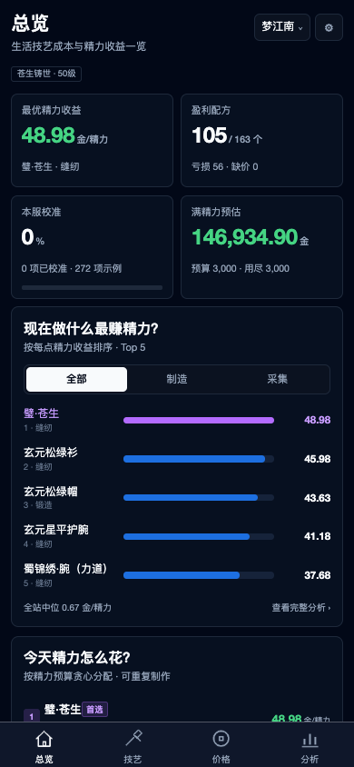

# 剑网三物价助手 · 剑网3「苍生铸世」生活技艺成本与精力收益计算器

面向《剑网3》当前 **苍生铸世（50 级）** 版本的生活技艺经营工具：选服务器、维护本服价格、编辑/新增配方、计算材料成本与精力收益，并把所有制品放在同一张精力收益榜上对比。

> 设计遵循 `docs/design/01-设计规范.md` 与 `docs/design/02-模块交互规范.md`：暗色工作台、12 列栅格、一卡一问、控件贴数据、颜色即编码、状态三态、口径常驻。

---

## 快速开始

静态站点，无构建、无外部依赖，数据保存在浏览器 `localStorage`。

```bash
cd JX3-AH-Calculator
python3 -m http.server 8931
# 打开 http://127.0.0.1:8931
```

也可以直接打开 `index.html`。建议使用本地服务器：`file://` 下部分浏览器会限制 `localStorage` 持久化。

---

## 功能地图

| 页面 | 回答的问题 | 关键能力 |
| --- | --- | --- |
| **总览** | 现在做什么最赚精力？今天精力怎么花？ | KPI 条、收益 Top 10、本日建议、技艺总览、服务器行情、采集 vs 制造 |
| **生活技艺** | 某个技艺下有什么可做？成本多少？ | 采集 3 类 / 制造 5 类、配方表、搜索/品阶/仅盈利筛选、材料行情内联改价、新增/编辑配方 |
| **价格库** | 本服材料多少钱？哪里缺价？ | 263 物品逐项定价、批量粘贴导入、跨服比价、CSV 导出、示例价/已校准/缺价三态 |
| **精力收益分析** | 哪个制品最值得做？差距多少？ | 收益排行、成本×收益散点、各技艺箱线图、双制品对比、满精力贪心分配、完整收益表 |

### 核心操作

- **选择服务器**：右上角服务器下拉，17 个当前服务器（含新服「九天」），支持新增自定义服务器；每个服务器独立价格空间。
- **编辑配方**：配方表行 → 详情抽屉 → 编辑；可改名称、品阶、等级、精力、手续费、产物、材料；内置配方可「恢复示例」。
- **新增配方**：生活技艺页右上角「新增配方/新增采集点」；可新建产物或材料物品，保存后进入价格库补价。
- **修改精力**：每条配方/采集点的「单次精力」均可编辑；设置中可改新建配方默认精力与精力预算。
- **计算与对比**：成本 = Σ材料 + 手续费；利润 = 产值 − 成本；精力收益 = 利润 ÷ 精力；支持「市场价 / 取最低（市场价与自制成本逐层取低）」两种口径。
- **导出**：每个图表可导出 PNG；分析/价格表可导出 CSV；设置中可导出/导入完整 JSON 备份。

---

## 当前版本核对（重要）

数据版本：**v3.3**；核验日期：**2026-11-18**；目标版本：**苍生铸世 · 50 级**（2026-10-29 公测）。

已按当前版本资料核对，**不采用**旧版本（90/100/130 级）的配方数值：

- 制造技艺以当前「技艺助手」名录为准：**锻造、缝纫、制药、烹饪、梓匠**。
- 采集技艺：**神农、采金、庖丁**；神农含云芝/鸡血石，采金含辉石，庖丁含羊肉/羊杂/羊皮。
- 制造配方已按 **JX3BOX 技艺助手 API（2026-11-18）** 重构：收录 **154 条当前版本制造配方 + 17 个当前版本采集点**；等级、精力、材料数量、产出范围来自 API，采集产出按 JX3BOX 物品资料核对，稀有掉率折算期望产值。
- 已核验样本：**玄元星平衫** 50 级 / 200 精力 / 地脉玄元×1、蜂王浆×10、兽皮胶×20、七彩线×20、百染线×20；价格优先取 JX3BOX 梦江南拍卖样本（200/263 项有效），明显异常或低样本报价保留示例价；产出与采集数量中为示例的部分已标注。
- 版本机制：技艺等级重返 50 级、新增等级突破与制造暴击、紫色以上产物带署名、现有配方不删除、新配方/新材料在新地图与训练师处获得。
- 当前配方名目示例：玄元星平衫/鞋/护腕/帽/护腰/裤、风语·衣·绣、蜀锦绣·腕、苍生·巨灵磨石/熔锭、龙血磨石、百炼水煮鱼、风语·老火骨汤、云中珍馐宴（通用）、截元丹、竹沥凝心饮、云州固阵丹、清漆药柜、木板、卯榫、器物令、鱼胶、拼布自选包、隔音帐、同袍营幡、璧·苍生。

### 核验来源

- [JX3BOX 技艺助手](https://www.jx3box.com/pvg/manufacture)（当前版本五类制造配方；本项目通过其 `/manufactures` 与 `/manufacture/{type}/{id}` API 抓取等级、精力、材料、产出范围）
- [官方 9-24：生活技艺焕新改造](https://news.17173.com/content/09242026/113440485.shtml)（50 级、突破、暴击、署名、截元丹、复活帐篷）
- [咸鱼有话说 305 期（11-14）](https://news.17173.com/content/11142026/213539983.shtml)（家园采集/梓匠等级下调、马草、路菜、挂件包、拼布、木板、器物令）
- [苍生铸世公测公告（10-29）](https://ol.3dmgame.com/news/202610/43603.html)（50 级数值重构、生活技艺全面重塑、新服「九天」）
- [JX3BOX 物品百科 · 苍生·巨灵磨石](https://www.jx3box.com/item/view/5_89594)

### 数据可信度标识

- **配方已核验**：等级、精力、材料、产出范围来自当前版本 API；154 条代表配方均已核验。
- **名目已核验**：物品名目/基础来源已核对；**价格仍为示例**。
- **待校验**：配比、采集产出、精力为可编辑示例，需按游戏内实测修正。
- 所有数据都可以在界面内修改；也可通过「设置 → 数据」导入自己的 JSON 配方库。

因此本工具不是「官方拍卖行实时数据」，而是**可校准的生产决策模型**：配方结构与当前版本对齐，价格由用户按本服行情维护。

> 说明：JX3BOX 当前制造配方总量约 1000 条（含家具/花卉与大量变体），本项目按类别选取 154 条代表配方，覆盖五个制造技艺的主要成品与中间材料；未收录的可通过「新增配方」补入。

---

## 计算口径

```
材料成本 = Σ（材料数量 × 材料单价）
总成本   = 材料成本 + 手续费
产值     = Σ（产物数量 × 产物单价）
利润     = 产值 − 总成本
精力收益 = 利润 ÷ 精力
毛利率   = 利润 ÷ 产值
```

- **市场价口径**：材料按填入的本服单价。
- **取最低口径**：每个材料取 `min(市场价, 自制成本/产出数量)`，递归计算，带循环保护。**它只优化材料成本，不会把自制中间产物所消耗的精力计入最终配方的精力分母**；若要比较全链路精力效率，请用市场价口径或把中间产物合并成一条自定义配方。
- **采集**：按单次采集点的多产出计算；游戏内采集消耗体力，本工具按精力口径统一折算，单次精力可编辑。
- **交易税/暴击/署名**：默认不计；可在“手续费”中体现交易税，暴击额外产出可通过减少材料消耗或增加产物数量体现。
- **满精力模拟**：按精力收益从高到低贪心分配，可重复制作；不建模交易税、暴击额外产出与市场深度，可用手续费/材料成本手动修正。


---

## 小程序端（微信 / 小红书）

同一套计算内核已移植为 **Taro 3.6.35 + React** 小程序，可同时编译到微信与小红书，源码在 [`miniapp/`](miniapp/README.md)。

```bash
cd miniapp
npm install
npm run build:weapp   # 微信小程序 → miniapp/dist/weapp
npm run build:xhs     # 小红书小程序 → miniapp/dist/xhs
```

- **为什么选 Taro**：小红书官方《框架开发》文档推荐 Taro 3.6.35，通过 `@tarojs/plugin-platform-xhs` 编译；不需要为两端各写一套原生代码。
- **兼容策略**：计算内核纯 JS 无 DOM；存储走 `Taro.getStorageSync/setStorageSync`；图表改用 **View + 百分比条形图**，不依赖 Canvas（小红书 Canvas 适配风险高）；不打开外链，来源链接提供复制。
- **数据同步**：`miniapp/scripts/sync-catalog.js` 从 `assets/data.js` 生成 `src/shared/catalog.json`；Web 数据更新后执行 `npm run sync:catalog`。
- **发布配置**：填写 `miniapp/project.config.json` 的微信 AppID 与 `project.xhs.json` 的小红书 AppID；两端 IDE 的导入方式、隐私/类目/审核清单见 [小程序 README](miniapp/README.md#发布前检查)。
- **体积**：微信约 692 KB、小红书约 624 KB，低于 2 MB 主包限制。

小程序端包含：总览、生活技艺、价格库、精力收益分析、配方详情/编辑、设置与备份；与 Web 端口径一致，差异是手机竖屏布局、View 图表、无 CSV/PNG 导出、仅暗色主题。

### 小红书小工具品牌素材

小工具图标与笔记封面在 [`brand/`](brand/README.md)：

- 图标：`brand/icon-1024.png` / `icon-512.png` / `icon-192.png`
- 3:4 首图：`brand/cover-3x4-1080x1440.png`
- 16:9 横版：`brand/cover-16x9-1200x675.png`
- 可编辑 SVG 源文件与尺寸/安全区说明见 [brand/README.md](brand/README.md)。

### 小红书小工具离线包

另提供符合小红书小工具容器规范的离线 H5 zip：`剑网三物价助手-minitool.zip`。它把 Web 版适配为纯离线经典脚本、容器 Storage、无下载/无外链/无剪贴板的形态；构建源与校验结果见 [MINITOOL.md](MINITOOL.md)。



---

## 文件结构

```
index.html                 入口
assets/styles.css          设计令牌 + 布局 + 组件 + 响应式
assets/data.js             苍生铸世 50 级种子数据（技能/物品/配方/服务器/来源）
assets/core.js             状态、localStorage、价格种子、成本递归、路由
assets/charts.js           纯 SVG 图表（条形/散点/箱线/对比）
assets/app.js              页面渲染、抽屉/弹窗、事件、导入导出、启动
miniapp/                   Taro 3.6.35 微信 / 小红书小程序（共享计算内核）
  src/shared/engine.js     纯 JS 计算内核（无 DOM）
  src/shared/catalog.json  由 assets/data.js 同步的数据
  src/pages/               总览 / 技艺 / 价格 / 分析 / 配方 / 设置
  dist/weapp, dist/xhs     已构建的两端产物
README.md
docs/design/               设计规范原始文件（未修改）
```

Web 端无框架、无网络请求、无 CDN，离线可用；小程序端只依赖 Taro 编译产物，不发起网络请求。

---

## 设计规范落地对照

| 规范 | 落地 |
| --- | --- |
| 侧栏 256 / Header 64 / 内容 max 1920 | `--sidebar-w` / `--header-h` / `--content-max`，12 列 16px gap |
| 卡片语法 | 一卡一问；标题/副标题/右上角控件；1px 描边 8px 圆角，无阴影 |
| 颜色即编码 | 制造蓝 / 采集绿 / 最优紫 / 亏损红；颜色同时配文字徽标，不单靠颜色 |
| 数字 | `tabular-nums`，价格 2 位小数，精力整数，单位缩放 |
| P02 页级筛选 | 服务器、成本口径、类型、品阶、搜索写入 URL |
| P03 卡片级控件 | 排行卡「全部/制造/采集」+ 品阶；分析卡「仅数据完整」开关 |
| P04 数据表格 | 真 `<table>`、首列 sticky、排序、行下钻、空态、导出 |
| P05 矩阵/分布 | 跨服比价表、各技艺箱线图、成本×收益散点 |
| P06 图表卡 | 标题即问题、口径说明、独立 PNG 导出、`role="img"` |
| P11 KPI | 数值 + 单位 + 对比基准（全站中位 / 满预算） |
| P12 行下钻 | 表格行 `›` 打开右侧配方详情抽屉 |
| P14 渐进披露 | `ⓘ` 口径提示、配方来源/核验状态 |
| P15 三态 | 骨架屏、空态出口动作、卡片级错误/提示、Toast `aria-live` |
| P16 可信度脚注 | 页面底部数据来源 + 核验日期 + 示例数据声明 |
| 动效 | 150–250ms，`prefers-reduced-motion` 直跳终态 |
| 可访问性 | skip link、焦点环、抽屉/弹窗焦点陷阱、Esc、键盘排序、图表可聚焦 |

---

## 已知边界

- 交易行手续费/税费、暴击额外产物、署名溢价、跨服交易限制未自动建模；可在「手续费」或材料价格中手动体现。
- 采集点的产出数量与精力为示例，需要按游戏内实测校准；不同地图/等级采集点可能不同。
- 配方库不是官方逐条数据；请以游戏内配方书与交易行行情为准。发现新版本改动时，直接编辑配方或在设置中导入新 JSON。
- 旧版本（90/100/130 级）配方与精力数值不兼容，已通过数据版本迁移整体切换，不会混入当前目录。
