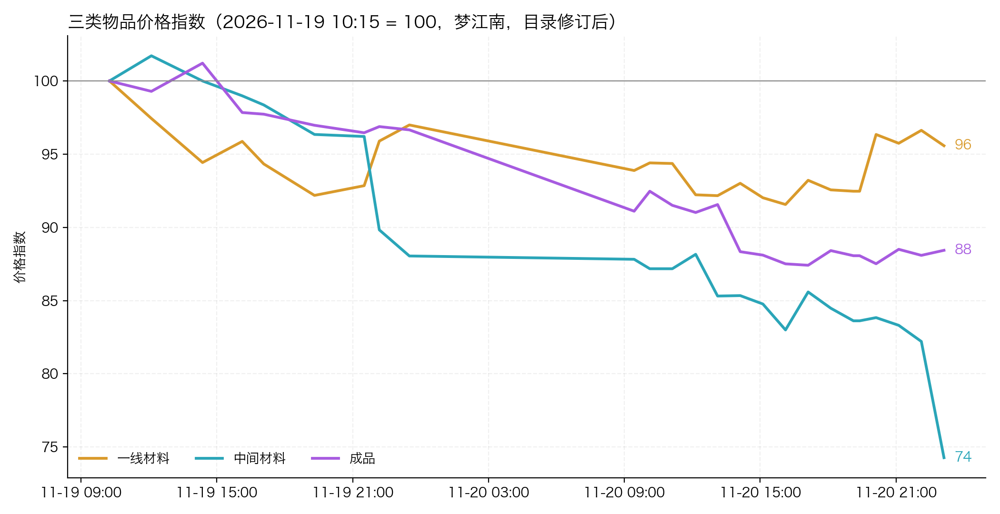
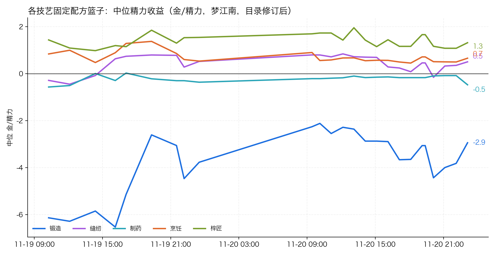
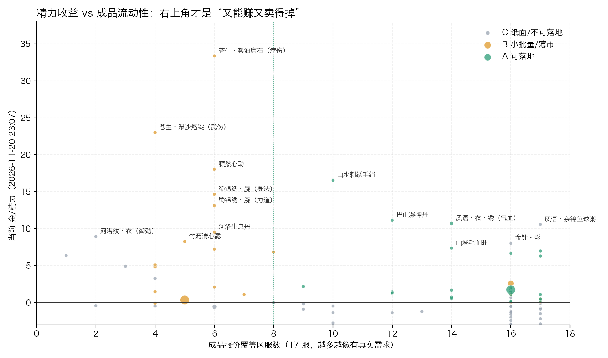
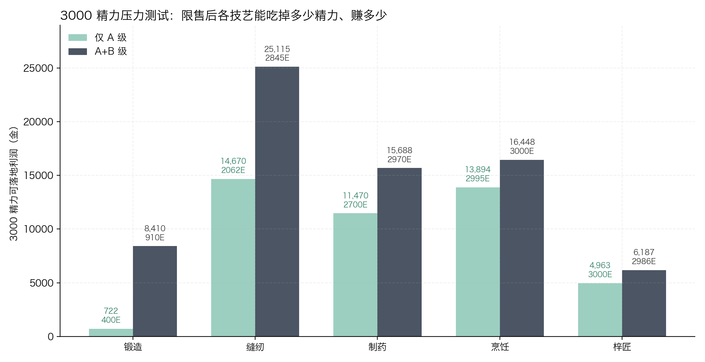

# 剑网3 生活技艺物价与收益审计

**数据截止：2026-11-20 23:07（北京时间）｜主服：梦江南｜样本：30 个价格快照 / 17 个区服 / 267 个物品 / 154 条制造配方 + 21 条采集配方**

> 后续产品化设计：[07-报价可信度与可落地收益设计](../../docs/design/07-报价可信度与可落地收益设计.md)

> 先说结论：站点默认计算口径下的“高收益配方”里，有相当一部分是靠无报价物品的目录基准价撑起来的。把无报价一律判死、只允许真实报价（商店常驻辅料除外）之后，**154 条制造配方只有 101 条能完整核算，55 条为正收益；按金/精力排序的纸面收益榜前 20 名有 16 名不可落地**。真正又赚又卖得掉的，集中在少数几条成品配方，而不是玄元装备和中间品。

---

## 0. 十条结论

1. **玄元线整体不可落地。** 关键材料「地脉玄元」在 30 个快照 × 17 个区服里 **0 次报价**，来源是拆解 50 级精简装备（JX3BOX 词条说明）；它卡住 20 条配方。所有玄元成品也 **0 次报价**。站点给的 3 万～4 万金售价只是目录基准价，不是市场价。
2. **绝世线也不可落地。** 绝世上衣/护腕/鞋/下装/头饰/腰带在全部样本里 0 次报价；材料「蜃楼珠」「切玉骨」只有 8～9 个服有报价，属于秘境稀有掉落。
3. **缝纫/锻造真正的门槛不是蜂王浆、兽皮胶，而是地脉玄元。** 蜂王浆 30/30 个时点、17/17 个服有报价；兽皮胶 30/30、16/17 个服有报价。它们供给弹性低、价格不便宜，但不是“无报价”的硬缺口。
4. **中间品是价值陷阱。** 中间品价格指数从 100 跌到 **74.3（-25.7%）**，24 个可比中间品里 20 个下跌；中间品配方的中位收益是 **-3.9 → -1.2 金/精力**，自己做中间品通常不如直接买。
5. **一线材料整体走平、内部剧烈分化。** 一线材料指数 95.6（-4.4%），中位涨跌 0%；但菌菇 +689%、石材 +456%、火墨 +291%，同时油布 -82%、百花线 -82%、黏土 -81%。这不是趋势，是薄市。
6. **成品整体小跌，但比中间品抗跌。** 成品指数 88.4（-11.6%），中位 -3.6%；45 个下跌、7 个上涨、21 个持平。需求端还在，杀价主要发生在半成品。
7. **A 级“可落地”配方只有 27 条，B 级“小批量/薄市”21 条，其余 106 条是纸面或不可落地。** A 级里当前收益最高的不是玄元，而是山水刺绣手绢、巴山凝神丹、风语·衣·绣（气血）。
8. **3000 精力压力测试：锻造吃不满。** 按每 SKU 每日 2～8 次的保守限售，锻造只能吸收 **910 精力**（A 级只有 400 精力），利润约 **8,410 金**；缝纫能吸收 2,845 精力、约 **25,115 金**；制药 2,970 精力、15,688 金；烹饪 3,000 精力、16,448 金；梓匠 2,986 精力、6,187 金。
9. **“归营旌”是最强的跨技艺高价值特例。** 四件半成品全部无报价，但都能自产；把 4 次半成品制作 + 1 次组装全部算进去，约 **600 精力/件、利润约 27,889 金、46.5 金/精力**。代价是锻造/缝纫/烹饪/制药/梓匠都要 50 级，且成品只有 4 个服有报价，只能小批量。
10. **采集只值得采两种。** 采金·辉石约 3.0 金/精力，庖丁·黑山羊约 1.6 金/精力；其余草药/矿石/鱼肉基本 0.04～0.17 金/精力，远不如把精力投到 A 级成品。

---

## 1. 数据：站点到底有多少“历史”

### 1.1 线上 JSON 只有一天

站点 `price-history/` 目前只有：

- `index.json`：1 个日期（2026-11-20）；
- `days/2026-11-20.json`：base + 12 个增量点，共 13 个快照，10:07～23:07。

所以“从站点直接下载全部历史价位”只能拿到 **2026-11-20 一天**。这不足以做多日走势。

### 1.2 从站点仓库的 data.js 历史版本补出 26 个快照

站点每次物价更新都会提交 `assets/data.js`，其中带 `meta.priceUpdatedAt` 和 `serverPrices`。我从仓库历史里抽取了 26 个唯一时间点（2026-11-18 14:45 ～ 2026-11-20 19:23），再与线上 JSON 的 13 个点合并去重，得到 **30 个快照**：

| 项目 | 数值 |
|---|---|
| 快照数 | 30 |
| 时间范围 | 2026-11-18 14:45 → 2026-11-20 23:07 |
| 跨度 | 约 2.3 天 |
| 区服 | 17 |
| 物品 | 267（旧版 263，少 4 个马草，不影响配方） |
| 制造配方 | 154 |
| 采集配方 | 21 |

**一致性校验**：2026-11-20 10:07 的 git 快照与线上 JSON base 逐项对比，梦江南 202 个报价 **202/202 完全一致**。这说明两种来源是同一套数据，可以合并。

### 1.3 两个必须说明的口径问题

1. **目录版本切换**：2026-11-19 08:54～12:06 之间，站点从 v3.3 连续切到 v3.6，其中 08:54 的基准价跳变最明显（例如风语·衣·绣从 1,034.91 跳到 2,134.92，百股线从 281 跌到 30.62）。这不是市场波动，是数据修订。
   - 因此本文的**走势主看 2026-11-19 10:15 之后的修订后段**（v3.5/v3.6），共 25 个快照。
   - 全段指数会附在注里，但不用它下结论。
2. **报价 ≠ 成交量**：拍卖报价只能证明“有人挂这个价”，不能证明“这个价能卖掉多少”。本文用“报价覆盖区服数 + 报价持续时点 + 价格波动率”做流动性代理，并在 3000 精力组合里加保守限售上限。这是压力测试，不是市场容量实测。

---

## 2. 物品分层：一线材料 / 中间材料 / 成品

分层不是按物品面板上的“材料/成品”标签，而是按**配方图**：

- **一线材料**：不能被制造、只能采集/商店/交易行获得，且作为配方投入。
- **中间材料**：能被制造，且被其他配方继续消耗。
- **成品**：能被制造，且不再作为任何配方材料（终端装备、食品、药品、背包、家具等）。

结果：

| 层级 | 数量 | 构成 | 典型物品 |
|---|---:|---|---|
| 一线材料 | 113 | 采集产出 29、商店常驻 54、纯交易行/稀有 37（有 7 个重叠） | 紫苏、甘草、云芝、辉石、鸡血石、羊肉、羊皮、百染线、炼火石、煤炭、药罐、地脉玄元、蜂王浆、兽皮胶、珠贝母、沉香木、青魄玉、蜃楼珠、切玉骨 |
| 中间材料 | 30 | 锻造 9、缝纫 6、烹饪 6、梓匠 5、制药 4 | 熟铁锭/密银锭/黄铜锭/青铜锭/锡锭/镔铁锭/生铁锭/铅锭、百花布/蜀染布/银丝缎/七彩线/五色石、酱料/卤料/馅料/饺子皮/饺子馅/安营炊鼎、药丸/药膏/药引/定魂丹砂、木板/卯榫/雕花/篾条/鱼胶（梓匠）、定营铁桩（锻造）、同袍营幡（缝纫） |
| 成品 | 124 | 锻造 36、缝纫 33、烹饪 20、制药 18、梓匠 17 | 玄元/绝世/蜀锦绣/风语装备、苍生磨石/熔锭、宴席/药品、锦缝春山囊/归营旌/地下室套件 |

几个容易误判的点：

- **马草**（百脉根/紫花苜蓿/甜象草/皇竹草）是一线材料，但没有任何配方使用，且 0 报价；对制造收益无影响。
- **定魂丹砂、安营炊鼎、定营铁桩、同袍营幡**是中间材料，不是成品；它们的报价在 11-18 之后基本消失。
- **雕花**是中间材料，成品「残烛柜架」「矩形回纹格」需要它；它本身也几乎没有持续报价。
- **归营旌**是成品，但需要四件中间材料（定营铁桩/同袍营幡/安营炊鼎/定魂丹砂）各 1 件。

完整 267 个物品的分类见 `out/items.csv`。

---

## 3. 物价走势：中间品杀得最狠

### 3.1 三类指数

以 2026-11-19 10:15（目录修订后的第一个快照）= 100，梦江南，取 30 个快照里全程有报价的“平衡篮子”：一线 88 个、中间 24 个、成品 73 个。



| 层级 | 期末指数 | 中位涨跌 | 上涨/下跌/持平 |
|---|---:|---:|---:|
| 一线材料 | 95.6 | 0.0% | 27 / 40 / 21 |
| 中间材料 | 74.3 | -21.0% | 3 / 20 / 1 |
| 成品 | 88.4 | -3.6% | 7 / 45 / 21 |

> 若按 11-18 14:45 起算全段，三类指数分别为 **102.7 / 67.9 / 88.4**；前期含 v3.3→v3.6 的目录修订（风语衣绣、百股线等基准价跳变），所以正文用修订后段的 95.6 / 74.3 / 88.4 下结论。

**读法**：

- 中间品是单边下跌，24 个里 20 个跌，几乎没有上涨的；这不是个别物品，是整层杀价。
- 一线材料整体走平，但内部换手极大：涨的涨几倍，跌的跌八成。它更像“薄市博弈”，不是稳定保值。
- 成品只小跌，45 个跌、7 个涨、21 个持平；需求端还在，杀价主要发生在半成品。

### 3.2 涨跌样本（11-19 10:15 后，梦江南）

| 层级 | 涨幅前列 | 跌幅前列 |
|---|---|---|
| 一线材料 | 菌菇 +689%、蛋 +492%、石材 +456%、火墨 +291%、骨头 +193%、羊皮 +138% | 油布 -82%、百花线 -82%、黏土 -81%、荷叶 -67%、大黄 -63%、杂碎 -60% |
| 中间材料 | 药丸 +16%、酱料 +4%、卤料 +3% | 饺子馅 -70%、饺子皮 -67%、青铜锭 -45%、黄铜锭 -37%、蜀染布 -37%、铅锭 -36% |
| 成品 | 风语·杂锦鱼球粥 +338%、飞鱼丸 +180%、蜀染布包 +69%、素银钥匙 +46%、佛跳墙 +12%、山水刺绣手绢 +10% | 棉布包 -98%、器物令 -63%、膘然心动 -58%、苍生·坠宵磨石 -40%、风语·上品健体丸 -40%、风语·水煮肉片 -39% |

这些极端值大多对应 1～6 个服的薄报价，不能当成“稳定行情”。真正有意义的是**中间层的普遍下跌**：青铜锭、黄铜锭、铅锭、蜀染布、饺子皮/馅，都是成批往下走。

### 3.3 为什么会这样

一个合理的解释是“开服溢价回吐 + 半成品竞争最充分”：

- 一线材料受采集精力、稀有掉率、商店价约束，供给弹性小，价格跌不动；
- 中间品技术门槛低、配方等级低（大量 20 精力），谁都能做，供给最容易过剩，所以先杀价；
- 成品有装备/宴席/药品的真实需求，且受图纸、等级、关键材料限制，价格相对抗跌。

这直接推导出下一节：**自己做中间品，大概率是在给市场送精力。**

### 3.4 收益走势：中间品配方是负的，成品配方只是微正

用“全程可核算的固定配方篮子”算中位金/精力（11-19 10:15 后）：

| 产出层级 | 固定篮子 | 期初中位 | 期末中位 | 读法 |
|---|---:|---:|---:|---|
| 中间材料 | 19 条 | -3.9 | -1.2 | 一直在亏，只是在缩小亏损 |
| 成品 | 57 条 | +1.0 | +0.4 | 微正，且在被压缩 |

这就是“收益走势”的核心：不是所有配方都赚钱，**中间层的平均配方是负收益，成品的平均配方也只是微正**；钱集中在少数 A 级成品上。

注意：中间品里也有少数正收益（密银锭 2.0、七彩线 1.8、银丝缎 1.8、卤料 1.5、酱料 0.6、卯榫 1.0、篾条 0.5），但都是薄利，且价格在跌；不要因为个别为正就大批量做中间品。

---

## 4. 各技艺实际赚钱情况

### 4.1 口径与评级

- 材料：本服真实报价优先；确认商店常驻的基础辅料（炼火石、煤炭、石灰、百染线、绢带、棉线、百花线、百股线、纺丝、硼砂、药罐等）允许按目录基准价计入；**其余无报价一律视为不可用**。
- 成品：必须有本服真实报价，否则视为卖不掉。
- 税 5%，加工费 0，产出按期望数量，不含暴击。
- A/B/C：
  - **A 可落地**：30 个快照中 ≥80% 可完整核算；成品 ≥8 个服有报价且 ≥80% 时点有报价；成品价格 CV ≤25%；中位金/精力 >0。
  - **B 小批量/薄市**：≥50% 时点可核算；成品 ≥4 个服有报价；中位 >0，但不满足 A 的流动性/稳定性。
  - **C 纸面/不可落地**：其余（缺关键料、成品无报价、或负收益）。
- A/B/C 是**配方级**评级，不是物品级：中间品配方也可能拿到 A（例如密银锭），但它的利润薄、价格在跌，和成品 A 不是一回事。

> 这里的“本服”是梦江南。其他 17 服的当前可行数与前三机会见 `out/server_summary.csv`；结论不能直接跨服套用。
> **敏感性**：若连商店常驻辅料也要求本服拍卖报价（比本文更严格），当前可核算会从 101 条降到 74 条、正收益从 55 条降到 45 条；山水手绢、云芝竹沥羹等依赖商店辅料的条目会退出，但巴山凝神丹、风语·衣·绣、山城毛血旺、五气归元丹、云州刀削面仍成立。

### 4.2 总表

| 技艺 | 配方 | A/B/C | 当前可行 | 当前正收益 | 最佳 A（当前） | 最佳 B（当前） | 中位金/精力（起→终） | 3000E 仅 A | 3000E A+B |
|---|---:|---:|---:|---:|---|---|---|---:|---:|
| 锻造 | 45 | 2/4/39 | 21 | 7 | 密银锭 2.0（20E） | 苍生·絮泊磨石 33.4（30E） | -6.1 → -2.9 | 722 / 400E | 8,410 / 910E |
| 缝纫 | 39 | 6/3/30 | 22 | 10 | 山水刺绣手绢 16.5（27E） | 蜀锦绣·腕（身法）14.6（120E） | -0.3 → +0.5 | 14,670 / 2,062E | 25,115 / 2,845E |
| 制药 | 22 | 5/4/13 | 20 | 10 | 巴山凝神丹 11.1（90E） | 河洛生息丹 9.5（90E） | -0.6 → -0.5 | 11,470 / 2,700E | 15,688 / 2,970E |
| 烹饪 | 26 | 11/2/13 | 22 | 15 | 山城毛血旺 7.4（75E） | 膘然心动 18.0（50E） | +0.8 → +0.7 | 13,894 / 2,995E | 16,448 / 3,000E |
| 梓匠 | 22 | 3/8/11 | 16 | 13 | 兖石地墁·套件 1.7（800E） | 铜雕踩球对狮·右 5.1（69E） | +1.4 → +1.3 | 4,963 / 3,000E | 6,187 / 2,986E |

**3000E 列的含义**：按每 SKU 每日 2～8 次（A 级按成品覆盖 4～8 次，B 级 2～3 次）的保守限售，从高到低装精力，直到 3000 精力或没有正收益配方为止。它是“精力能不能吃满”的压力测试，不是收益承诺。

各技艺固定篮子的中位金/精力走势：



### 4.3 锻造：纸面最猛，落地最差

- 纸面第一是苍生·絮泊磨石（疗伤）33.4 金/精力，第二苍生·瀑沙熔锭（武伤）23.0；但成品只有 6 个/4 个服有报价，属于薄市。
- A 级只有 2 条：密银锭 2.0、苍生·坠宵磨石 1.7；A 级 3000E 只能吸收 400 精力、赚 722 金。
- A+B 也只有 910 精力可吃，赚 8,410 金；剩余 2,090 精力没有正收益配方可投。
- 玄元/苍生系列 20 条 50 级配方全部被地脉玄元卡死；苍生·巨灵磨石/熔锭成品 0 报价；绝世线成品 0 报价。
- 结论：**锻造的高收益是“少量薄市消耗品”撑起来的，不能当成稳定产能。** 要么小批量做苍生磨石/熔锭，要么转做密银锭/坠宵磨石吃低毛利。

### 4.4 缝纫：有一条真正能打的 A 级



- **风语·衣·绣（气血）**：120E，当前 10.7、样本中位 10.6，成品 14 个服有报价、100% 时点有报价、价格 CV 16%。这是缝纫最稳的一条。
- **山水刺绣手绢**：27E，当前 16.5、中位 10.2，成品 10 个服有报价；但期末成品价从 270 跳到 298，当前值有尖峰成分，27E 的低门槛适合小号/碎片精力。
- **蜀锦绣·腕（身法/力道）**：120E，当前 14.6/13.1，但成品只有 6 个服有报价，B 级；适合小批量，不适合当主产能。
- 玄元/绝世/锦缝春山囊/同袍营幡/河洛纹鞋/驾驾伪装全部不可落地（地脉玄元或成品无报价）。
- 结论：**缝纫能赚钱，但只靠风语衣绣 + 山水手绢 + 少量蜀锦绣；玄元线是纸面富贵。**

### 4.5 制药：A 级最多，但典型配方仍是负的

- **巴山凝神丹**：90E，当前 11.1、中位 10.1，成品 12 个服有报价、CV 2%；这是制药最稳的一条。
- **五气归元丹**：90E，当前 6.7、中位 10.2，成品 16 个服有报价；但成品价从 870 跌到 620，收益在下降，当前值比中位低不少。
- **竹沥清心露**：90E，当前 8.3，但成品只有 5 个服有报价，B 级。
- **河洛生息丹**：中位 10.9，但成品只有 50% 时点有报价，B 级，不能当稳定产能。
- **定魂丹砂**：纸面 57.8 金/精力，但成品只在 11-18 前 3 个快照有 8,888 的报价，之后消失；这是最典型的纸面陷阱。
- 制药固定篮子中位 -0.6 → -0.5：多数配方不赚钱，钱集中在巴山/五气/竹沥。

### 4.6 烹饪：最稳的“量产型”技艺

- **山城毛血旺**：75E，当前 7.4、中位 7.4，成品 14 个服、90% 时点有报价；稳定。
- **云芝竹沥羹**：75E，当前 7.0、中位 6.0，成品 17 个服、100% 时点有报价；非常稳。
- **云州刀削面**：75E，当前 6.3、中位 6.3，成品 17 个服；稳定。
- **膘然心动**：纸面/当前 18.0，中位 58.3，但成品只有 6 个服，且价格从 6,999 跌到 1,699（CV 51%）；B 级，只能小批量。
- 烹饪固定篮子中位 +0.8 → +0.7：是五个制造技艺里唯一“典型配方为正”的之一（另一个是梓匠）。

### 4.7 梓匠：低收益、但能吃满精力；归营旌是特例

- **归营旌**：纸面 159.4 金/精力，四件半成品全部无报价；如果全部自产，约 600E/件、利润 27,889、46.5 金/精力。详见第 5.4 节。
- **拼布72色全包**：中位 8.2，但当前只有 1.3；材料百股线从 281 跌到 30.62，沉香木又曾从 160 跳到 238，波动极大，A 级但当前不适合追。
- **地下室·8米木质标准包**：350E，当前 2.6、中位 2.5，成品 16 个服；收益低但稳定，适合吃满精力。
- **兖石地墁·套件**：800E，当前 1.7、中位 1.9，成品 16 个服；单次占用精力大，适合挂机/多开。
- 梓匠固定篮子中位 +1.4 → +1.3：稳定低正收益，是“吃精力”的兜底技艺，不是暴利技艺。

### 4.8 采集：只值得采辉石和黑山羊

| 采集 | 精力 | 中位金/精力 | 中位单次利润 |
|---|---:|---:|---:|
| 采金·辉石 | 40 | 3.01 | 120.3 |
| 庖丁·黑山羊 | 40 | 1.63 | 65.4 |
| 神农·珊瑚 | 40 | 0.17 | 6.8 |
| 神农·虫草/甘草 | 40 | 0.10 | 4.1～4.2 |
| 采金·铁矿/铜矿/锡矿/铅锌矿 | 40 | 0.09～0.11 | 3.7～4.5 |
| 神农·紫苏/黄花菜/鱼腥草 | 45～50 | 0.08～0.09 | 4.0～4.3 |
| 庖丁·山野野兽/河鲜 | 40 | 0.04～0.05 | 1.7～1.9 |

草药和普通矿的采集收益极低，因为单价被压到接近采集机会成本；只有辉石（110 金/个）和黑山羊（羊肉+羊皮+羊杂）值得专门采。

---

## 5. 制作难度：地脉玄元才是总闸门

### 5.1 关键材料事实表

| 材料 | 获取方式 | 30 快照报价 | 当前区服覆盖 | 用途数 | 判定 |
|---|---|---|---:|---:|---:|---|
| 地脉玄元 | 拆解 50 级精简装备（JX3BOX 词条） | 0/30 | 0/17 | 20 | **硬缺口** |
| 境华 | 试炼之地 | 0/30 | 0/17 | 3 | **硬缺口** |
| 铃兰·混彩 | 种植产物 | 0/30 | 0/17 | 1 | **硬缺口** |
| 竹叶青 | 未确认商店来源 | 0/30 | 0/17 | 1 | **硬缺口（保守）** |
| 蜂王浆 | 挖宝/方士挖宝/珍稀宝箱 | 30/30 | 17/17 | 16 | 软约束 |
| 兽皮胶 | 庖丁采集几率，专精提高 | 30/30 | 16/17 | 13 | 软约束 |
| 蜃楼珠 | 东海秘境掉落 | 30/30 | 9/17 | 3 | 软约束（且成品无报价） |
| 切玉骨 | 秘境掉落 | 30/30 | 8/17 | 3 | 软约束（且成品无报价） |
| 珠贝母 | 寻道宝箱/珍稀宝箱 | 30/30 | 17/17 | 19 | 软约束 |
| 沉香木 | 交易行（无独立词条） | 30/30 | 17/17 | 10 | 软约束 |
| 青魄玉 | 秘境掉落/交易行 | 30/30 | 17/17 | 20 | 软约束 |
| 辉石 | 采金几率，专精提高 | 30/30 | 17/17 | 11 | 软约束 |
| 云芝 | 神农几率，专精提高 | 30/30 | 17/17 | 18 | 软约束 |
| 鸡血石 | 采集额外掉落/精英怪 | 30/30 | 17/17 | 14 | 软约束 |
| 炼火石/煤炭/石灰 | 主城炭火商/针线商 | 30/30 | 5～7/17 | 22/6/4 | 充足（商店） |
| 百染线/绢带/棉线/百花线/百股线/纺丝 | 主城针线商 | 0～29/30 | 4～13/17 | 27/10/5 等 | 充足（商店） |
| 硼砂 | 采金几率/商店 | 30/30 | 17/17 | 13 | 充足 |

来源：[兽皮胶](https://www.jx3box.com/item/view/5_30851)、[蜂王浆](https://www.jx3box.com/item/view/5_55626)、[蜃楼珠](https://www.jx3box.com/item/view/5_31397)、[切玉骨](https://www.jx3box.com/item/view/5_32787)、[境华](https://www.jx3box.com/item/view/5_90338)、[珠贝母](https://www.jx3box.com/item/view/5_30853)、[辉石](https://www.jx3box.com/item/view/5_30850)、[云芝](https://www.jx3box.com/item/view/5_30845)、[鸡血石](https://www.jx3box.com/item/view/5_30856)（JX3BOX 物品百科/API，2026-11-20 核验）。

**关键判断**：

- 地脉玄元不是“贵”，是“没有”。0/30 × 0/17，且不能制造，来源是拆 50 级精简装备。站点用 24,000 的目录价把它当成可买材料，这是玄元线所有纸面收益的根源。
- 蜂王浆、兽皮胶不是无报价，而是“有价但供给弹性低”。蜂王浆 30/30、17 服，中位 187 金；兽皮胶 30/30、16 服，中位 50 金。它们会限制你一天能做多少件，但不会让你完全做不了。
- 蜃楼珠、切玉骨是秘境稀有，报价覆盖 9/17、8/17；但绝世成品本身 0 报价，所以问题不在材料，在“卖不掉”。
- 炼火石/煤炭/石灰/百染线/绢带/棉线/百花线/百股线/纺丝等是主城商店常驻。它们没有拍卖报价，不代表不能落地；本文按商店/目录价计入，不算硬缺口。

### 5.2 玄元线的纸面价格有多不可靠

同样是 50 级玄元装备，纸面收益从 **-13.9 到 +48.3 金/精力**：

| 配方 | 精力 | 纸面单次利润 | 纸面金/精力 | 严格判定 |
|---|---:|---:|---:|---|
| 玄元松绿衫 | 200 | 9,653 | 48.3 | 地脉玄元 + 成品无报价 |
| 玄元松绿帽 | 200 | 8,620 | 43.1 | 地脉玄元 + 境华 + 成品无报价 |
| 玄元星平护腕 | 200 | 7,279 | 36.4 | 地脉玄元 + 成品无报价 |
| 玄元赤地鞋 | 200 | 7,240 | 36.2 | 地脉玄元 + 境华 + 成品无报价 |
| 玄元星平护腰 | 200 | 5,804 | 29.0 | 地脉玄元 + 成品无报价 |
| 玄元星平衫 | 200 | **-256** | **-1.3** | 地脉玄元 + 成品无报价 |
| 玄元星平帽 | 200 | -1,202 | -6.0 | 地脉玄元 + 成品无报价 |
| 玄元风鹤裤 | 200 | -2,775 | -13.9 | 地脉玄元 + 成品无报价 |

这些配方材料相近，纸面收益却能差约 60 金/精力；主要原因是输出物的 `base` 被设成了 26,792～42,041 的不同数字，材料成本差异远不足以解释这个差距。**没有成交价支撑的 base，只是数字。** 玄元星平衫甚至是纸面亏损，说明这些 base 并不是按真实成交价校准的。

### 5.3 物料吞吐：就算地脉玄元有货，也吃不下

以 3000 精力计：

| 配方 | 可做次数 | 关键料需求 | 瓶颈 |
|---|---:|---|---|
| 玄元星平衫 | 15 | 地脉玄元 15、蜂王浆 150、兽皮胶 300、七彩线 300、百染线 300 | 地脉 0 报价；兽皮胶/蜂王浆靠稀有掉落，300/150 件很难批量 |
| 风语·衣·绣 | 25 | 猫眼石 125、珠贝母 125、宝石 250、绢带 250、棉线 500 | 都是常见料/商店料，可批量 |
| 巴山凝神丹 | 33 | 珠贝母 33、甘草 330、五味子 132、药引 165、药罐 660 | 常见料，药引可买，可批量 |
| 苍生·絮泊磨石 | 100 | 兽皮胶 100、铅锭 100、炼火石 500、煤炭 1,000 | 成品仅 6 服报价；500/1,000 件商店料虽能买，但未必卖得掉 100 次（250 个） |

所以“精力收益比”不能只看单次利润，还要看**关键料能不能按报价买到足够的量**。玄元线在第一步就断了；苍生磨石能买料，但成品市场未必吃得下。

### 5.4 归营旌：最强的跨技艺特例

归营旌 = 定营铁桩 + 同袍营幡 + 安营炊鼎 + 定魂丹砂 + 鸡血石×5，120E。

四件半成品当前全部无报价：

| 半成品 | 制作精力 | 材料成本（当前） | 当前报价 | 能否自产 |
|---|---:|---:|---|---|
| 定营铁桩 | 120 | 1,207 | 0/30，1 服曾有 | 能（熟铁锭/辉石/松脂/熟矾） |
| 同袍营幡 | 120 | 696 | 0/30，0 服 | 能（百花布/兽皮胶/黄花菜/绢带/黄蜡） |
| 安营炊鼎 | 120 | 1,701 | 0/30，2 服曾有 | 能（卤料/云芝/鱼腥草/羊皮/酥油/藤椒） |
| 定魂丹砂 | 120 | 1,508 | 3/30（仅 11-18），2 服 | 能（药引/紫苏/云芝/竹沥/药曲） |

全链自产口径：

- 总精力：4×120 + 120 = **600E/件**
- 材料成本：约 **5,218 金**
- 成品收入：34,850 × 0.95 = **33,107 金**
- 单件利润：**27,889 金**
- 精力收益：**46.5 金/精力**
- 成品报价：34,850，30/30 个时点稳定，但只有 **4 个服**有报价

这是本文计算的链条里最高的可执行收益，但门槛也最高：

1. 锻造、缝纫、烹饪、制药、梓匠都要 50 级；
2. 四件半成品都要各做一次，不能买；
3. 成品只有 4 个服有报价，建议按 1～2 件/日限量，不能按 3000E 无限做。

如果你没有五技艺满级，归营旌按严格口径就是 **C 级不可落地**；如果你有，它是值得单独排产的高价值件。

---

## 6. 精力收益比重新校验：纸面 vs 可执行

### 6.1 站点口径为什么会高估

站点的价格回退逻辑在 `assets/core.js`：本服无报价时回退到 `canonical.base`，且 `missing` 只在 `base <= 0` 时为真。结果是 154 条制造配方几乎全部“可算”，收益榜自然被无报价物品撑高。

本审计的口径：

- 无报价的非商店材料 → 不可用；
- 无报价的成品 → 卖不掉；
- 商店常驻辅料 → 可按目录价；
- 其余同站点（5% 税、0 加工费、期望产出）。

对比：

| 口径 | 可完整核算 | 正收益 | 纸面榜前 20 可落地 | 前 20 单次利润合计 |
|---|---:|---:|---:|---:|
| 站点纸面（允许 base 回退） | 154/154 | 94 | — | 113,143 |
| 严格 + 商店辅料 | 101/154 | 55 | 4/20 | 3,727 |
| 差额 | 53 条 | 39 条 | 16 条 | **-109,416** |

注：113,143 与 3,727 都是“每条配方做一次”的利润加总，不是日收益；它只用来衡量纸面榜的虚高程度。

按金/精力排序的纸面榜前 20 里，16 条被卡：

| 纸面榜前列 | 纸面金/精力 | 卡点 |
|---|---:|---|
| 归营旌 | 159.4 | 四件半成品无报价（可全链自产，见 5.4） |
| 定魂丹砂 | 57.8 | 成品报价在 11-18 后消失 |
| 玄元松绿衫 | 48.3 | 地脉玄元 + 成品无报价 |
| 璧·苍生 | 44.1 | 地脉玄元 + 成品无报价 |
| 玄元松绿帽 | 43.1 | 地脉玄元 + 境华 + 成品无报价 |
| 玄元星平护腕 | 36.4 | 地脉玄元 + 成品无报价 |
| 玄元赤地鞋 | 36.2 | 地脉玄元 + 境华 + 成品无报价 |
| 玄元烽火护腕 | 31.1 | 地脉玄元 + 成品无报价 |
| 玄元赤地护腕 | 30.5 | 地脉玄元 + 成品无报价 |
| 玄元星平护腰 | 29.0 | 地脉玄元 + 成品无报价 |

### 6.2 A 级 / B 级清单

**A 级（可落地，按当前金/精力排序）**

| 配方 | 技艺 | 精力 | 当前金/精力 | 样本中位 | 当前单次利润 | 成品服数 | 报价持续 |
|---|---|---:|---:|---:|---:|---:|---:|
| 山水刺绣手绢 | 缝纫 | 27 | 16.5 | 10.2 | 447 | 10 | 100% |
| 巴山凝神丹 | 制药 | 90 | 11.1 | 10.1 | 1,001 | 12 | 100% |
| 风语·衣·绣（气血） | 缝纫 | 120 | 10.7 | 10.6 | 1,286 | 14 | 100% |
| 山城毛血旺 | 烹饪 | 75 | 7.4 | 7.4 | 552 | 14 | 90% |
| 云芝竹沥羹 | 烹饪 | 75 | 7.0 | 6.0 | 523 | 17 | 100% |
| 五气归元丹 | 制药 | 90 | 6.7 | 10.2 | 600 | 16 | 100% |
| 云州刀削面 | 烹饪 | 75 | 6.3 | 6.3 | 473 | 17 | 100% |
| 寻踪觅宝·护腕 | 缝纫 | 80 | 2.2 | 2.0 | 175 | 9 | 100% |
| 密银锭 | 锻造 | 20 | 2.0 | 0.5 | 40 | 16 | 100% |
| 开锅豆腐 | 烹饪 | 50 | 1.8 | 1.2 | 91 | 16 | 100% |

> 山水手绢当前 16.5 有期末价格尖峰（270→298）成分；按中位 10.2 更稳。巴山/风语是“最稳的两条”。

**B 级（小批量/薄市，收益可能高但流动性/稳定性不足，别当主产能）**

| 配方 | 技艺 | 精力 | 当前金/精力 | 样本中位 | 当前单次利润 | 成品服数 | 备注 |
|---|---|---:|---:|---:|---:|---:|---|
| 苍生·絮泊磨石（疗伤） | 锻造 | 30 | 33.4 | 33.5 | 1,001 | 6 | 最猛的薄市消耗品 |
| 苍生·瀑沙熔锭（武伤） | 锻造 | 60 | 23.0 | 20.0 | 1,379 | 4 | 薄市 |
| 膘然心动 | 烹饪 | 50 | 18.0 | 58.3 | 901 | 6 | 成品价从 6,999 跌到 1,699 |
| 蜀锦绣·腕（身法） | 缝纫 | 120 | 14.6 | 13.9 | 1,757 | 6 | 薄市高价值 |
| 蜀锦绣·腕（力道） | 缝纫 | 120 | 13.1 | 13.1 | 1,574 | 6 | 薄市高价值 |
| 河洛生息丹 | 制药 | 90 | 9.5 | 10.9 | 858 | 6 | 仅 50% 时点有报价 |
| 竹沥清心露 | 制药 | 90 | 8.3 | 8.2 | 743 | 5 | 薄市 |
| 刺绣手绢 | 缝纫 | 21 | 7.2 | 6.5 | 152 | 6 | 薄市 |

### 6.3 3000 精力压力测试



| 技艺 | 仅 A 级：利润 / 消耗精力 | A+B：利润 / 消耗精力 |
|---|---:|---:|
| 锻造 | 722 / 400E | 8,410 / 910E |
| 缝纫 | 14,670 / 2,062E | 25,115 / 2,845E |
| 制药 | 11,470 / 2,700E | 15,688 / 2,970E |
| 烹饪 | 13,894 / 2,995E | 16,448 / 3,000E |
| 梓匠 | 4,963 / 3,000E | 6,187 / 2,986E |
| 混合最优 | 28,190 / 2,982E | **39,696 / 2,997E** |

**最重要的三个读数**：

1. **锻造吃不满精力**：A+B 也只有 910E 可投。这不是“锻造不赚钱”，是“锻造的正收益配方太少、太薄”，剩余精力没有正期望的去处。
2. **缝纫上限最高**：A+B 25,115 金/2,845E，靠的是风语衣绣 + 蜀锦绣小批量 + 山水手绢。
3. **烹饪/制药最稳**：能吃到 3,000E，且 A 级配方多；适合当日常主产能。梓匠能吃完精力，但单位收益低，适合多开/挂机兜底。

> 这些数字对限售假设敏感：如果每个 SKU 能卖 10 次而不是 4～8 次，利润会更高；如果只能卖 1～2 次，会显著更低。**排序比绝对值更可信**：按“能投多少精力 + 稳定性”，缝纫/烹饪/制药 > 梓匠 > 锻造；锻造虽然 A+B 利润略高于梓匠，但只能投 910E，剩余精力无处可去。

---

## 7. 落地方案

### 7.1 单开 / 时间少：先做“稳”的三条

1. **风语·衣·绣（气血）**：120E，10.7 金/精力，14 服报价，价格稳。每天 3～5 件。
2. **巴山凝神丹**：90E，11.1 金/精力，12 服报价，价格稳。每天 3～5 件。
3. **云州刀削面 / 山城毛血旺 / 云芝竹沥羹**：75E，6～7 金/精力，14～17 服报价。用来补满剩余精力。

按 A 级限售，这套组合约 **28,190 金/3,000E**；如果加入少量 B 级（苍生磨石、蜀锦绣），可到约 **39,696 金/3,000E**，但要接受薄市卖得慢。

### 7.2 多开 / 五技艺满级：归营旌优先

- 归营旌 1～2 件/日：600E/件，27,889 金/件；先做 1 件试水，确认 4 个服的出货速度。
- 剩余精力做风语衣绣 + 巴山 + 云州刀削面。
- 这套的上限明显高于单技艺，但前提是五技艺 50 级 + 能接受 4 服薄市。

### 7.3 小号 / 低等级 / 碎片精力

- **山水刺绣手绢**：27E，当前 16.5、中位 10.2；材料是五色石 + 百染线 + 石灰，门槛低。
- **开锅豆腐**：50E，1.8 金/精力，成品 16 服；适合小号。
- **卤料/酱料**：20E，0.4～1.5 金/精力；低门槛，但收益薄。

### 7.4 避免清单

- **玄元全系**：地脉玄元 0 报价，成品 0 报价；纸面 3 万～4 万是假的。
- **绝世全系**：成品 0 报价；材料稀有也卖不掉。
- **定魂丹砂单卖**：成品报价只在 11-18 出现，之后消失；除非你做归营旌自用。
- **锻造大批量**：正收益配方只能吃 910E，硬做只会做负收益配方。
- **中间品批量**：中间品配方中位 -1.2 金/精力，直接买更便宜。
- **草药采集**：0.04～0.17 金/精力，不如把精力留给成品。

### 7.5 分服提醒

梦江南不是唯一答案。`out/server_summary.csv` 显示：

- 破阵子：蜀锦绣·腕（力道）45.1、拼布72色全包 26.5、锦缝春山囊 16.8；
- 幽月轮：苍生·瀑沙熔锭 101.0、蜀锦绣·腕（身法）63.7；
- 龙争虎斗：定魂丹砂 92.6、苍生·瀑沙磨石 72.5；
- 唯我独尊：膘然心动 135.9、苍生·絮泊磨石 33.9；
- 傲血戰意：仅 16 条可核算、9 条正收益，市场最薄。

这些高值大多对应 1～2 个服的报价，**先看本服成交，不要直接跨服套利**。

---

## 8. 风险与限制

1. **样本只有 2.3 天**：30 个快照覆盖 11-18 14:45～11-20 23:07。没有周内/赛季周期，不能外推“长期趋势”。
2. **报价不是成交量**：所有“可落地”都是“有报价 + 报价持续 + 覆盖区服”的代理判断。真正的市场深度需要拍卖成交/挂单量，本站没有。
3. **数据修订**：11-19 08:54～12:06 有 v3.3→v3.6 目录切换，部分 base 跳变；本文走势主看 10:15 后的修订后段。
4. **单服主口径**：正文是梦江南；跨服差异很大，不能直接套。
5. **不含升级成本**：50 级技艺的突破/冲级成本没有计入；归营旌还要求五技艺 50 级。
6. **不含暴击/品质**：产出按期望数量，未计暴击、署名、品质溢价。
7. **税/费**：统一 5% 税、0 加工费；若本服有额外手续费/上架费，收益会再低。
8. **薄市价格尖峰**：山水手绢、膘然心动、金针·影等都有单点尖峰；本文用中位数和 CV 降权，但无法完全消除。

---

## 9. 附件与复现

### 9.1 文件

| 文件 | 内容 |
|---|---|
| `out/items.csv` | 267 个物品的分类、报价、覆盖、涨跌 |
| `out/recipes.csv` | 154 条制造配方的成本、收益、金/精力、A/B/C、卡点 |
| `out/key_materials.csv` | 关键材料的获取、报价、用途、判定 |
| `out/paper_traps.csv` | 纸面高收益但不可落地的配方清单 |
| `out/skill_summary.csv` | 各技艺 A/B/C、最佳配方、3000E 组合 |
| `out/server_summary.csv` | 17 服当前可行数、正收益数、前三机会 |
| `out/trends.csv` | 30 个快照的三类指数与各技艺中位收益 |
| `out/tables.json` | 上述表格的 JSON 版 |

### 9.2 公式

- 单次成本 = Σ(材料报价 × 数量) + 加工费
- 单次收入 = Σ(成品报价 × 期望数量) × (1 - 5%)
- 单次利润 = 收入 - 成本
- 金/精力 = 单次利润 / 配方精力
- 报价持续 = 有报价的快照数 / 30
- 成品覆盖 = 当前有报价的区服数 / 17
- 价格 CV = 报价序列标准差 / 均值

### 9.3 复现

```bash
cd analysis/price-audit-2026-11-20
python3 extract_git_snapshots.cjs   # 从 data.js 历史抽取快照
python3 build_tables.py             # 物品/配方表
python3 build_key_tables.py         # 关键材料表
python3 trends_export.py            # 走势数据（build_summaries 依赖它）
python3 build_summaries.py          # 技艺/纸面陷阱/分服表
python3 make_charts.py              # 图表
```

> 数据源：[站点物价历史](https://cherishxie.github.io/JX3-AH-Calculator/price-history/)（2026-11-20 的 index/day JSON）+ 该站点仓库 `assets/data.js` 的历史版本（2026-11-18～11-20）。物品来源描述参考 [JX3BOX 物品百科](https://www.jx3box.com/) 与 [JX3BOX 物品 API](https://node.jx3box.com/item/5_30851?client=std)（兽皮胶、蜂王浆、蜃楼珠、切玉骨、境华、珠贝母、辉石、云芝、鸡血石等）。
