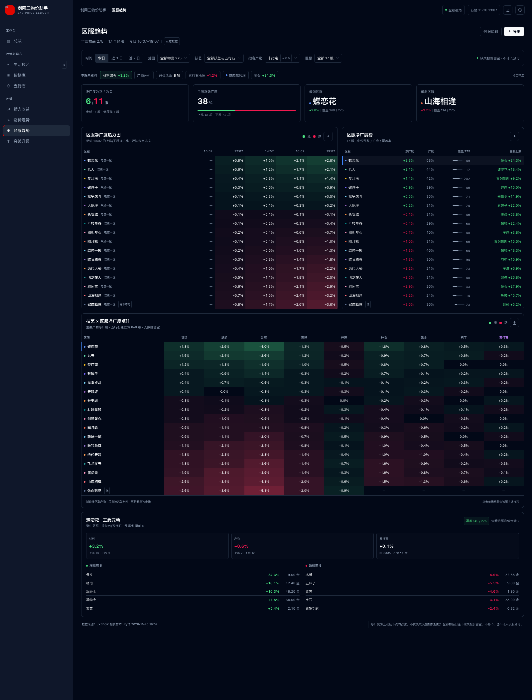
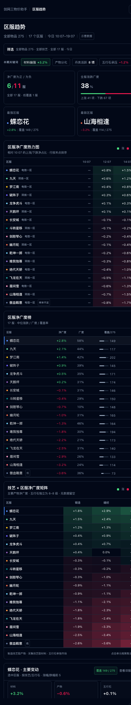

# 区服趋势 · 需求与设计文档

> 状态：**设计稿 v0.3 / 开发中（dev）**
> 日期：2026-11-20
> 位置：分析 → 区服趋势（暂定路由 `/server-trends`）
> 依赖：`data/price-history/`、现有「物价走势」数据层

---

## 1. 一句话定义

**区服趋势是一张“区服观察台”**：

- 一眼看：各服整体在涨还是跌、涨跌面有多广、哪些技艺/五行石在动；
- 二眼看：各服的主要变动物品；
- 三眼看：本期关键词，快速抓住市场主题；
- 点进去：从区服、技艺或物品下钻到现有「物价走势」。

不是 17 条价格曲线叠加图。

---

## 2. 背景与目标

### 2.1 背景

现有「物价走势」回答：

> 某个物品/材料，在某个区服，随时间怎么变化？

区服趋势要回答：

- 哪个区服整体在涨/跌？
- 哪个技艺、五行石方向更强？
- 一个区服的涨跌是普遍变化，还是少数物品异动？
- 不同区服的主要变动物品是什么？
- 本期市场的关键词是什么？

### 2.2 目标

1. 多区服整体涨跌对比；
2. 分技艺、分五行石查看主要产物涨跌；
3. 支持指定产物多选，查看其跨服表现；
4. 服务器多选，默认全部 17 服；
5. 自动提炼关键词，首屏即可看到主题；
6. 可从区服/物品下钻到物价走势；
7. 历史增长后仍能加载和交互。

### 2.3 非目标（首版）

- 不做成交额加权指数、资金流入流出；
- 不做跨服倒卖/套利建议；
- 不画 17 条全量折线；
- 五行石在全部物品排名中计入；同时在技艺矩阵中保留 6–8 级独立列；
- 不用基准价补位判断区服涨跌；
- 不做“最强区服”的无样本结论。

---

## 3. 与「物价走势」的边界

| 维度 | 物价走势 | 区服趋势 |
| --- | --- | --- |
| 分析单位 | 物品 | 区服/技艺/关键词 |
| 视角 | 单服 × 单物品 × 时间 | 多服 × 物品集合 × 时间 |
| 主要问题 | 这个物品怎么变 | 哪个服在变、哪个技艺在动、主要是什么 |
| 下钻 | 无 | 区服/技艺/物品 → 物价走势 |
| 默认范围 | 今日/自定义小时 | 今日，后续扩展固定窗口 |

两页共用同一份 `data/price-history`。

---

## 4. 当前数据盘点

### 4.1 规模

- 区服：**17**
- 普通物品：**267**（材料 + 产物）
- 五行石：**1–8 级**，8 项
- **全部物品口径：275 项（含五行石）**
- 当前历史：**1 天，9 个节点**（2026-11-20）
- 单日原始文件：约 **139KB**
- 存储：每日 `base` 全量 + `samples` 增量

### 4.2 覆盖率差异

以当前基准点为例：

| 区服 | 普通物品有效报价 / 267 |
| --- | ---: |
| 梦江南 | 202 |
| 唯我独尊 | 194 |
| 九天 | 117 |
| 山海相逢 | 114 |
| 傲血戰意 | 73 |

普通物品有效报价范围约 **73–202 / 267**；全部物品分母为 275（含五行石）。

**所有区服排名的分母不同，必须显示覆盖率和可比物品数。**

### 4.3 排名口径：全部物品，缺失留空

按本轮需求确定：

- **跨服排名使用全部物品（275 项，含五行石）**；
- 不要求所有区服都有同一件物品；
- 某服某物品没有报价 → **留空，不加入该服计算**；
- 每服的分母 = 该服首尾都有报价的可比物品数；
- 不为了“共同篮子”缩小物品范围。

因此：

- 排名展示的是“该服自身可得样本下的涨跌”；
- 覆盖率低的区服必须标记；
- 页面必须同时显示 `可比数 / 覆盖数`，否则排名不可解释；
- 不做“所有服使用完全相同篮子”的隐含假设。
- 与「物价走势」统一：物价走势的「全部类型」同样包含 275 项（267 普通 + 8 五行石）；选择「五行石」技艺时仍单独显示 8 项。

### 4.4 当前只能做今日盘中

历史从 2026-11-20 开始，暂时没有多日样本。

首版：

- 默认「今日」；
- 明确“历史从 11-20 开始”；
- 不包装成长期趋势。

---

## 5. 范围与筛选

### 5.1 页面级筛选

| 筛选 | 选项 | 默认 |
| --- | --- | --- |
| 时间 | 今日 / 近 3 日 / 近 7 日 / 近 30 日；今日可自定义小时 | 今日 |
| 范围 | 全部物品 / 指定产物 | 全部物品 |
| 技艺 | 全部技艺 / 锻造 / 缝纫 / 制药 / 烹饪 / 梓匠 / 神农 / 采金 / 庖丁 / 五行石 | 全部技艺 |
| 区服 | 17 服多选 | 全部 17 服 |
| 最低可比 | 30 项 | 30 |

### 5.2 指定产物多选

- 指定产物 = 在物品多选面板中勾选材料/产物/五行石；
- 面板内支持搜索；
- 默认不指定（使用全部物品）；
- 指定后：
  - 区服排名、热力图、技艺矩阵、主要变动、关键词都只基于所选物品；
  - 每个区服仍只使用自己有报价的指定物品；
  - 缺失留空，不补零；
  - 显示“已选 N 项”和清除按钮。
- 指定产物与“技艺”筛选冲突时：
  - 指定产物优先；
  - 技艺作为分组展示（若所选物品跨技艺）；
  - 或显式禁用技艺筛选，避免歧义。

### 5.3 技艺/五行石口径

为了回答“各个技艺、五行石主要产物的涨跌”，定义：

| 类别 | 主要物品 |
| --- | --- |
| 锻造 / 缝纫 / 制药 / 烹饪 / 梓匠 | 该技艺下 `kind=product` 的产物 |
| 神农 / 采金 / 庖丁 | 该技艺下 `kind=material` 的采集材料 |
| 五行石 | 6 / 7 / 8 级为主要，默认只看 6–8；可切换 1–8 全部 |

说明：

- “主要产物”不使用全部材料+产物混合；
- 全部物品排名包含 1–8 级五行石；
- 技艺矩阵中的五行石列取 6–8 级，单独观察；
- 若某技艺在某服没有可比物品，格子显示 `—`，不显示 0%。

---

## 6. 核心指标

### 6.1 只使用本服有效报价

只使用：

```text
prices[server][item]
```

不使用 `catalogPrices` 补位。

### 6.2 可比物品

对区间 `[t0, t1]`，某物品在该服可计入当且仅当：

- `t0` 有有效本服报价；
- `t1` 有有效本服报价；
- 价格 > 0。

不要求其他区服也有报价。

### 6.3 变动阈值

```text
return > +0.5%   → 上涨
return < -0.5%   → 下跌
其余             → 持平
```

首版固定阈值，tooltip 说明。

### 6.4 区服净广度（主排序指标）

当前全部物品口径下，大量物品持平，**中位数经常为 0**，不能直接作为区服主排序。

因此主排序使用**净涨跌广度**：

```text
up_i     = return_i > +0.5%
down_i   = return_i < -0.5%
netBreadth = (upCount - downCount) / comparable
```

- 范围：`-100% ~ +100%`；
- 正值：上涨物品多于下跌物品；
- 负值：下跌物品多于上涨物品；
- 代表性不等于价格幅度；价格幅度看主要变动与物品明细；
- 中位数仅作辅助诊断，不用于“最强/最弱”。

### 6.5 全服涨跌广度

```text
breadth = 全服上涨物品数 / (全服上涨物品数 + 全服下跌物品数)
```

持平不计入分母；同时显示上涨/下跌/持平。

### 6.6 覆盖率与活跃度

```text
coverage = 可比物品数 / 当前范围物品数（全部 = 275）
activity = 变化物品数 / 有效报价数
```

### 6.7 技艺/五行石矩阵

行：区服；列：8 个技艺 + 五行石。

每格：

```text
该服在该技艺的“主要物品”净广度
```

- 无可比 → `—`；
- 低覆盖 → 单元格弱化；
- 五行石列使用 6–8 级（或 1–8 级切换）；
- 数字和颜色同时存在。

### 6.8 主要变动

每个区服展示：

- 涨幅前 5；
- 跌幅前 5；
- 物品名、当前价、区间涨跌；
- 按主要技艺/五行石分组；
- 不使用“贡献度”一词。

### 6.9 低覆盖标记

建议：

- `可比物品 < 30` 或 `覆盖率 < 30%` → 低覆盖；
- 仍显示在表格；
- 不进入“最强/最弱”KPI；
- 不进入默认多区服对比；
- 显示 `低覆盖` 或 `样本不足`。

---

## 7. 关键词提炼

### 7.1 目标

首屏用少量关键词告诉用户：

- 哪个类别在领涨/承压；
- 哪些物品词反复出现；
- 哪个区服最强；
- 是否存在分化/低覆盖。

### 7.2 两类关键词

#### A. 趋势关键词（规则生成）

来源：聚合指标 + 分类指标 + 区服排名。

例：

- `材料偏强 +3.2%`
- `产物分化`
- `五行石承压 -1.2%`
- `蝶恋花领涨`
- `低覆盖 1 服`

规则示例：

- 材料净广度 > 产物净广度 + 阈值 → `材料相对抗跌/偏强`
- 上涨/下跌接近 → `分化`
- 五行石净广度 < 0 → `五行石承压`
- 最强区服 → `XX领涨`
- 低覆盖数量 > 0 → `低覆盖 N 服`

#### B. 物品词关键词（轻量分词）

来源：当前范围/主要变动物品的名称。

不引入外部 NLP，使用：

- 已知后缀/词表：`丹`、`丸`、`散`、`膏`、`玉`、`石`、`布`、`皮`、`木`、`矿`、`香`、`药`、`鱼`、`肉`、`骨` 等；
- 物品名中的 `·`、括号、前后缀；
- 统计当前范围内出现频次 + 涨跌幅权重；
- 取前 6–8 个。

例：

- `丹类活跃 8 项`
- `骨头 +24.3%`
- `五行石 6/7 级走弱`
- `布料分化`

### 7.3 展示

- 位置：筛选栏下方、KPI 上方；
- 形式：横向关键词 chips；
- 每个 chip：关键词 + 数值/数量；
- 可点击筛选/聚焦；
- 提供“清除”；
- 最多 8 个，避免变成标签墙；
- 颜色只用于方向，文字必须自解释。

### 7.4 性能

- 关键词从摘要/top movers 生成；
- 不为了关键词扫描 17 × 275 全量原始数据；
- 若指定产物范围，仅对该范围生成；
- 关键词结果可缓存到摘要层。

---

## 8. 页面信息架构

### 8.1 路由与导航

- `/server-trends`
- 分析 → 区服趋势
- 页面标题：区服趋势
- 页面级视角：全部区服
- 右上角当前服务器选择不影响本页；页内单独区服多选。

### 8.2 页面结构

```text
[页面标题]
[筛选：时间 / 范围 / 技艺 / 指定产物 / 区服]
[关键词 strip]
[KPI 条]
[区服 × 时间热力图]   [区服涨跌榜]
[技艺 × 区服矩阵]
[单服详情：按技艺/五行石的主要变动]
[可选：指定产物跨服对比]
[数据说明]
```

### 8.3 KPI

- 净广度为正 / 为负区服数
- 全服涨跌广度
- 最强区服（样本足够）
- 最弱区服（样本足够）
- 低覆盖区服数
- 平均有效覆盖率（可选）

### 8.4 区服 × 时间热力图

- 行：区服
- 列：时间节点
- 单元格：相对区间首点的净广度
- 颜色 + 数字
- 行按最新净广度排序
- 低覆盖标记
- 列数 >48 降采样

### 8.5 区服净广度榜

| 区服 | 净广度 | 上涨/下跌/持平 | 可比数 | 覆盖率 | 主要上涨 | 主要下跌 |
| --- | ---: | --- | ---: | ---: | --- | --- |

- 固定服务器颜色点；
- 行 hover；
- 点击行选中；
- 低覆盖弱化。

### 8.6 技艺 × 区服矩阵

- 行：区服
- 列：锻造 / 缝纫 / 制药 / 烹饪 / 梓匠 / 神农 / 采金 / 庖丁 / 五行石
- 单元格：该技艺主要物品净广度
- 无数据显示 `—`
- 五行石列独立颜色/标记
- 点击单元格：选中该服 + 该技艺，详情滚动到对应位置

### 8.7 单服详情

- 选中区服后：
  - 技艺/五行石分类净广度；
  - 涨幅前 5 / 跌幅前 5；
  - 覆盖/可比/低覆盖；
  - 点击物品 → `/trends` 带参数。
- 若指定产物范围，详情只显示所选产物。

### 8.8 指定产物跨服对比

- 当指定产物 >1 个时显示；
- 每个产物一行/一组，展示：
  - 各区服净广度；
  - 最高/最低价差；
  - 覆盖情况；
- 首版可先不做，作为二期。

### 8.9 移动端

- 筛选默认收起；
- 关键词横向滚动；
- KPI 两列；
- 热力图/矩阵横向滚动，首列 sticky；
- 榜单卡片化；
- 详情置底。

### 8.10 扩展：物品视角

物品视角回答“某物品在多少个区服上涨/下跌、幅度与中位数是多少”，属于同一页面的第二个视角。

详见：[05-区服趋势-物品视角设计](./05-区服趋势-物品视角设计.md)。

### 8.11 字号与交互一致性

区服趋势已按 `01-设计规范.md` 调整最小字阶：

- 页面标题 20 / 28；
- 卡片标题 15 / 22；
- 表头 12 / 16，表格正文 14 / 20；
- 微标签、筛选标签、关键词 10.5–12；
- 图内标签/图例 10.5–12；
- 辅助说明 10–12；
- 不再使用 8–9px 的功能文本。

后续新增或修改区服趋势交互，均按 `docs/design` 的栅格、字号、控件位置、状态颜色与键盘操作规范执行。

页面级口径说明已移除，标题下只保留「区服视角 / 物品视角」切换；具体口径继续放在卡片副标题、图例和空态中，避免占满标题区。

---

## 9. 交互与状态

### 9.1 筛选

- 时间：固定窗口优先；
- 范围：全部物品 / 指定产物；
- 指定产物：面板内搜索、全选/清空；
- 技艺：单选/全部；
- 区服：多选，默认全部；
- 最低可比：默认 30。

### 9.2 空态

- 无历史：历史从 11-20 开始；
- 无可比：当前范围没有首尾都有报价的物品；
- 低覆盖：样本不足提示；
- 失败：重试/清空缓存。

### 9.3 跳转

- 区服详情物品 → `/trends?server=...&tfocus=...&tfrom=...&tto=...`
- 关键词 chip → 过滤当前范围
- 技艺矩阵单元格 → 聚焦该服 + 该技艺

---

## 10. 界面设计效果图

> 设计示意数据，不是实际行情。

### 桌面端



### 移动端



静态设计稿：[server-trends.html](./mockups/server-trends.html)

设计稿遵循：

- 12 列栅格、暗色工作台、8px 卡片、1px 描边；
- 页面筛选 → 关键词 → KPI → 主图 → 矩阵 → 明细；
- 17 服不画 17 条折线；
- 数字与颜色同时表达方向；
- 低覆盖区服有标签；
- 移动端筛选收起、矩阵横向滚动。

---

## 11. 性能设计

### 11.1 数据体量

- 单日原始：约 139KB
- 30 天：约 4MB
- 365 天：约 50MB
- 不能全量加载。

### 11.2 摘要层

```text
data/price-history/server-summary/
  index.json
  days/YYYY-MM-DD.json
```

每个节点每服保存：

- coverage / comparable；
- 全物品净广度、广度；
- 每个技艺主要物品净广度；
- 五行石 6–8 级净广度；
- 涨幅/跌幅 top 5；
- 关键词 tokens；
- 低覆盖标记。

指定产物范围不预计算，按需用原始数据计算。

### 11.3 固定窗口

- 今日、近 3 日、近 7 日、近 30 日；
- 今日自定义小时用原始数据；
- 长历史只提供固定窗口或每日最后节点；
- 不对“任意 30 天 + 任意小时”做完整精确聚合。

### 11.4 按需加载

- 摘要：首屏；
- 单服详情：读取该服原始日文件；
- 指定产物：读取相关日文件；
- Worker + IndexedDB；
- AbortController 取消旧请求；
- 热力图最多 48 列。

### 11.5 关键词性能

- 从摘要/top movers 生成；
- 不在主线程扫描全量；
- 预计算 top tokens；
- 指定产物时只分析该范围。

---

## 12. 数据质量与边界

### 12.1 覆盖率不同

全部物品口径下，各服分母不同：

- 不是同一篮子；
- 排名是“该服自身样本内”的描述；
- 必须显示可比数/覆盖率；
- 低覆盖服不进入最强/最弱。

### 12.2 无成交量

- 不能做成交额加权；
- 不能叫“贡献度”；
- 只能做描述性涨跌。

### 12.3 样本价格

- JX3BOX 样本可能受单次挂单影响；
- 低价物品百分比可能极大；
- 显示绝对价格；
- 可提供排除低价物品开关。

### 12.4 五行石

- 全部物品排名包含五行石；
- 矩阵单独一列（6–8 级）；
- 默认 6–8 级，可切 1–8。

### 12.5 当前历史不足

- 只有 1 天；
- 首版只承诺今日盘中；
- 长趋势显示“数据积累中”。

---

## 13. 数据接口建议

```text
JX3ServerTrends.summary({ from, to, scope, skills, items, servers })
JX3ServerTrends.detail({ server, from, to, scope, items })
JX3ServerTrends.keywords({ from, to, scope, items, servers })
JX3ServerTrends.itemAcrossServers({ itemKey, at })
```

摘要字段：

```json
{
  "at": "...",
  "coverage": 149,
  "comparable": 120,
  "medianReturn": 0.028,
  "up": 41,
  "down": 67,
  "flat": 160,
  "bySkill": {
    "duanzao": { "median": 0.012, "comparable": 18 },
    "wuxingshi": { "median": -0.012, "comparable": 6 }
  },
  "topUp": [],
  "topDown": [],
  "keywords": ["材料偏强", "丹类活跃", "蝶恋花领涨"]
}
```

---

## 14. 验收标准（首版）

- [ ] 默认今日、全部物品 275 项（含五行石）、全部 17 服；
- [ ] 全部物品排名，缺失留空，不补 0；
- [ ] 每服显示可比数/覆盖率/低覆盖；
- [ ] 支持技艺/五行石切换与矩阵；
- [ ] 支持指定产物多选，缺失不计入；
- [ ] 关键词 strip 可见、可点击；
- [ ] 单服详情按技艺/五行石展示主要涨跌；
- [ ] 点击物品进入物价走势；
- [ ] 移动端筛选收起、矩阵横向滚动；
- [ ] 首屏不加载全量历史；
- [ ] 数字/文字不依赖颜色。

---

## 15. 分期建议

### MVP

- 今日；
- 全部物品；
- 区服多选；
- 关键词 strip；
- KPI；
- 区服×时间热力图；
- 区服涨跌榜；
- 技艺×区服矩阵；
- 单服主要变动；
- 覆盖率/低覆盖。

### 二期

- 指定产物多选与跨服对比；
- 近 3/7/30 日固定窗口；
- 关键词点击过滤；
- 摘要预计算完善；
- Worker/IndexedDB。

### 三期

- 成交额/成交量接入；
- 区服聚类/异常；
- 自定义关键词；
- 报告导出。

---

## 16. 待评审决策

1. ~~“全部物品”是否包含五行石？~~ 已确认：包含，全部 275 项；矩阵另保留五行石 6–8 级独立列。
2. “主要产物”口径：制造=产物、采集=材料、五行石=6–8 级，是否认可？
3. 指定产物是否覆盖技艺筛选？建议指定产物优先。
4. 关键词是否采用“趋势词 + 物品词”混合？建议是。
5. 低覆盖阈值 30 项 / 30% 是否合适？
6. 首版是否只做今日，7/30 日等历史积累后再开？

---

## 17. 结论

区服趋势的核心是：

- **全部物品 275 项（含五行石）、缺失不补零**，用可比数说明分母；
- 不画 17 条线，用热力图、矩阵、榜单；
- 技艺/五行石矩阵可读；
- 指定产物多选；
- 关键词提炼让主题一眼可见；
- 摘要、固定窗口、按需加载和 Worker 控制历史性能。

这些口径确认后再进入开发。
