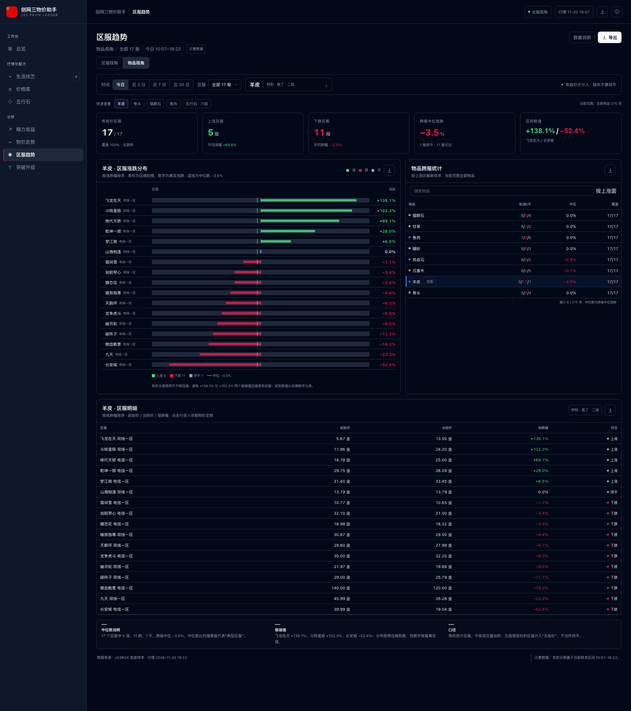
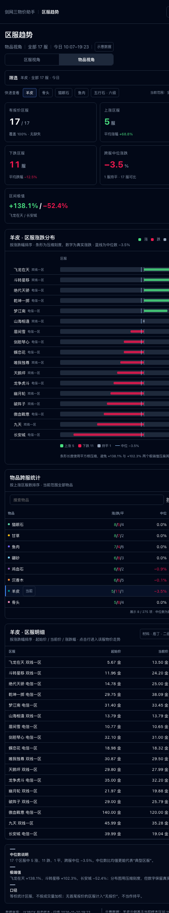

# 区服趋势 · 物品视角设计

> 状态：**已开发（dev）/ 待验收**
> 日期：2026-11-20
> 归属：分析 → 区服趋势 → 物品视角
> 依赖：[04-区服趋势设计](./04-区服趋势设计.md)、`data/price-history/`

---

## 1. 需求

现有区服趋势回答的是：

> 哪个区服整体在涨、哪个技艺在动？

新增的**物品视角**回答：

> **某个物品，在多少个区服上涨/下跌？幅度多大？跨服中位数是多少？**

以「羊皮」为例，需要一眼看到：

- 17 个区服里，多少服上涨、多少服下跌、多少服持平、多少服无报价；
- 上涨区服的平均涨幅、下跌区服的平均跌幅；
- 跨服中位涨跌幅；
- 最高/最低区服及其幅度；
- 每个区服的起始价、当前价、涨跌幅与状态；
- 从“羊皮”继续找其他跨服涨跌面明显的物品。

---

## 2. 与区服视角的边界

| 维度 | 区服视角（已有） | 物品视角（新增） |
| --- | --- | --- |
| 问题 | 哪个区服在涨 | 某个物品在哪些区服涨/跌 |
| 主对象 | 区服 | 物品 |
| 统计方向 | 一个区服内多个物品 | 一个物品跨多个区服 |
| 主指标 | 区服净广度 | 上涨服数 / 下跌服数 / 跨服中位 |
| 图表 | 区服 × 时间热力图 | 单物品区服分布 |
| 下钻 | 区服详情 | 区服 → 物价走势 |

两个视角共用时间、区服选择和数据口径。

---

## 3. 入口与 URL

### 3.1 入口

- 区服趋势页面顶部「区服视角 / 物品视角」切换；
- 区服详情中点击物品 → 物品视角；
- 关键词 chip 点击物品词 → 物品视角；
- 已有「指定产物」筛选可带入第一个物品。

### 3.2 URL

```text
/server-trends?sview=item&srange=today&sservers=...&sitem=item:m_m_5_30873
```

- `sview=item`：物品视角；
- `sitem`：单个物品 key；
- `sservers`：区服多选，默认全部 17 服；
- `srange`：今日 / 近 3 / 7 / 30 日。

首版为**单物品**；多物品对比在二期。

---

## 4. 指标口径

### 4.1 有效区服

对物品 `i`、区服 `s`：

```text
p0 = 本服 t0 有效报价
p1 = 本服 t1 有效报价
return = p1 / p0 - 1
```

只有 `p0`、`p1` 都有效时才计入；缺任一报价 = **无报价**，不是持平。

### 4.2 状态

沿用 ±0.5% 阈值：

```text
return > +0.5%   → 上涨
return < -0.5%   → 下跌
其余             → 持平
```

### 4.3 汇总指标

```text
comparable = 有效区服数
up         = 上涨区服数
down       = 下跌区服数
flat       = 持平区服数
missing    = 选中区服数 - comparable
median     = 跨服涨跌幅中位数
avgUp      = 上涨区服的平均涨幅
avgDown    = 下跌区服的平均跌幅
max/min    = 最高/最低涨跌幅（带区服名）
coverage   = comparable / 选中区服数
```

展示时：

- 上涨/下跌/持平/无报价**四个数字分开**；
- 中位数是主指标；
- 平均涨幅/跌幅只描述对应方向，不与中位数混用；
- 等权统计区服，不按成交量加权；
- 数据没有成交量，不写“资金流入/流出”。

### 4.4 低样本

- `comparable < 3` 或 `coverage < 30%`：标记「样本不足」；
- 仍展示区服明细；
- 不进入默认“跨服涨跌榜”前排；
- 单服选择时提示“跨服统计至少需要 2 服”。

### 4.5 异常值

- 保留最大/最小值；
- 图表使用压缩刻度，数字保留真实值；
- 不默认剔除异常值；
- 后续可增加“排除极端值”开关。

---

## 5. 页面结构

```text
[区服趋势]
[区服视角 | 物品视角]
[时间] [区服多选] [物品选择] 
[快速查看：羊皮 / 骨头 / 猫眼石 / 鱼肉 / 五行石]
[KPI：有报价 / 上涨 / 下跌 / 中位 / 极值]
[物品涨跌分布]              [物品跨服统计榜]
[区服明细表]
[读法/口径]
```

### 5.1 KPI

以羊皮当前样本为例：

- 有报价：17 / 17（覆盖 100%，无缺失）
- 上涨：5 服，平均 +68.8%
- 下跌：11 服，平均 −12.5%
- 跨服中位：−3.5%
- 区间极值：+138.1% 飞龙在天 / −52.4% 长安城

### 5.2 物品涨跌分布

- 每个区服一行；
- 横条表示涨跌幅；
- 0% 参考线；
- 中位数参考线；
- 颜色：涨/跌/平；
- 无报价行单独显示；
- 按涨跌幅排序；
- 数字始终显示；
- 极端值使用平方根压缩条形长度，数字不压缩。

### 5.3 物品跨服统计榜

用于发现“哪些物品在多数区服上涨/下跌”：

| 物品 | 涨/跌/平 | 中位 | 覆盖 |
| --- | --- | ---: | ---: |

- 默认按上涨服数排序；
- 支持搜索；
- 点击行切换当前物品；
- 选中行高亮；
- 展示 8–10 行 + “查看全部”。

### 5.4 区服明细表

| 区服 | 起始价 | 当前价 | 涨跌幅 | 状态 |
| --- | ---: | ---: | ---: | --- |

- 按涨跌幅排序；
- 点击行进入该服物价走势；
- 无报价区服显示 `—` 和「无报价」，不显示 0%；
- 当前价保留两位。

### 5.5 读法

- 中位数比均值更能代表典型区服；
- 极端值会拉高均值，页面同时展示；
- 无报价 ≠ 持平；
- 等权 17 服，不是成交额加权。

---

## 6. 交互

### 6.1 切换视角

- 顶部 segmented；
- 切到物品视角时保留时间/区服；
- 物品视角默认选中上次物品，否则选当前范围“上涨面最高”的物品；
- 没有选择物品时显示选品空态。

### 6.2 选择物品

- 物品选择面板：搜索名称/技艺/类型；
- **覆盖全部 275 项（含五行石），即使该物品当前没有报价也可被找到**；
- 统计榜只列出当前范围有可比样本的物品；
- 统计榜搜索在全部有可比样本的物品中查找，不是只搜前 8 行；
- 单选；
- 包含五行石 1–8 级；
- 快速查看：上涨面最高、当前关键词、已有指定产物；
- 切换后 URL 更新，图表/表格/KPI 重新计算。

### 6.3 改区服

- 区服多选默认全部；
- 修改后 effective/comparable/missing 重算；
- `up + down + flat + missing = 选中区服数` 必须成立。

### 6.4 点击

- 分布图行 → 选中该服，可滚动到明细；
- 明细行 → `/trends?server=...&tfocus=...`；
- 统计榜行 → 切换当前物品；
- 分布图/明细表支持导出。

### 6.5 移动端

- 视角切换全宽；
- 筛选收起；
- KPI 两列；
- 分布图/表格横向滚动；
- 统计榜卡片化。

---

## 7. 状态与边界

- **无历史**：提示历史从 2026-11-20 开始；
- **物品不存在**：回到选品空态；
- **全部无报价**：显示“当前区服均无该物品有效报价”；
- **仅 1 服有报价**：显示数值，但标「样本不足」；
- **仅 1 个区服被选中**：提示跨服统计至少需要 2 服；
- **全部持平**：中位 0%，上涨/下跌 0，显示持平数；
- **五行石**：按 1–8 级独立物品统计；
- **价格极低**：显示当前绝对价，不隐藏百分比；
- **单日数据**：仅今日盘中，不包装长期趋势。

---

## 8. 性能

物品视角复用区服视角的区服端点，不额外拉取 17 份历史：

- 已加载区间的区服 points 中直接取 `quotes/stones`；
- 单物品统计 = 17 个端点，成本很低；
- 统计榜需要 275 个物品 × 17 服，首版可一次性计算并缓存；
- 缓存 key：`from + to + servers`；
- 切换物品不重新拉数据；
- 长历史使用摘要/固定窗口（与 04 一致）；
- 统计榜可预计算 top N，避免每次全量扫描。

---

## 9. 效果图

### 桌面端



### 移动端



静态稿：[server-trends-item.html](./mockups/server-trends-item.html)

> 图中为示意数据；羊皮示例数字来自当前样本区间 10:07–19:23。

---

## 10. 验收

- [ ] 物品视角入口、URL 可刷新；
- [ ] 选择羊皮后显示 5 涨 / 11 跌 / 1 平 / 0 无报价（当前样本）；
- [ ] 中位 −3.5%、上涨均值、下跌均值、极值正确；
- [ ] 改区服后四个计数仍相等；
- [ ] 无报价不显示为 0%，不计入持平；
- [ ] 明细表含起始价、当前价、涨跌、状态；
- [ ] 青魄玉可被物品选择/统计榜搜索到；
- [ ] 统计榜可切换物品；
- [ ] 点击区服行进入物价走势；
- [ ] 移动端筛选收起、图表/表格可滚动；
- [ ] 低样本有标记。

---

## 11. 分期

### MVP

- 单物品；
- KPI；
- 分布图；
- 区服明细；
- 统计榜 top 8；
- 区服多选；
- 移动端。

### 二期

- 多物品对比（最多 4–8 个）；
- 排除极端值开关；
- 统计榜完整抽屉；
- 自定义排序（上涨面/中位/覆盖）；
- 分享链接。

### 三期

- 摘要预计算；
- 区服权重/成交量接入；
- 异常值说明；
- 导出报告。

---

## 12. 待确认

1. 首版单物品 + 统计榜，是否足够？
2. 统计榜默认按“上涨服数”还是“净广度（涨−跌）”排序？
3. 低样本阈值用 `comparable < 3` / `coverage < 30%` 是否合适？
4. 图表极端值采用压缩刻度、保留真实数字，是否接受？
5. 多物品对比是否进入首版？
