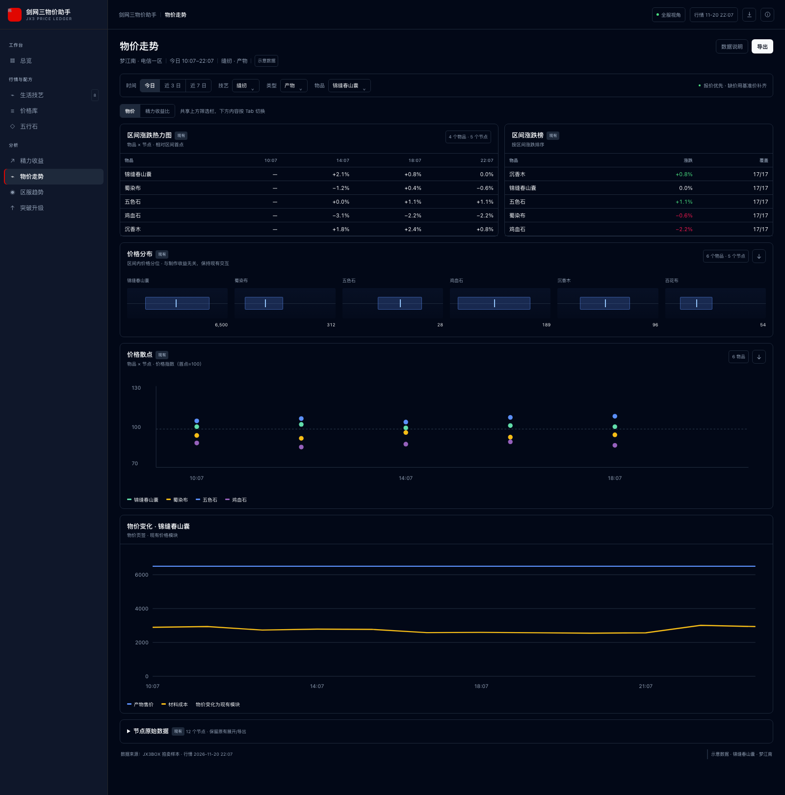
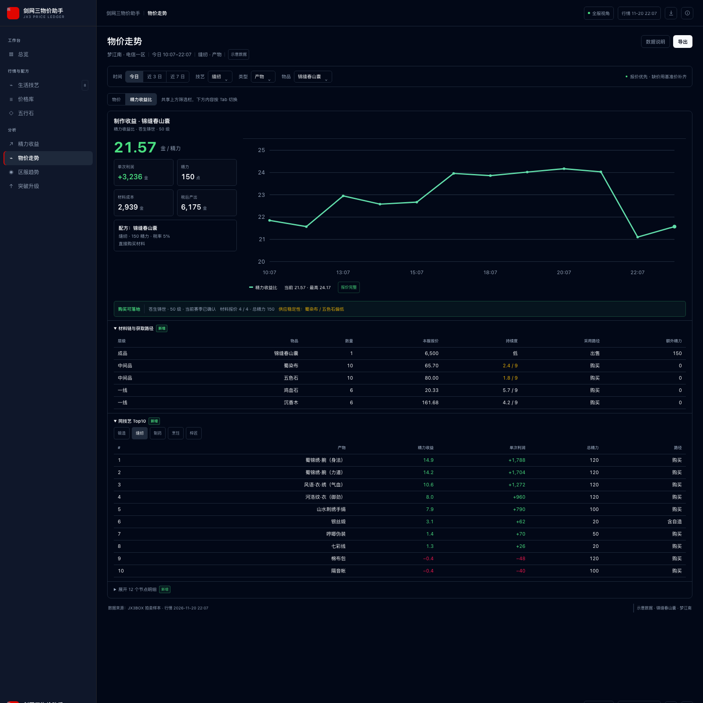
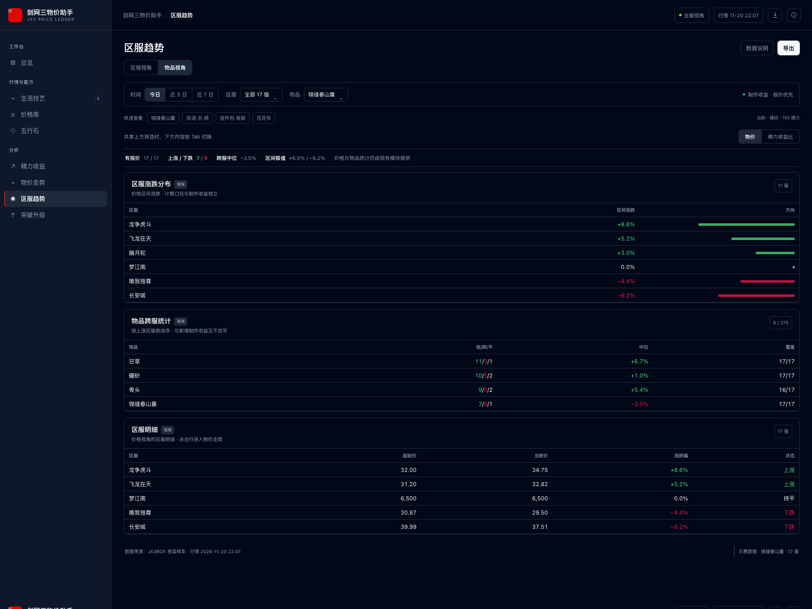
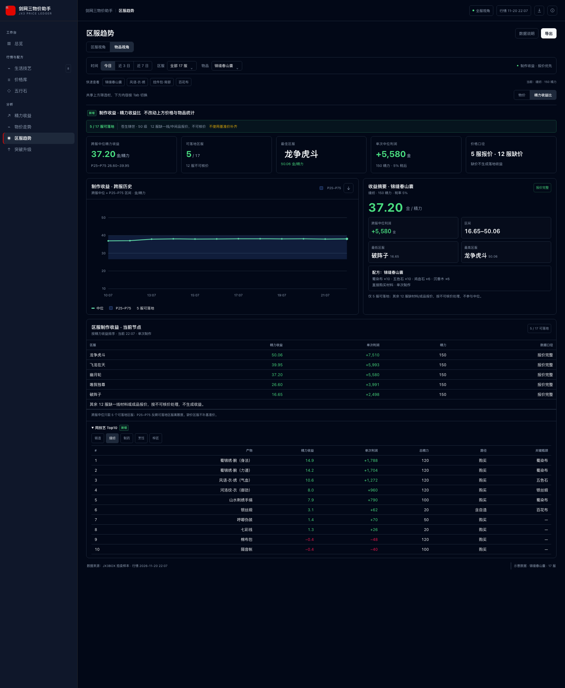

# 物价走势 / 区服趋势 · 制作收益历史设计

> 状态：**v2 实际落地校验 / 待评审，不进入开发**
> 日期：2026-11-20
> 关联：[04-区服趋势设计](./04-区服趋势设计.md)、[05-区服趋势-物品视角设计](./05-区服趋势-物品视角设计.md)
> 目标：在物价走势与区服趋势中补充“产物在历史节点的精力收益比”，并校验材料获取、中间品与制作难度，避免把不可落地收益当成真实收益。

---

## 1. 目标

现有页面能回答：

- 物品价格怎么变；
- 哪个区服在涨跌；
- 一个物品在多少区服涨跌。

但还不能直接回答：

> **这个产物在某个历史节点，扣掉材料成本、交易税和精力后，每点精力能赚多少？**

新增目标：

1. 针对**可制作产物**，按历史节点计算单次制作的精力收益比；
2. 在物价走势中看到选中产物的收益历史；
3. 在区服趋势中看到产物在不同区服、不同历史节点的收益差异；
4. 明确展示材料成本、税后产出、单次利润、精力消耗和计算口径；
5. 缺报价时不伪造收益，估算值必须明确标记。

---

## 2. 范围

### 2.1 包含

- 有 `craft` 配方的产物；
- 制造/缝纫/制药/烹饪/梓匠等可制作产物；
- 配方产出的中间品（如布、线、石）如果本身可交易，也作为产物处理；
- 历史节点上的材料价、产物价、配方精力、手续费、交易税。

### 2.2 不包含

- 只有采集、没有配方的材料；
- 五行石合成：涉及爆率/概率，不能与普通配方使用同一确定性精力收益；
- 成交量、资金流、需求预测；
- 跨服倒卖/套利建议；
- 自动推荐“最赚钱配方”。

五行石以后如需支持，单独做“五行石合成收益”模型。

---

## 3. 指标定义

### 3.1 输入

对配方 `r`、区服 `s`、节点 `t`：

- `materials`：配方直接材料及数量；
- `outputs`：配方产出及数量/概率；
- `energy`：配方精力；
- `fee`：配方手续费；
- `taxRate`：交易税率，默认 5%（读取设置）；
- `price(i,t,s)`：物品在节点、区服的价格。

### 3.2 计算

```text
materialCost = Σ price(material, t, s) × qty
outputGross  = Σ price(output, t, s) × qty × chance
outputNet    = outputGross × (1 - taxRate)
profit       = outputNet - materialCost - fee
perEnergy    = profit / energy
```

其中：

- `perEnergy` 单位：**金 / 精力**；
- `profit` 单位：金 / 单次制作；
- 负值表示亏损；
- 概率产出按期望数量计算；
- 税费只扣产出，不扣材料。

### 3.3 材料成本口径

**v1 曾使用“直接购买材料”口径；v2 调整为“购买优先，缺货才自造”**：

- 材料有本服有效报价：按购买计算；
- 中间品无报价、但有配方：自造，成本与精力都要计入；
- 一线材料无报价：不能假设可以买到，标记为不可核价/需自采；
- 自造/自采路径单独标记，不与纯购买收益混算。

> 旧版“直接材料仍按基准价补齐”的算法不能作为实际落地收益，只能作为理论估算。

### 3.4 价格来源

优先级（v2）：

1. 本服有效报价；
2. 中间品无报价但可自造：走自造路径，计入其精力；
3. 一线材料无报价：不能假设可购买，标记「缺价/需自采」，不进入落地收益；
4. 基准价补齐仅可作为**理论估算**，不得标为可落地。

展示规则：

- 全部使用本服报价：标记「报价完整」；
- 自造中间品：标记「含自造 / 额外精力」；
- 缺一线材料报价：标记「不可核价」或「需自采」；
- 产品本身无报价：标记「无产出报价」，不能算出售收益；
- 基准价估算与落地收益必须分栏，不可混成一个数。

### 3.5 配方选择

- 一个产物可能有多个配方；
- 默认使用该产物在**区间末点精力收益最高**的配方，并固定用于整段历史，保证可比；
- 显示配方名称、精力、材料数量；
- 可切换其他配方后重算；
- 若所有配方都缺价 → 显示“缺材料/产物报价”。

> 当前数据中大部分产物只有 1 个主配方；多配方逻辑作为兼容设计。

### 3.6 低样本 / 不可计算

- 任一必需材料或产物无有效价格：该节点收益断点；
- 有效节点 < 3：标记「样本不足」；
- 仅报价可算的区服 < 3：跨服收益结论弱化；
- 估算节点单独计数，不混入“报价完整”数量。

---

## 4. 物价走势中的呈现

### 4.1 位置

在现有「物价变化」卡之后增加一张：

> **制作收益 · {产物名}**

仅当当前聚焦物品有 `craft` 配方时显示；材料/无配方物品显示空态或隐藏。

### 4.2 卡片内容

- 当前节点精力收益比；
- 单次利润 / 精力 / 材料成本 / 税后产出；
- 配方名称、精力、税率；
- 历史节点折线：
  - 横轴：节点；
  - 纵轴：金/精力；
  - 0 线；
  - 断点表示缺价；
  - 估算节点用空心点/虚线；
- 当前 / 最高 / 最低节点；
- 「报价 / 含基准价」标记与切换；
- 展开后的节点明细表：
  - 时间、产物价、材料成本、税后产出、单次利润、精力收益比；
  - 不展示成交量。

### 4.3 与其他卡片关系

- 价格线仍回答“价格怎么变”；
- 制作收益卡回答“制作划不划算”；
- 不把价格和精力收益强行放在同一纵轴。

---

## 5. 区服趋势中的呈现

### 5.1 物品视角

选中产物后增加：

- KPI：
  - 当前跨服中位精力收益；
  - 可算区服数 / 选中区服数；
  - 正收益区服数；
  - 最佳区服及其收益；
- 历史图：
  - 每个节点计算各区服 `perEnergy`；
  - 展示跨服中位线 + P25–P75 区间带；
  - 断点表示该节点没有可算区服；
- 区服表：
  - 增加「精力收益」列；
  - 显示当前节点收益、利润、是否估算；
  - 点击区服仍进入物价走势。

### 5.2 区服视角

在选中区服详情增加：

- **制作收益 Top 5**：该服当前节点精力收益最高的 5 个产物；
- 每行：产物、精力收益、单次利润、精力、配方；
- 点击产物 → 物品视角并聚焦该产物；
- 区服视角不铺开全部产物的历史矩阵，避免与物品视角重复。

### 5.3 物品统计榜

可选增加：

- 「精力中位」列；
- 支持按精力收益排序；
- 只对有配方的物品显示，不参与无配方物品排序。

---

## 6. 交互

- 指标卡 tooltip 解释公式与税率；
- 切换「仅本服报价」后所有收益重算；
- 点击历史节点：定位到该节点收益；
- 点击配方名称：展开材料清单；
- 点击区服/产物：沿用现有下钻；
- 缺价节点显示 `—`，不连接折线；
- 估算节点和报价节点视觉不同，但数字都保留；
- 移动端：图横向滚动，明细表横向滚动，KPI 两列。

---

## 7. 数据与性能

### 7.1 计算量

- 175 个配方 × 17 服 × 当前 12 个节点；
- 每节点需要材料价、产物价；
- 与物价历史共用 points，不额外拉取全量历史。

### 7.2 缓存

- 缓存 key：`server + from + to + recipeId + priceMode`；
- 单物品详情只算当前物品；
- 跨服区服表只算当前产物；
- 统计榜需要全产物时，按需计算并缓存；
- 长历史使用摘要/固定窗口，与 04/05 一致。

### 7.3 摘要层

可在服务端/构建期预计算：

```text
perProductPerEnergy[date][server][item] = {
  perEnergy, profit, materialCost, outputNet, energy,
  quoteComplete, estimated, missing
}
```

首版可用前端按需计算，但必须只加载选中区间的 points。

---

## 8. 边界

- 价格是样本价，不是成交价；
- 无成交量，不能判断需求；
- 制作收益不等于实际利润（还有失败、时间、人工、跨服）；
- 税率默认 5%，用户可在设置修改；
- 材料直接购买口径不包含自产精力；
- 产物价格用基准价时是估算；
- 五行石不进入普通配方模型；
- 只有 1 天历史，当前仅盘中节点。

---

## 9. 验收

- [ ] 有配方产物在物价走势显示制作收益卡；
- [ ] 无配方物品不显示伪造收益；
- [ ] 每个节点正确计算材料成本、税后产出、利润、精力收益；
- [ ] 税率读取设置；
- [ ] 缺价节点断开，估算节点有标记；
- [ ] 区服物品视角显示跨服中位/P25–P75；
- [ ] 区服表增加精力收益列；
- [ ] 区服视角显示制作收益 Top 5；
- [ ] 点击产物/区服下钻正确；
- [ ] 移动端可横向滚动；
- [ ] 不声称成交额/需求量。

---

## 10. 分期

### MVP

- 物价走势：单产物制作收益卡 + 节点明细；
- 区服物品视角：中位/P25–P75 + 区服收益列；
- 区服视角 Top 5；
- 报价/估算标记。

### 二期

- 仅报价开关；
- 多配方切换；
- 物品统计榜按精力收益排序；
- 自产中间品口径；
- 摘要预计算。

### 三期

- 五行石概率收益；
- 历史收益回测；
- 自定义精力预算；
- 分享/导出。

---

## 11. 效果图

### 物价走势 · 物价 / 精力收益页签





### 区服趋势 · 价格 / 精力收益页签





静态稿：

- [物价走势 · 制作收益](./mockups/trends-profit.html)
- [区服趋势 · 制作收益](./mockups/server-trends-profit.html)

> 效果图使用「锦缝春山囊」示例；数值为当前样本的示意计算，随行情变化。
> 效果图同时标出了「现有」与「新增」区域：现有热力图、涨跌榜、价格图、物品统计和区服明细保持原位，制作收益作为附加卡片插入。
>
> 效果图已按 v2 更新：加入赛季校验、购买/自造、材料链、可落地状态、缺价不可核价和分技艺 Top10。

---

## 12. 已确认决策

1. 材料成本采用“购买优先，缺货自造”，自造计入总精力；
2. 一线材料缺报价时不做基准价补齐、不出落地收益；
3. 技艺落地收益只在可落地产物上统计；
4. 不使用人工稀有材料白名单，按当前赛季资料自动判定；无法确认当前赛季的不作为关键材料；
5. 分 5 个制造技艺展示 Top10；采集技艺不参与制作收益排名。

---

## 13. 示例数据（锦缝春山囊）

- 配方：缝纫 · 150 精力 · 税率 5%；
- 梦江南当前节点：单次利润约 3,236 金，精力收益约 21.57 金/精力；
- 跨服（含基准价补齐）当前中位约 17.48 金/精力；
- 最佳区服示例：龙争虎斗约 50.06 金/精力；
- 以上为当前样本示例，不构成制作建议。

---

## 14. 与现有功能兼容

制作收益是**附加信息层**，不重做现有页面。

### 14.1 物价走势

保持现有全部能力：

- 时间、技艺、类型筛选；
- 物品搜索/多选；
- 区间涨跌热力图、涨跌榜；
- 价格分布、价格散点；
- 物价变化；
- 节点原始数据、CSV/PNG 导出；
- 物品聚焦与下钻。

新增行为：

- 制作收益卡跟随当前 `tfocus + tfrom/tto + server`；
- 不新增第二个物品选择器；
- 当前物品无配方时，原页面照常显示，制作收益卡显示“该物品不是可制作产物”；
- 只在原卡片流中插入，不替换价格图、热力图或原始数据；
- 原有物品多选搜索的选择状态不被制作收益卡改写。

### 14.2 区服趋势

保持现有全部能力：

- 区服视角 / 物品视角切换；
- 时间、区服、物品筛选；
- 区服净广度热力图、榜单、技艺矩阵；
- 物品视角价格 KPI、区服涨跌分布、物品跨服统计、区服明细；
- 搜索、快速查看、最近 15 个；
- `sview / sitem / sservers / srange` URL 状态。

新增行为：

- 物品视角：在现有价格内容之后插入制作收益，不替换价格分布/统计榜；
- 区服视角：在选中区服详情中插入 Top 5，不改动净广度矩阵；
- 制作收益与现有筛选共用 `sitem`、`sservers`、`srange`；
- 当前物品非制作产物时，价格与涨跌功能不受影响；
- 搜索/快速查看仍只维护一套物品状态，不因制作收益新增第二套选择器；
- 现有导出、下钻、移动端滚动保持。

### 14.3 URL 与状态

不新增必需路由参数：

- 物价走势：继续使用 `tfocus / tfrom / tto / tskill / ttype`；
- 区服趋势：继续使用 `sview / sitem / sservers / srange`；
- 制作收益不单独记忆物品，避免与现有物品状态分叉；
- 制作收益的“仅报价/含基准价”是展示开关，默认不写入 URL（二期可加 `tpmode`/`spmode`）。

---

## 15. 已知问题：二次模糊搜索

> 该问题由用户反馈，本轮只记录、不改代码。

### 15.1 现象

1. 打开物品搜索；
2. 模糊搜索物品 A 并选中；
3. 再次打开搜索，输入物品 B；
4. 下拉结果不更新或无法搜索到 B。

可能影响：

- 区服趋势 · 物品视角的物品选择；
- 区服趋势 · 物品跨服统计搜索；
- 物价走势 · 物品多选搜索；
- 区服视角 · 指定产物搜索。

### 15.2 影响

- 用户无法连续切换物品；
- 快速查看/制作收益可能停留在上一件物品；
- 看起来像“搜索功能失效”。

### 15.2.1 疑似原因

- 物价走势的物品选择是**多选**：选择物品后只更新 `titems`，面板保持打开，搜索词没有清空；用户接着输入新物品时，旧关键字仍在，变成“旧词 + 新词”的组合，导致没有结果；
- 区服趋势是**单选**：选择后应关闭面板并清空查询；如果实现没有清空或重渲染后仍保留旧的 `hidden` 状态，也会出现同样现象；
- 统计榜搜索与物品选择搜索如果共享同一 query/旧列表，二次搜索会受影响。

### 15.3 修复要求

- 单选（区服趋势物品、指定产物）：选择后关闭面板并清空搜索词；
- 多选（物价走势物品）：选择后**保持面板打开**，但立即清空搜索词并恢复完整列表，已勾选状态保留；
- 重新输入时必须从**完整物品目录**开始，而不是上一轮筛选结果；
- 每次输入都重新计算匹配，不依赖上一次的 `hidden` 状态；
- 输入框、匹配数、列表三者必须同步；
- Enter 选择第一项、点击选择、快速查看选择保持；
- 物价走势多选搜索与区服趋势单选搜索分别维护独立 query，不共享旧状态；
- 选中物品后不得重置当前区服/时间/价格口径。

### 15.4 回归用例

- 搜索「青魄玉」→ 选择 → 再搜索「春山」→ 可看到「锦缝春山囊」；
- 搜索「羊」→ 选择「羊皮」→ 再搜索「青魄」→ 可看到「青魄玉」；
- 输入不存在物品 → 显示 0 项 → 清空 → 恢复完整列表；
- 物价走势多选：勾选 A 后搜索 B，B 仍可勾选；
- 区服趋势统计榜：选中 A 后搜索 B，B 仍出现在榜内；
- 快速查看与制作收益不因二次搜索丢失。

### 15.5 兼容要求

该修复必须同时覆盖物价走势与区服趋势，不得只修其中一个入口；不得改变现有筛选、URL 和选中物品逻辑。

---

## 16. 左右 Tab 布局（本轮调整）

新增模块不再继续向下堆叠，改为在同一区域切换。

### 16.1 物价走势

- **筛选栏只保留一套**，位于 Page 标题下方，Tab 在筛选栏下方；
- Tab：**物价 / 精力收益比**；
- 「物价」页签只显示现有价格内容：
  - 区间涨跌热力图；
  - 区间涨跌榜；
  - 价格分布；
  - 价格散点；
  - 物价变化；
  - 节点原始数据。
- 「精力收益比」页签只显示制作收益内容：
  - 落地校验；
  - 单次摘要与历史收益线；
  - 材料链；
  - 同技艺 Top10；
  - 节点明细。
- 两个页签内容不再混排；
- 切换 Tab 不改变物品、时间、技艺、类型筛选；
- 默认「物价」，保持现有习惯。

### 16.2 区服趋势 · 物品视角

- 共用一套筛选栏和物品选择，Tab 位于筛选栏下方；
- Tab：**物价 / 精力收益比**；
- 「物价」页签只显示现有价格内容：
  - 价格 KPI；
  - 区服涨跌分布；
  - 物品跨服统计；
  - 区服明细。
- 「精力收益比」页签只显示制作收益内容：
  - 落地校验；
  - 制作收益 KPI；
  - 跨服中位/P25–P75；
  - 可落地区服表；
  - 同技艺 Top10。
- 切换 Tab 不改变 `sitem / sservers / srange`；
- 非制作产物时「精力收益比」页签禁用或显示不可用说明，物价页签照常。

### 16.3 区服趋势 · 区服视角

- 区服详情中的「制作收益 Top 5」仍为附加模块，不改净广度热力图、榜单和技艺矩阵；
- 不额外增加整页 Tab，避免区服视角再分叉。

### 16.4 Tab 交互规范

- Tab 使用 `tablist/tab/tabpanel` 语义；
- 左右方向键可切换，Enter/Space 激活；
- 默认选中现有「物价/价格」页签；
- Tab 状态在当前页面会话内保留，不作为必需 URL 参数；
- 移动端 Tab 全宽，图表横向滚动；
- 切换不重置筛选、滚动位置和物品详情。

### 16.5 效果图

- 物价 · 物价页签：[trends-profit-desktop.png](./assets/trends-profit-desktop.png)
- 物价 · 精力收益页签：[trends-profit-tab-profit.png](./assets/trends-profit-tab-profit.png)
- 区服 · 价格页签：[server-trends-profit-desktop.png](./assets/server-trends-profit-desktop.png)
- 区服 · 精力收益页签：[server-trends-profit-tab-profit.png](./assets/server-trends-profit-tab-profit.png)

> 效果图中既有「现有」模块，也有「新增」模块；Tab 只是收起新增内容，不删除现有模块。

---

## 17. v2 实际落地校验

> 本节修正 v1 把“有基准价/理论配方”当作可落地收益的问题。核心原则：**没有报价且无法自造/自采的材料，不能当作可购买材料。**

### 17.1 目标变化

从“算出一个精力收益比”改为回答三个问题：

1. 这个产物在当前区服/节点**能不能做出来并卖掉**？
2. 如果能，走购买还是自造路径，**真实精力**是多少？
3. 如果关键材料缺报价，收益是**不可核价**还是需要自采/暂缓判断？

### 17.2 三层材料链

把每个配方的输入按层级分类：

| 层 | 定义 | 用途 |
| --- | --- | --- |
| 一线材料 | 无配方的采集/掉落材料 | 判断最底层供给与报价 |
| 中间品 | 有配方、但不是最终成品的材料 | 判断买还是自造 |
| 成品 | 当前配方最终产物 | 卖出收入 |

对每个产物建立：

```text
成品
├─ 一线材料 A
├─ 中间品 B
│  ├─ 一线材料 C
│  └─ 一线材料 D
└─ 一线材料 E
```

### 17.3 落地路径

#### 路径 A：购买优先

- 所有直接材料都有本服有效报价 → 直接买；
- 总精力 = 成品配方精力；
- 收益 = 成品税后售价 − 直接材料成本 − 手续费；
- 标记「购买可落地」。

#### 路径 B：缺货自造

- 某些中间品无报价，但有配方；
- 递归自造，材料成本按底层购买价；
- 总精力 = 成品精力 + 所有自造中间品精力；
- 收益 = 成品税后售价 − 底层材料成本 − 手续费；
- 标记「含自造 · 额外精力」。

#### 路径 C：不可核价

- 一线材料无报价；
- 没有可购买价格，也没有可计算的底层报价；
- 不生成收益数字，标记「不可核价 / 需自采」；
- 若用户能自采，需另立“自采时间/机会成本”口径，首版不做。

#### 路径 D：无法出售

- 成品自身无有效报价；
- 即使能做出来，也不能按市场价计算收益；
- 标记「无产出报价」；
- 不进入可落地产物榜。

### 17.4 关键材料难度

不依赖主观“难不难”，用可验证信号 + 人工白名单：

| 信号 | 说明 |
| --- | --- |
| 报价持续度 | 当前区间有多少节点有本服报价；低 → 不稳定 |
| 区服覆盖 | 多少选中区服有报价；低 → 获取渠道窄 |
| 价格离散 | 区服间价格差异大 → 获取不稳定/信息差 |
| 配方层级 | 中间品链深度、配方等级/品阶 |
| 赛季归属 | 只对当前赛季已确认的材料做关键材料判断；无法确认的不进入关键材料 |

示例（当前样本）：

- 蜀染布、五色石、银丝缎等中间品报价持续度低，不能默认随时买到；
- 地脉玄元等在锻造/缝纫配方中反复出现且多服缺价，是典型瓶颈；
- 玄元星平衫等产物多服无报价，不能按基准价算“卖得掉”的收益。

> 以上材料是否属于当前赛季，必须按第 19 节的赛季判定规则校验；无法确认当前赛季归属的，不进入“关键材料”与难度判断。

### 17.5 每个技艺的实际赚钱情况

新增「技艺落地收益」分析：

| 技艺 | 有配方产物 | 可落地产物 | 可落地收益中位 | 主要瓶颈 |
| --- | ---: | ---: | ---: | --- |

规则：

- 只在**可落地路径**上统计；
- 采集技艺无制作收益，单独标“供给/价格观察”，不参与制作收益排名；
- 样本不足时不排名，只显示计数和原因；
- 不把“理论估算”混入“可落地中位”。

### 17.6 分层价格与收益趋势

每个产物详情展示：

1. **一线材料价格指数**（首点=100）；
2. **中间品价格指数**；
3. **成品价格指数**；
4. **成品精力收益比**（只画可落地节点）。

图下必须标：

- 每层使用本服报价的数量；
- 自造中间品数量；
- 缺价节点/不可核价节点；
- 总精力（含自造）。

### 17.7 区服与跨服规则

- 每个区服独立判断可落地；
- 跨服中位只统计**该服可落地**的值；
- 显示 `可落地区服 / 有报价区服 / 选中区服`；
- 无落地区服时显示空态，不给 0；
- 不得用基准价把不可落地区服补成可落地；
- 区服视角 Top 5 只取可落地产物。

### 17.8 页面改造方向

#### 精力收益页签

在原有收益数字上方增加「落地校验」条：

```text
[购买可落地] 材料报价 4/4 · 总精力 150
或
[含自造] 蜀染布无报价 → 自造 +20 精力；总精力 170
或
[不可核价] 地脉玄元无报价，缺少一线材料
或
[无产出报价] 成品当前无报价
```

数字区分：

- 主数字：**可落地收益**；
- 折叠次级：**理论估算**（使用基准价，仅参考）；
- 不把两者放在同一行并列。

#### 材料链

新增「材料链」折叠表：

| 层级 | 物品 | 数量 | 本服报价 | 持续度 | 采用路径 | 额外精力 |
| --- | --- | ---: | --- | ---: | --- | ---: |

#### 技艺落地榜

- 区服视角 / 物品视角都可进入；
- 行：技艺、可落地产物数、可落地收益中位、主要缺价材料；
- 点击技艺筛选产物；
- 采集技艺不参与制作收益排序。

### 17.9 指标修订

```text
finalPerEnergy = 可落地利润 / 总精力
totalEnergy    = 成品配方精力 + Σ 自造中间品精力
feasible       = 成品有报价 且 所有输入可购买或可自造到底层报价
```

禁止：

- 缺一线材料报价时用基准价补齐并称为“实际收益”；
- 缺中间品报价时直接按 0 成本或忽略其精力；
- 用“有配方”推断“材料可获得”；
- 用跨服最高价计算能卖出的收益。

### 17.10 验收补充

- [ ] 一线材料缺报价 → 不可核价，不出收益数字；
- [ ] 中间品缺报价但有配方 → 自造并计入总精力；
- [ ] 成品无报价 → 无产出报价，不进榜；
- [ ] 购买/自造路径有明确标签；
- [ ] 跨服中位只含可落地区服；
- [ ] 技艺榜只在可落地产物上统计；
- [ ] 分层价格/收益趋势可展开到材料链；
- [ ] 旧基准价估算与可落地收益视觉分离。

### 17.11 数据/性能

- 需要预计算每个配方/产物的**材料链与可落地路径**；
- 每个节点/区服计算一次，缓存 key 含日/时/区服/配方/路径；
- 175 配方 × 17 服 × 12 节点，链深度通常 1–2 层；
- 自造路径只在缺报价时触发，成本可控；
- 长历史使用摘要，不在主线程递归展开全部配方。

---

## 18. 本次结论

1. v1 的“基准价补齐 + 直接材料”只能作为理论参考，不能作为落地收益；
2. v2 必须按一线材料 / 中间品 / 成品分层校验；
3. 无报价材料不能默认可购买；能自造则计入额外精力，不能自造则不可核价；
4. 每个技艺只在可落地产物上统计真实收益；
5. 分层价格趋势与成品精力收益要同时呈现；
6. 现有物价走势/区服趋势模块和左右 Tab 不变，只改精力收益页签内部数据口径与展示；
7. 二次模糊搜索问题仍保留在设计文档中，待开发一并修复。

---

## 19. 已确认口径与赛季判定

### 19.1 已确认口径

本轮确认：

1. 材料成本采用**购买优先、缺货自造、自造计入总精力**；
2. 一线材料无本服报价时，**不生成可落地收益，不再用基准价补齐**；
3. 技艺落地收益只在**可落地产物**上统计；
4. 不维护人工“已知稀有材料”白名单，改为**当前赛季资料自动判定**；无法确认当前赛季的材料，不作为关键材料；
5. 分技艺展示 **Top 10**。

### 19.2 当前赛季判定

当前数据包的赛季信息：

- `meta.expansion = 苍生铸世`
- `meta.levelCap = 50`
- `meta.version = 苍生铸世 · 50 级`
- `catalogVersion = v3.6`
- `verifiedAt = 2026-11-19`

对应的当前赛季依据：

- [《剑网3》「苍生铸世」10 月 29 日公测、等级回退至 50 级](https://ol.3dmgame.com/news/202610/43603.html)
- [JX3BOX 当前版本技艺助手/配方名录](https://www.jx3box.com/pvg/manufacture)
- 数据包内 `meta.sources`：JX3BOX 技艺助手 API、苍生铸世公测公告、9-24 生活技艺焕新、11-14/11-19 技艺调整

### 19.3 材料赛季状态

每个配方材料/产物增加：

```text
seasonStatus: confirmed | unconfirmed
seasonSource: 'current-catalog' | 'current-meta-source' | 'unknown'
keyMaterialEligible: boolean
```

规则：

- 物品来自**当前版本配方/当前版本物品目录**，且数据源标注当前版本 → `confirmed`；
- 只有 `confirmed` 材料可以进入：
  - 关键材料；
  - 制作难度；
  - Top10 瓶颈解释；
- `unconfirmed` 材料：
  - 可以出现在价格数据中；
  - **不能**被标记为“当前赛季关键材料”；
  - 不参与难度评分和 Top10 瓶颈判断；
- 不使用人工白名单；
- 无法确认的物品不因“看起来稀有”被当作关键材料。

> 赛季判定依据是数据来源和时间，不是物品价格高低，也不是主观难度。

### 19.4 当前赛季下的重点观察对象

以下仅为**候选观察对象**，最终必须通过 19.3 的 `confirmed` 校验后，才可标记为关键材料：

- 缝纫链：蜀染布、五色石、银丝缎、百花布；
- 锻造/缝纫共用：地脉玄元、境华、黄蜡；
- 采集/交易行：鸡血石、沉香木、硼砂。

若上述物品无法在**当前版本目录/当前赛季来源**中确认，则只保留为普通材料，不做关键材料结论。

---

## 20. 分技艺 Top 10

### 20.1 范围

- 5 个制造技艺：锻造、缝纫、制药、烹饪、梓匠；
- 采集技艺不做制作收益 Top10，只在材料供给/价格层展示；
- 每个技艺分别排名，不跨技艺混排。

### 20.2 排名规则

只统计当前区服、当前节点、当前筛选下的**可落地产物**：

```text
候选 = 可落地产物（购买可落地 或 含自造可落地）
排序 = 可落地精力收益比 desc
同分 = 总精力 asc，再按产物名
展示 = 前 10 名；不足 10 名展示实际数量
```

不进入 Top10：

- 一线材料缺报价（不可核价/需自采）；
- 成品无报价；
- 只能靠基准价理论估算；
- 赛季未确认的材料导致瓶颈无法判断时，降级说明但不伪造收益。

### 20.3 列

| 排名 | 产物 | 精力收益 | 单次利润 | 总精力 | 路径 | 关键瓶颈 | 报价覆盖 |
| ---: | --- | ---: | ---: | ---: | --- | --- | --- |

- 路径：购买 / 含自造；
- 关键瓶颈：只显示已确认当前赛季的材料；
- 报价覆盖：完整/部分/缺价；
- 点击行 → 物品视角/物价走势，并打开该产物制作收益。

### 20.4 页面落点

- **区服趋势 · 区服视角**：新增「技艺落地 Top10」卡；
  - 分技艺 Tab；
  - 默认折叠，展开后显示 10 行；
  - 选中区服/时间与页面一致；
  - 不挤占净广度矩阵和区服详情。
- **物品视角 / 物价走势**：制作收益卡增加「同技艺 Top10」按钮，打开抽屉复用同一组件；
- 不新增整页路由；
- 不用 Top10 替换任何现有模块。

### 20.5 验收

- [ ] 每个制造技艺可单独查看 Top10；
- [ ] 只显示可落地产物；
- [ ] 不足 10 个时显示实际数量并标样本数；
- [ ] 缺价/需自采/无产出报价不出现在榜单；
- [ ] Top10 的瓶颈材料只含赛季已确认材料；
- [ ] 点击行能下钻到对应产物；
- [ ] 采集技艺不在制作收益榜中冒充排名；
- [ ] 与现有价格/区服模块并存，不新增页面高度堆叠（抽屉/折叠）。

### 20.6 性能

- 只需对当前区服/时间计算 5 个技艺的候选产物；
- 先过滤不可落地，再排序取 10；
- 结果按 `server + node + skill + priceMode` 缓存；
- 展开时才渲染完整表格，默认折叠；
- 长历史继续使用摘要。

---

## 21. 本次决策结论

- 采用购买优先、缺货自造，自造精力计入；
- 一线材料无报价不出落地收益，不用基准价补；
- 技艺榜只在可落地产物上统计；
- 赛季判定自动化，无法确认当前赛季的材料不作为关键材料；
- 分 5 个制造技艺展示 Top10，采集技艺不参与制作收益排名；
- 二次模糊搜索问题仍在文档中，开发时一并修复；
- 现有物价走势/区服趋势模块和左右 Tab 不变，只改精力收益数据与展示。

> 效果图已按 v2 更新：项目前为价格页签，精力收益页签包含落地校验、材料链和分技艺 Top10。
