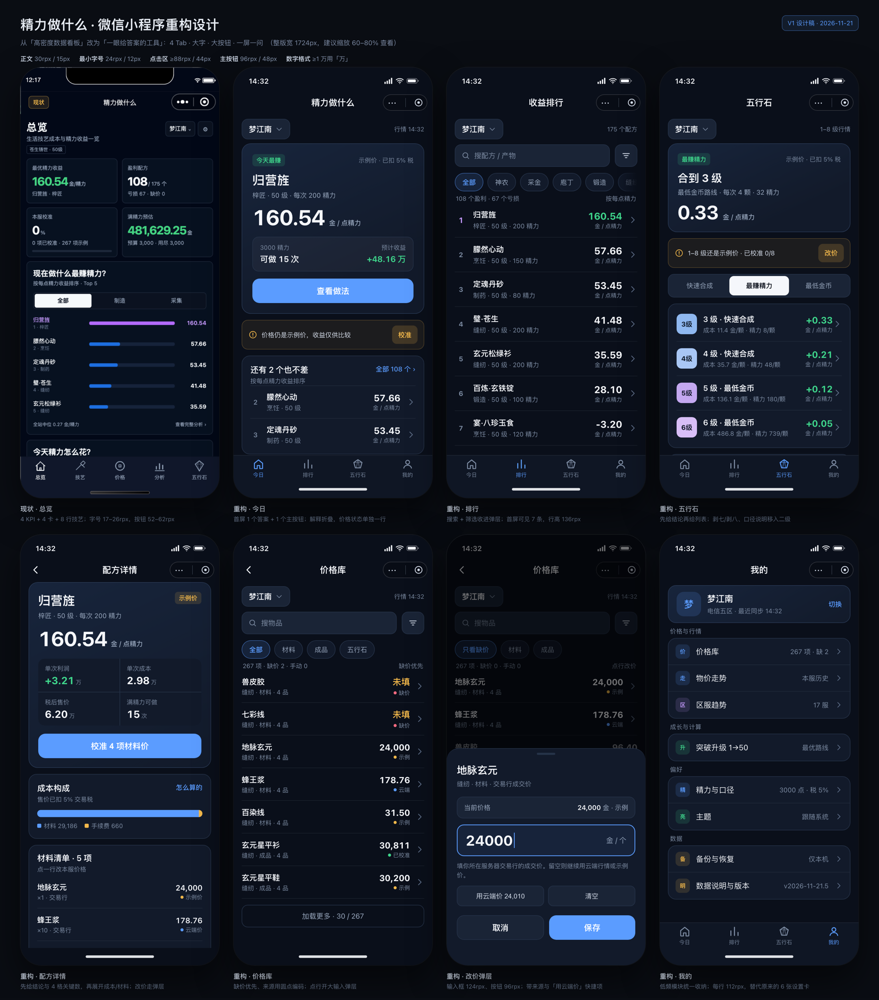
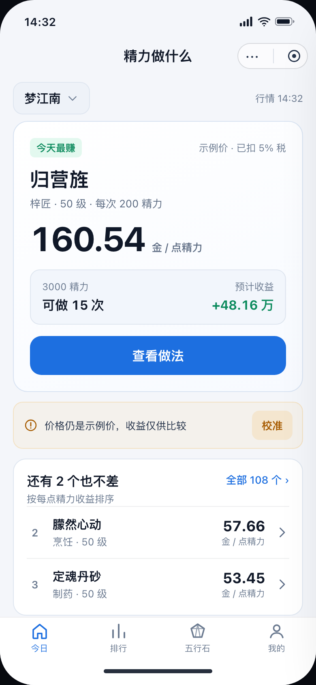
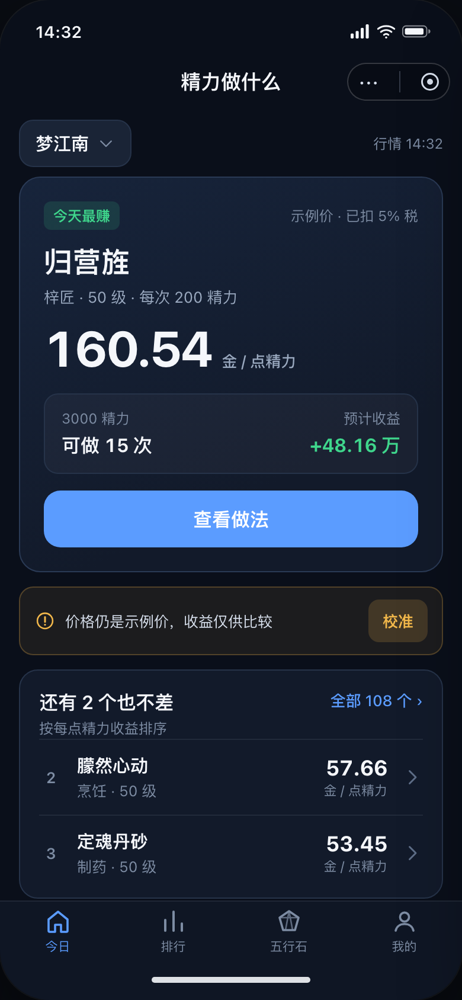
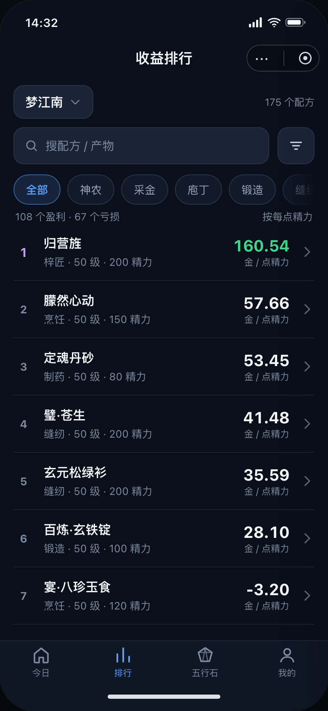
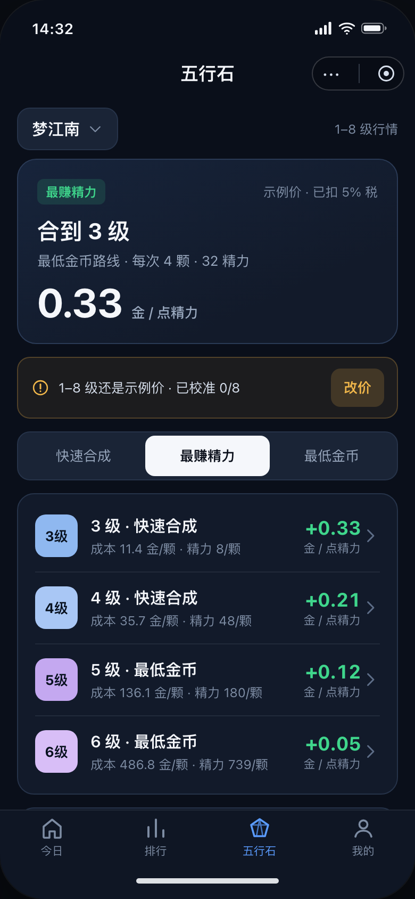
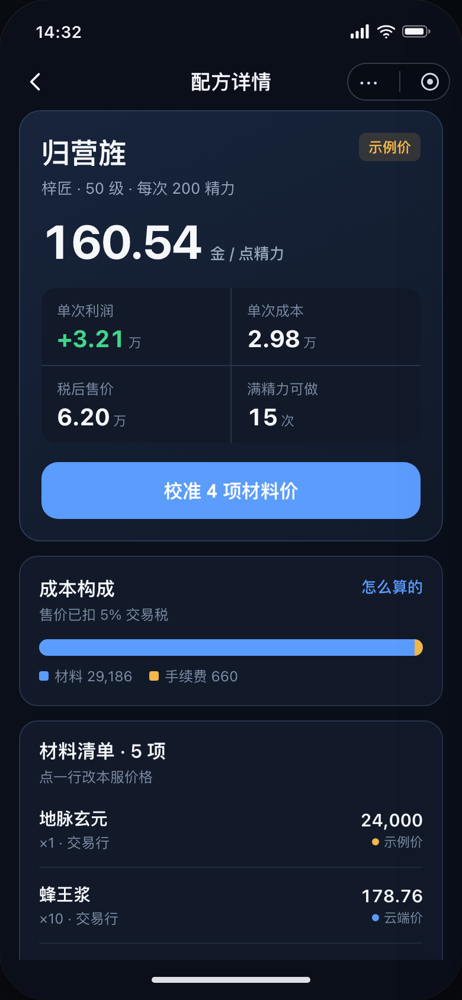
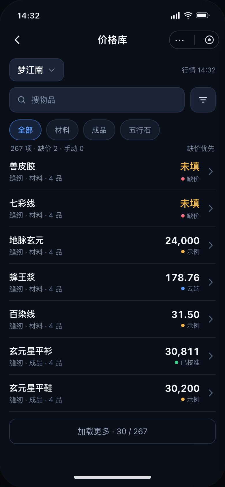
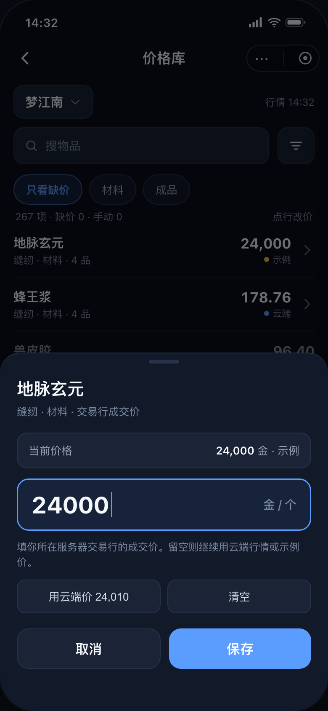
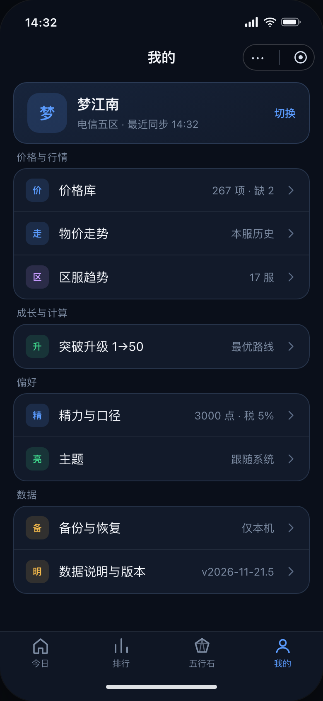

# 微信小程序 · 移动端体验重构设计（V1）

> 状态：**设计稿 + 数据同步**。4 Tab 页面重构尚未开始；444 项核心目录、672 项行情目录分包与行情链路已同步到本地工作区（未提交、未发布），详见 [`web-module-audit.md`](./web-module-audit.md)。
> 目标端：微信小程序优先；小红书端按同一套组件跟随（无五行石 Tab）。
> 视觉稿：[`layout.html`](./layout.html) · 截图：[`screenshots/`](./screenshots/)
> 日期：2026-11-21

---

## 0. 先看结论

现在的小程序不是"界面不够好看"，而是**把桌面数据看板的结构直接搬到了手机上**：

- **字号**：基础字号 `26rpx`（13px）；全部 157 处字号声明里，**117 处 ≤23rpx（11.5px），占 75%**，最小 17rpx（8.5px）。
- **触控**：主按钮 62rpx（31px）、次按钮 52rpx（26px）、价格输入 56rpx（28px）、开关轨道 30rpx（15px），只有 44px 推荐值的 **59%–73%**。
- **密度**：5 个 Tab + 7 个二级页；分析页 8 个 KPI + 11 个内容块；价格页 4 个 KPI + 444 行、每行一个小输入框；设置页 6 张卡 10 个控件。
- **路径**：想知道"今天做什么"，要先跳过 5 秒启动页，进总览先看 4 个 KPI，再在 KPI 和第一张卡里找排名，还要去分析页才能改预算。

**V1 的设计判断：做减法，而不是放大字号。**

| 维度 | 现状 | V1 |
| --- | --- | --- |
| 底部 Tab | 5 个（总览 / 技艺 / 价格 / 分析 / 五行石） | **4 个**（今日 / 排行 / 五行石 / 我的） |
| 每屏任务 | 4–12 个模块 | **1 个问题 + 1 个主动作** |
| 基础字号 | 26rpx / 13px | **30rpx / 15px**，最小 24rpx |
| 点击区 | 52–64rpx | **≥88rpx / 44px**，主按钮 96rpx / 48px |
| 首屏答案 | 埋在 4 个 KPI 里 | **Hero 第一屏**，1 次点击到配方 |
| 改价 | 列表内 56rpx 输入框 | **整行点击 → 大输入弹层** |
| 低频模块 | 与分析页混排 | 收进"我的"，按需下钻 |



---

## 1. 现状诊断（用数据说话）

### 1.1 一次完整的"今天做什么"路径

```
打开小程序
→ 启动引导页（固定 5 秒倒计时 + 广告占位，可跳过）
→ 总览
   4 个 KPI（最优收益 / 盈利配方 / 本服校准 / 满精力预估）
   → 第一张卡「现在做什么最赚精力？」（4 个 KPI 之后）
   → 5 条带进度条的排行
   → 点进配方详情
→ 想改"我只有 2000 精力" → 回分析 Tab → 滑到「满精力怎么分配」→ 改预算
```

用户要的是"今天做哪个、做几次、大概赚多少"，但首屏先给的是 4 个口径不同的指标；"做几次"藏在下一张卡「今天精力怎么花」，"改预算"藏在另一个 Tab。

### 1.2 字号：75% 的字号不超过 11.5px

统计口径：`src/app.css` + 各页面/组件中的 `font-size:` 声明，共 **157 处**（不含行内 `fontSize`）。

| 字号 | 折算 px（375 宽） | 出现次数 | 典型用途 |
| --- | --- | --- | --- |
| 17rpx | 8.5px | 14 | 单位、价格状态、脚注 |
| 18rpx | 9px | 23 | 标签、图表轴、说明 |
| 19rpx | 9.5px | 19 | 卡片脚注、迷你卡副文 |
| 20rpx | 10px | 13 | 说明文案 |
| 21rpx | 10.5px | 17 | 卡片副标题、表单标签 |
| 22rpx | 11px | 20 | 列表描述、按钮小字 |
| 23rpx | 11.5px | 11 | 列表名、按钮 |
| 24–26rpx | 12–13px | 23 | 正文主体 |
| 27–52rpx | 13.5–26px | 17 | 标题与 KPI |

- **117 处（75%）≤23rpx**，其中 **56 处（36%）≤19rpx**。
- 页面基础字号 `page { font-size: 26rpx }` = **13px**，低于移动端正文字号的通用下限。
- 部分 18rpx 文字同时使用了 `--muted-3: #475569`：在 `#020817` 背景上对比度仅 **2.6:1**（WCAG AA 要求 4.5:1）；`--muted-2: #64748B` 也只有 **4.0:1**。**又小又淡**，是"看不清"的直接原因。

> 对照：Apple HIG 建议正文 ≥17pt（约 34rpx）；微信小程序常规正文 14–16px（28–32rpx）。本项目大量"正文"实际是 9–11px。

### 1.3 触控：控件高度只有推荐值的六成

| 控件 | 现状 | 折算 px | 推荐值 | 占比 |
| --- | --- | --- | --- | --- |
| 主按钮 `.btn` | 62rpx | 31px | 88rpx / 44px | 70% |
| 次按钮 `.btn-sm` | 52rpx | 26px | 88rpx / 44px | 59% |
| 分段控件 `.seg-item` | 52rpx | 26px | 88rpx / 44px | 59% |
| 技艺 Tab `.skill-tab` | 58rpx | 29px | 88rpx / 44px | 66% |
| 图标按钮 `.icon-btn` | 58×58rpx | 29×29px | 88×88rpx | 66% |
| 区服胶囊 `.server-pill` | 58rpx | 29px | 88rpx / 44px | 66% |
| 价格输入 `.price-box` | 150×56rpx | 75×28px | 88rpx 高 | 64% |
| 开关 `.toggle .track` | 54×30rpx | 27×15px | 88×88rpx | 34% |
| 列表行 `.list-row` | 约 70rpx | 35px | 112–128rpx | 55–62% |

微信里单手操作时，拇指落点误差约 7–10mm；44px 是底线，不是"舒适值"。现在价格输入框只有 28px 高，周围还紧贴文字，误触和漏触都很正常。

### 1.4 信息密度：每页都在"展示全部"

| 页面 | 卡片 | KPI | 筛选/输入控件 | 长列表/图表 |
| --- | --- | --- | --- | --- |
| 总览 | 4 | 4 | 2 按钮 + 1 分段 | 5 排行 + 8 技艺 + 8 行价格状态 |
| 分析 | 7 + 4 个迷你卡 | 8 | 7 | Top12 + 散点 + 8 行箱线 + 5 行分配 + 完整榜 |
| 价格 | 2 | 4 | 6 | 444 行物品，每行一个输入框 |
| 五行石 | 5 | 4 | 3 | 8 行价格 + 4 合成 + 4 赌跳级 + 3 剥石 |
| 设置 | 6 | 0 | 10 | 服务器列表 + 备份 + 说明 |

分析页一个页面同时承担了：行情入口、区服趋势入口、突破入口、本服可做评级、收益排行、散点图、箱线图、五行石入口、双制品对比、满精力分配、完整榜单。**用户打开后不知道从哪一行开始看**，这是"无从下手"的结构性原因，不是文案问题。

### 1.5 重复与耦合：同一件事有 2–3 个入口

- **排行榜**：总览有 Top5，分析有 Top12，分析还有"完整收益榜"；三个榜的口径、排序、行样式都不同。
- **价格**：价格页 444 行、技艺页"本技艺材料行情"、配方详情材料列表、五行石价格卡，四套改价交互。
- **趋势**：总览有入口卡，分析有 `TrendMini`，我的没有统一入口。
- **满精力预估**：总览 KPI、总览「今天精力怎么花」卡、分析页分配卡，三处重复。
- **顶栏**：11 个页面都有服务器、主题、设置、品牌标签 4 个操作；主题切换在 11 个页面重复出现。

### 1.6 代码层面的梳理

| 代码现象 | 证据 | 影响 | V1 对策 |
| --- | --- | --- | --- |
| 单文件样式膨胀 | `src/app.css` **819 行**，字号/间距/组件全混在一起 | 改一处字号要全文搜索，容易漏 | 拆 `tokens.css / base.css / components.css / pages.css` |
| 页面职责过载 | `pages/analysis/index.jsx` **411 行**，一个组件算 8 类数据 | 难维护、首屏计算重、无法复用 | 拆为「排行 / 今日方案 / 对比 / 我的」 |
| 重复实现 | 价格、技艺、配方、五行石各写一套"名称+输入框+状态" | 交互不一致、触控规格各不相同 | 抽 `PriceRow` + `PriceSheet` + `SourceTag` |
| 顶栏重复 | `TopBar.jsx` 在 11 个页面引入，含服务器/主题/设置 | 每页顶部 3 个操作，挤压首屏 | 原生导航栏 + 统一 `ServerBar`；主题移入"我的" |
| 全量渲染 | 价格库一次渲染 444 行 | 低端机滚动卡顿、首屏慢 | 30 条/页 + `onReachBottom` |
| 反馈只用 Toast | 改价成功/失败都 `showToast` | 错误不定位、成功打断操作 | 输入框内联校验 + 行内状态 |
| 跨页靠 Storage | `activeSkill` 存本地再 `switchTab` | 导航状态不可预期 | 查询参数/页面内筛选 |
| 行内硬编码 | 页面里大量 `style={{ fontSize: '36rpx' }}`、宽度 | 无法统一字号规范 | 全部走 token 与组件 |
| 5 Tab / 12 页 | `app.config.js` | 一级入口过多、图标与页面维护成本高 | 4 Tab，低频页降为二级 |

**不需要动的部分**：`shared/engine.js` 计算内核、`store.js` 状态与持久化、云端行情同步、数据文件、备份格式。这些是资产，重构只换"壳"。

### 1.7 根因归纳

1. **信息架构是桌面看板**：Tab 按"数据模块"分（技艺/价格/分析），不是按"用户任务"分。
2. **没有移动端触控规范**：尺寸沿用 Web 的紧凑密度。
3. **没有信息分层**：所有指标、所有解释、所有高级功能默认展开。
4. **没有新手路径**：启动页只负责展示 5 秒，没告诉用户先干什么。

---

## 2. 设计原则与目标

### 2.1 五条原则

1. **一屏一问**：每个页面只回答一个问题；标题即问题，数字即答案。
2. **先答案，后解释**：首屏先给结论和主动作；成本构成、口径、公式折叠到二级或 `ⓘ`。
3. **拇指优先**：所有可点区域 ≥88rpx；主按钮全宽 96rpx；核心动作放在 Hero 底部或吸底，不做顶部小图标。
4. **渐进披露**：默认只显示一屏所需信息；筛选、说明、低频功能进弹层或二级页。
5. **数据可信**：每个价格都带来源（云端/示例/手动）；每个结论都能一键看"怎么算的"。

### 2.2 目标

| 目标 | 可验证标准 |
| --- | --- |
| 3 秒内知道今天做什么 | 打开 → 今日首屏可见答案，无需滚动 |
| 1 次点击看到做法 | 今日 → 配方详情 = 1 次点击 |
| 2 次点击完成改价 | 价格库 → 物品行 → 输入保存 |
| 单手可操作 | 所有目标 ≥88rpx / 44px；主按钮全宽，位于 Hero 底部或吸底 |
| 不再"无从下手" | 每屏 1 个主按钮；空态有且只有 1 个下一步 |
| 学习成本 | 首启 3 步、≤30 秒完成；老用户可跳过 |

### 2.3 不做什么

- 不换品牌、不做插画重绘、不做游戏皮肤；保留现有蓝/绿/紫数据色和暗色气质。
- 不改计算口径、不加自动交易/爬虫、不做账号体系。
- 不为了"高级感"加大留白到一屏只有一张卡；这是工具，不是内容社区。

---

## 3. 模块取舍：把 5+7 个入口收敛成 4 个 Tab

### 3.1 模块评分

评分维度：**频次**（每天/每周/偶尔）× **决策价值**（能否直接改变玩家行为）× **移动端适配度**。

| 模块 | 用户要回答的问题 | 频次 | 价值 | V1 决策 | 新位置 |
| --- | --- | --- | --- | --- | --- |
| 今日推荐 + 满精力方案 | 今天做什么最赚？做几次？ | 每天 | 高 | **主 Tab** | 今日 |
| 收益排行 / 搜索 | 还有哪些能赚？某个配方赚多少？ | 每天/每周 | 高 | **主 Tab** | 排行 |
| 配方详情 / 成本构成 | 这个配方成本多少、材料是什么？ | 每天 | 高 | 二级页 | 排行/今日 → 详情 |
| 改价 | 本服价格是多少？ | 每周 | 高 | 弹层 | 全局复用 |
| 五行石合成 | 合到几级最赚？赌不赌 7/8 级？ | 每周 | 高 | **主 Tab** | 五行石 |
| 价格库 | 我哪些价格没填？ | 每周 | 中高 | 二级页 | 今日状态条 / 我的 |
| 突破升级 1→50 | 冲级怎么最省/最赚？ | 每月 | 中 | 二级页 | 我的 → 成长 |
| 物价走势 | 这东西最近涨了还是跌了？ | 偶尔 | 中 | 二级页 | 我的 / 配方详情 |
| 区服趋势 | 哪个服便宜？哪个服在涨？ | 偶尔 | 中 | 二级页 | 我的 → 行情 |
| 双制品对比 | A 和 B 做哪个？ | 偶尔 | 中 | 二级页 | 排行右上「对比」 |
| 本服可做 A/B/C 评级 | 这个服能不能做？ | 偶尔 | 低 | **合并**为"只看价格齐全"筛选 | 排行筛选 |
| 成本×收益散点 | 哪些配方又便宜又赚？ | 偶尔 | 低 | **V1 移除入口**（代码保留，P2 可放"深度分析"） | — |
| 各技艺箱线图 | 哪个技艺更稳？ | 偶尔 | 低 | **V1 移除入口** | — |
| 剥七 / 剥八参考 | 剥离划算还是合成划算？ | 偶尔 | 中 | **折叠**进五行石"更多" | 五行石 → 更多 |
| 启动 5 秒引导 + 广告位 | — | 每次 | 低 | **移除**，改首启 3 步 | 首次进入 |
| 设置 / 备份 / 主题 | 我的数据在哪？怎么换区服？ | 偶尔 | 必需 | **主 Tab** | 我的 |

### 3.2 为什么砍"分析"Tab

分析页是过去所有新功能的"收件箱"：趋势、突破、五行石、对比、分布都往里塞。结果是一个 Tab 里有 11 个内容块、8 个 KPI，却没有一个明确的"我现在该做什么"。

V1 把它的内容按用户问题拆开：

- **今天做什么** → 今日（答案 + 方案）
- **哪个更赚** → 排行（搜索 + 筛选 + 详情）
- **怎么对比** → 排行右上「对比」（独立页）
- **行情/成长** → 我的（低频入口）
- **散点/箱线** → 不进 V1 主路径；需要时从"我的 → 深度分析"进入（P2）

### 3.3 为什么价格库不做 Tab

价格库是**维护任务**，不是每日目的地。用户不需要每天打开 444 行列表；他需要的是"现在缺哪几个价，补上就能算准"。因此：

- 今日首屏用一条**价格状态条**提示（示例价/缺价/云端时间），一键进入缺价优先的价格库。
- 配方详情里，材料行直接点开改价弹层，改完原地重算。
- 我的里保留完整价格库入口。
- 三个入口都能到达，但不占一级 Tab。

### 3.4 小红书端

- Tab：**今日 / 排行 / 我的**（3 个）。五行石与公式编辑仍只在微信端（沿用现有 `TARO_ENV` 条件）。
- 不引入自定义 TabBar；沿用平台原生 tabBar，避免两端安全区差异。
- 趋势/突破作为二级页保留；P2 再评估是否对齐微信。

---

## 4. 新信息架构

### 4.1 4 个 Tab

| Tab | 页面标题 | 回答的问题 | 主动作 |
| --- | --- | --- | --- |
| 今日 | 精力做什么 | 今天做什么最赚？ | 查看做法 |
| 排行 | 收益排行 | 还有哪些值得做？ | 点行看详情 |
| 五行石 | 五行石 | 合到几级最赚？ | 改价 / 看公式 |
| 我的 | 我的 | 价格、区服、数据在哪？ | 价格库 / 设置 |

> 页面内不再重复大标题：导航栏标题由 `index.config.js` 的 `navigationBarTitleText` 设置，内容区直接从"区服行"开始，节省约 100rpx 首屏高度。

### 4.2 导航图

```
今日（Tab）
├─ 配方详情（行/主按钮）
│  ├─ 改价弹层
│  ├─ 怎么算的（说明弹层）
│  └─ 编辑配方（自定义/示例）
├─ 价格库 → 改价弹层
│  └─ 行情目录（672 项，微信分包）
├─ 五行石（Tab）
└─ 今日方案 / 采购清单（P1）

排行（Tab）
├─ 筛选弹层（类型/技艺/品阶/只看价格齐全）
├─ 配方详情
└─ 双制品对比（P1，右上角）

五行石（Tab）
├─ 改价弹层（1–8 级）
├─ 改爆率弹层（7/8 级）
├─ 五行石公式（新增/编辑）
└─ 更多：剥七/剥八、口径说明

我的（Tab）
├─ 切换区服（弹层）
├─ 价格库
├─ 物价走势
├─ 区服趋势
├─ 突破升级 1→50
├─ 配方对比（P1）
├─ 偏好：精力预算 / 交易税 / 主题 / 大字号
├─ 数据：备份与恢复 / 数据说明与版本
└─ 重新观看新手引导
```

### 4.3 页面清单

| 类型 | 页面 | 处理 |
| --- | --- | --- |
| Tab | `pages/overview` → 今日 | 重写布局与内容，保留文件名减少路由改动 |
| Tab | `pages/analysis` → 收益排行 | 大幅删减，只留搜索/筛选/列表 |
| Tab | `pages/stones` → 五行石 | 重写布局 |
| Tab | `pages/settings` → 我的 | 重写为分组大行 |
| 二级 | `pages/recipe` | 重写信息层级与改价方式 |
| 二级 | `pages/prices` | 重写为"缺价优先"列表 + 弹层 |
| 分包 | `market/pages/directory` | 672 项行情目录：搜索/分类/记价，不参与收益（仅微信） |
| 二级 | `pages/trends` | 保留，换 token/间距；入口移至"我的" |
| 二级 | `pages/server-trends` | 保留，换 token/间距；入口移至"我的" |
| 二级 | `pages/breakthrough` | 保留，换 token/间距；入口移至"我的" |
| 二级 | `pages/stone-formula` | 保留，换 token/间距 |
| 二级 | `pages/skills` | **删除**；配方列表并入排行，材料改价并入价格库 |
| 首启 | `pages/guide` | **改为 3 步新手引导**，取消 5 秒倒计时 |
| 新增 P1 | `pages/compare` | 双制品对比，从分析页抽出 |
| 新增 P1 | `pages/plan` | 今日方案 + 材料采购清单（可选） |

**功能不丢**（换位置，不删除）：自定义配方 / 自定义物品、批量导入、恢复示例价、服务器增删、主题切换、JSON 备份与恢复、物价走势、区服趋势、突破升级、五行石公式编辑。V1 只删两样东西：`pages/skills` 这个重复的列表页，以及散点/箱线的入口（代码保留）。

### 4.4 旧 → 新映射

| 旧页面/模块 | 新位置 |
| --- | --- |
| 总览 4 KPI + 4 卡 | 今日：1 个 Hero + 价格状态条 + 2 条备选 + 五行石速答 |
| 总览「现在做什么」Top5 | 今日 Hero + 备选；完整榜在排行 |
| 总览「今天精力怎么花」 | 今日 Hero 的"可做 15 次 / 预计 +48.16 万" |
| 总览「哪个技艺整体更划算」 | 排行筛选（技艺 chips）+ P2 深度分析 |
| 总览「本服行情准备好了吗」 | 今日价格状态条 + 我的/价格库 |
| 技艺页配方列表 | 排行（默认全部技艺，chips 切换） |
| 技艺页材料行情 | 配方详情材料清单 + 价格库 |
| 价格页 4 KPI + 444 行 | 价格库：缺价优先 + 搜索 + 30 条/页 |
| 价格页五行石价 | 五行石 Tab 的"改价"弹层 |
| 价格页跨服价差 | 区服趋势（我的） |
| 分析页行情三看 | 我的 → 物价走势 / 区服趋势 / 突破升级 |
| 分析页 Top12 + 完整榜 | 排行榜（合并） |
| 分析页散点/箱线 | V1 隐藏；P2 深度分析 |
| 分析页双制品对比 | 排行右上「对比」 |
| 分析页满精力分配 | 今日 Hero + 方案（P1） |
| 分析页五行石迷你卡 | 五行石 Tab |
| 设置页 6 卡 | 我的：4 组大行 |

### 4.5 TabBar 图标与文案

- 4 个 Tab：今日 / 排行 / 五行石 / 我的。
- 图标 81×81px PNG，2px 线性风格；普通态 `#7D8CA3`，选中态 `#5B9CFF`（亮色 `#1D6FE0`）。
- 主题仍分亮/暗两套图标（沿用 `theme.js` 的切换方式），共 4×2×2 = 16 张；现有 home/stones 可复用，新增"排行/我的"两套。
- **原生 TabBar 文案固定 10px**，`app.json` 不提供字号配置。V1 保持原生（稳定、安全区由系统处理）；若评审仍觉得小，P2 再评估自定义 TabBar（12px 文案、28px 图标），成本是自绘底栏 + 安全区 + 切换态。

---

## 5. 设计系统

视觉稿按 **390×844** 绘制；下表统一换算为 **750rpx 设计稿**（1px@390 ≈ 1.92rpx），实现取 4rpx 倍数。

### 5.1 字号：正文 30rpx，最小 24rpx

| Token | rpx | px@375 | 字重 | 用途 | 旧值 → 新值 |
| --- | --- | --- | --- | --- | --- |
| `--fs-display` | 48 | 24 | 700 | 页面/弹层大标题 | 40 → 48 |
| `--fs-h1` | 48 | 24 | 700 | Hero 配方名 | 40 → 48 |
| `--fs-section` | 36 | 18 | 600 | 区块标题 | 30 → 36 |
| `--fs-card` | 32 | 16 | 600 | 卡片标题、主按钮 | 30 → 32 |
| `--fs-body` | 30 | 15 | 400/500 | 正文、列表主文案 | 24–26 → 30 |
| `--fs-caption` | 26 | 13 | 400 | 次要说明、标签 | 18–22 → 26 |
| `--fs-micro` | 24 | 12 | 400 | 仅脚注/角标，不承载关键信息 | 17–19 → 24 |
| `--fs-num-xl` | 80 | 40 | 700 | Hero 数字 | 46 → 80 |
| `--fs-num-lg` | 40 | 20 | 700 | 详情页关键数字 | 30 → 40 |
| `--fs-num-md` | 36 | 18 | 600 | 列表右侧数值 | 26 → 36 |
| `--fs-btn` | 32 | 16 | 600 | 按钮文案 | 21–23 → 32 |

规则：

- **禁止新增 <24rpx 的字号**；`24rpx` 只能用于脚注、版权、单位，正文一律 30rpx。
- 每个卡片最多 3 种字号：标题 32 / 正文 30 / 说明 26。
- 数字使用 `font-variant-numeric: tabular-nums`，避免跳动。
- 行高：正文 1.5，标题 1.35，大数字 1.05–1.2。
- 长文本最多 2 行，超出省略；不把关键信息放进省略号。

### 5.2 触控、行高与间距

| Token | rpx | px@375 | 用途 |
| --- | --- | --- | --- |
| `--tap-min` | 88 | 44 | 一切可点区域的下限 |
| `--row` | 128 | 64 | 主列表行（排行/价格） |
| `--row-sm` | 112 | 56 | 我的/设置行 |
| `--btn-primary` | 96 | 48 | 页面主按钮（全宽） |
| `--btn-secondary` | 88 | 44 | 次按钮、筛选、取消 |
| `--input` | 96 | 48 | 搜索框、普通输入 |
| `--input-lg` | 124 | 62 | 改价弹层数字输入 |
| `--icon-btn` | 88×88 | 44×44 | 图标按钮 |
| `--chip-h` | 72 视觉 / 88 命中 | 36 / 44 | 筛选 chips（上下各留 8rpx 透明命中区） |
| `--page-x` | 32 | 16 | 页面左右内边距 |
| `--card-pad` | 32 | 16 | 卡片内边距 |
| `--card-gap` | 24 | 12 | 卡片间距 |
| `--section-gap` | 48 | 24 | 区块间距 |
| `--radius-card` | 24 | 12 | 卡片 |
| `--radius-btn` | 20 | 10 | 按钮 |
| `--radius-sheet` | 32 | 16 | 弹层顶部 |
| `--radius-pill` | 999 | — | chips/胶囊 |

实现要求：

- 可点区域小于 88rpx 时，用透明 padding 补足命中区，不允许"视觉大、命中区小"。
- 相邻可点元素间距 ≥16rpx，避免误触。
- 主按钮全宽，放在 Hero 底部、内容流末尾或底部安全区上方；不做顶部小图标按钮。
- 底部安全区：`padding-bottom: calc(48rpx + env(safe-area-inset-bottom))`；有吸底按钮时再叠加 96rpx。

### 5.3 颜色与主题

保留现有品牌气质，但把"卡片/背景几乎同色"改成三级表面，减少靠 1rpx 描边分层。

**暗色（视觉稿主展示）**

| Token | 值 | 对比度（on surface） | 用途 |
| --- | --- | --- | --- |
| `--bg` | `#0A0F1A` | — | 页面底 |
| `--surface` | `#121A2A` | — | 卡片 |
| `--surface-2` | `#1A2436` | — | 输入框/内嵌块 |
| `--border` | `#263349` | — | 描边/分隔 |
| `--text` | `#F5F7FB` | 16.2:1 | 主文本 |
| `--text-2` | `#D7DFEC` | 13.0:1 | 次级正文 |
| `--muted` | `#9AA9BF` | 7.3:1 | 说明 |
| `--muted-2` | `#7D8CA3` | 5.1:1 | 最小字号说明（≥24rpx 才可用） |
| `--accent` | `#5B9CFF` | 6.3:1 | 主按钮/链接 |
| `--positive` | `#3FD68C` | 9.3:1 | 正收益 |
| `--warning` | `#F2B84B` | 9.7:1 | 缺价/提醒 |
| `--danger` | `#FF6B81` | 6.4:1 | 亏损/删除 |
| `--peak` | `#C79BFF` | 7.9:1 | 第一名/强调 |

**亮色**（对比度按白卡计算）

| Token | 值 | 备注 |
| --- | --- | --- |
| `--bg` | `#F4F6FA` | |
| `--surface` | `#FFFFFF` | |
| `--surface-2` | `#EEF2F8` | |
| `--border` | `#DFE6F0` | |
| `--text` | `#101828` | 16.4:1 |
| `--muted` | `#5C6B82` | 5.0:1 |
| `--muted-2` | `#5F6F86` | 4.7:1 |
| `--accent` | `#1D6FE0` | 4.8:1 |
| `--positive` | `#0A7D54` | 4.8:1 |
| `--warning` | `#A65B00` | 5.1:1 |
| `--danger` | `#C6283C` | 5.6:1 |

规则：

- 正文对比度 ≥4.5:1，大字（≥48rpx / 24px）≥3:1；**不再使用 `#475569` 作为文字色**。
- 颜色只做编码，不做装饰：绿色=正收益/手动价，黄色=缺价/示例价，蓝色=云端价/链接，紫色=第一名。
- 来源标签必须"圆点 + 文字"双编码，不允许只靠颜色区分。
- 主题默认**跟随系统**（`Taro.getSystemInfoSync().theme`），我的里提供"跟随系统 / 亮色 / 暗色"。



### 5.4 数字与文案

**数字格式**

| 场景 | 规则 | 示例 |
| --- | --- | --- |
| 每点精力 | 2 位小数，带单位 | `160.54 金/点精力` |
| 单颗利润 | 2 位小数，正数带 `+` | `+35.52 金/颗` |
| 汇总收益 | ≥1 万用「万」，最多 2 位小数 | `+48.16 万` |
| 物品价格 | 千分位，最多 2 位小数 | `24,000` / `178.76` |
| 精确值 | 详情/说明弹层展示完整数字 | `+481,629.25 金` |
| 百分比 | 1 位小数 | `22.1%` |

**文案字典**

| 旧 | 新 | 理由 |
| --- | --- | --- |
| 最优精力收益 | 今天最赚 | 先回答用户的问题 |
| 本服校准 | 价格填好了没 | 去掉内部术语 |
| 满精力预估 | 3000 精力能赚 | 把预算写进标题 |
| 精力收益（金/精力） | 每点精力赚（金/点精力） | 说人话 |
| 缺价 | 没填价格 | 明确动作 |
| 行情 / 示例 | 云端价 / 示例价 | 保留数据来源的诚实性 |
| 盈亏线 | 爆率要多少才不亏 | 直接说结论 |
| 跨服价差 | 区服差价 | 缩短 |
| 数据完整 | 价格齐全 | 去掉抽象词 |
| 净广度 | 涨跌面 | 口语化 |
| 成本口径 | 材料按市场价 / 最低价 | 说明选项 |
| 本服可做 | 价格齐全、可计算 | 合并成一个筛选 |

**按钮用动词**：查看做法 / 校准价格 / 保存 / 换区服 / 看公式 / 用云端价。不要用"确定""提交""进入"。

**说明折叠**：每个含公式的卡片右上角放 `ⓘ`，点开说明弹层，内容包含：指标定义、公式、是否含税、是否含暴击、数据时间。主屏只留一行注释（≤26rpx）。

### 5.5 组件清单

| 组件 | 规格 | 复用页面 |
| --- | --- | --- |
| `ServerBar` | 高 112rpx；区服胶囊 88rpx；右侧行情时间 26rpx | 今日/排行/五行石 |
| `HeroAnswer` | 40rpx 内边距；标签 24rpx；名称 48rpx；大数字 80rpx；计划块；96rpx 主按钮 | 今日/五行石 |
| `AnswerRow` | 128rpx；名称 30/600；说明 26；数值 36/700；右侧 chevron | 今日备选/排行 |
| `BigButton` | 96rpx；32rpx/600；radius 20rpx；按压态 scale .98 | 全局 |
| `Chip` | 视觉 72rpx，命中 88rpx；26rpx；选中蓝底 14% + 蓝边 | 排行/价格 |
| `Segmented` | 轨道 88rpx；项 80rpx；26rpx；选中反相 | 五行石/筛选 |
| `StatGrid` | 2×2；1rpx 分隔；值 40rpx；单位 22rpx | 配方详情 |
| `PriceRow` | 128rpx；名称/来源/价格；整行可点 | 价格库/材料清单/五行石价 |
| `PriceSheet` | 60–75vh；标题 40；输入 124rpx；主/次按钮 96 | 全局改价 |
| `FilterSheet` | 60vh；分组行 112rpx；复选/单选 44rpx | 排行/价格 |
| `InfoSheet` | 底部弹层；正文 28/1.7；公式块 | 说明/怎么算的 |
| `SourceTag` | 圆点 8rpx + 文字 24rpx；云端/示例/手动 | 全局 |
| `EmptyState` | 图标 96；标题 30；说明 26；按钮 88 | 全局 |
| `Skeleton` | 行高 32rpx；shimmer 1.2s | 排行/价格/趋势 |

---

## 6. 页面设计

### 6.1 今日：一屏回答"今天做什么"



**首屏结构**

```
[区服 梦江南 ⌄]                    [行情 14:32]
┌ Hero ─────────────────────────────┐
│ 今天最赚        示例价 · 已扣 5% 税 │
│ 归营旌                            │
│ 梓匠 · 50 级 · 每次 200 精力       │
│ 160.54  金 / 点精力                │
│ ┌ 3000 精力       预计收益 ┐       │
│ │ 可做 15 次       +48.16 万│       │
│ └──────────────────────────┘       │
│ [ 查看做法 ] 96rpx                 │
└───────────────────────────────────┘
[ ! 价格仍是示例价，收益仅供比较   校准 ]
┌ 还有 2 个也不差          全部 108 个 ›┐
│ 2 朦然心动  烹饪 · 50 级      57.66 › │
│ 3 定魂丹砂  制药 · 50 级      53.45 › │
└──────────────────────────────────────┘
┌ 石 五行石合到 3 级最赚           › ┐
│   0.33 金/点精力 · 七级爆率线 22.1%  │
└──────────────────────────────────────┘
```

**设计说明**

- 只保留 1 个主按钮：`查看做法` → 配方详情。备选行的"全部 108 个"去排行。
- 计划块把"预算 → 次数 → 预计收益"一次说清；预算在"我的 → 精力预算"改，今日不放入口，避免首屏控件过多。
- 价格状态条不是"数据完整性 KPI"，而是**一句人话 + 一个校准按钮**。三种状态：
  - 示例价：`价格仍是示例价，收益仅供比较`（黄）
  - 有缺价：`有 6 项没填价格，收益会偏低`（黄，按钮"去补价"）
  - 价格齐全：`价格已齐全 · 最近同步 14:32`（绿，按钮"查看"）
- 五行石只放"结论 + 关键指标"，不展开价格与公式。
- 数字右上角固定带来源：`示例价 · 已扣 5% 税` / `云端价 · 14:32` / `已校准 · 4/5 项`。**示例价不能只放在下方提示条里**，必须紧贴数字，避免用户只看大数字就做决定。
- 如果所有配方都亏损：Hero 改为"今天先别做"，文案给"当前价格下没有正收益配方"，主动作改为"看亏损最少"。
- 如果一项价格都没有：Hero 改为"先填 3 个价格"，主动作"开始填价"，备选隐藏。

**移除了什么**：4 个 KPI、8 行技艺列表、8 行价格状态、走势入口卡、重复的"满精力预估"。

**验收**：首屏可见答案；1 个主按钮；≤3 张卡；不滚动也能看到备选的第一条。

---

### 6.2 排行：搜索 + 筛选 + 大行列表



**结构**

- 顶部：区服行（112rpx）+ 搜索框（88rpx）+ 筛选按钮（88×88rpx）。
- 技能 chips：全部 / 神农 / 采金 / 庖丁 / 锻造 / 缝纫 / 制药 / 烹饪 / 梓匠，横向滚动，右侧渐隐提示可滑。
- 列表：128rpx 行高；排名 + 名称 + `技艺 · 等级 · 精力` + 右侧数值 + 单位。
- 每页 30 条，底部"加载更多"；搜索/筛选变化时重置到 30 条。
- 列表末尾保留一个 88rpx 的描边按钮 `＋ 新建配方`；编辑/删除在配方详情底部，不占列表首屏。

**筛选弹层**（底部 60vh）

- 类型：全部 / 制造 / 采集（单选）
- 品阶：全部 / 1–4 品（单选）
- 开关：只看价格齐全、只看正收益
- 底部：重置 / 应用（96rpx）

**状态**

- 缺价行：数值位置显示 `待补价`（26rpx 黄），排到列表底部；顶部一条"有 N 个配方缺价"。
- 空搜索：`没找到配方` + `清空筛选`。
- 加载：3 行骨架。
- 排序：固定按"每点精力"降序；不提供排序切换（V1 减少控件）。

**移除了什么**：3 个 KPI、类型分段 + 技艺 Picker + 品阶 Picker + 仅完整开关（4 个内联筛选）、Top12 条形图、散点图、箱线图、满精力分配、完整榜重复列表、双制品对比（移到独立页）。

**验收**：首屏可见 ≥6 条；筛选 ≤2 次点击；任一配方的详情 1 次点击。

---

### 6.3 五行石：先给"合到几级"，再给列表



**结构**

1. Hero：`合到 3 级` + `0.33 金/点精力` + 路线/次数/精力。
2. 价格状态条：`1–8 级还是示例价 · 已校准 0/8` + `改价`。
3. 分段：快速合成 / 最赚精力 / 最低金币（88rpx）。
4. 等级列表：3/4/5/6 级，每行 `成本 · 精力/颗`，右侧 `金/点精力`；点行看公式。
5. 赌跳级：七级/八级两行，右侧 `22.1%` / `30.0%` 徽标，点行改爆率。

**更多**（折叠在列表下方）

- 剥七 / 剥八参考
- 数据与口径
- 恢复示例价

**状态**

- 未填价格：Hero 改"先填 1–8 级价格"，主按钮"改价"。
- 全负：`现在合成不赚`，建议"直接买 / 等价格"。
- 爆率为 0：`你填的爆率 0%，低于盈亏线 22.1%，不建议赌`。

**移除了什么**：4 个 KPI、独立价格卡（8 行内联输入）、4 张说明卡、剥七/剥八默认展开。

---

### 6.4 配方详情：结论 → 关键数 → 成本 → 材料



**结构**

- Hero：名称 + 技艺/等级/精力 + 大数字 + 2×2 关键数（单次利润 / 单次成本 / 税后售价 / 满精力可做）。
- 条件主按钮：
  - 有缺价/示例价：`校准 4 项材料价`（进入缺价优先的价格库或逐个弹层）
  - 价格齐全：`用这个配方`（加入今日方案 / 返回今日）
- 成本构成：横向堆叠条 + 图例（材料 / 手续费），副标题"售价已扣 5% 交易税"。
- 材料清单：行高 112rpx；左侧名称 + `×数量 · 单价`；右侧小计 + 来源标签；整行点开改价弹层。
- 产物与售价：折叠行。
- 底部：`怎么算的`（InfoSheet）、`编辑配方`、`删除`（仅自定义）。

**状态**

- 缺价材料：小计显示 `待补价`，来源红点；总利润显示 `收益待补价`。
- 改价后：原地重算，主按钮文案同步变化（示例价→已校准）。
- 编辑模式：沿用现有表单，但输入框统一 96rpx，保存按钮吸底 96rpx。

**移除了什么**：16 个内联控件、5 张卡、每行 56rpx 输入框、Toast 成功提示。

---

### 6.5 价格库与改价弹层：把"填 444 行"变成"补 2 个缺价"




**价格库结构**

- 顶部行情目录入口：`672 项家园/强化/消耗品 · 只查价/记价，不参与配方收益` → 微信分包页。

- 区服行 + 行情时间。
- 搜索 88rpx + 筛选 88×88rpx。
- chips：全部 / 材料 / 成品 / 五行石。
- 汇总一行：`267 项 · 缺价 2 · 手动 0` + `缺价优先`。
- 列表 128rpx：名称 + `技艺 · 类型 · 品阶`；右侧价格（或"未填"）+ 来源标签。
- 30 条/页；缺价永远置顶。

**改价弹层**（底部，60–75vh）

```
────────  handle  ────────
地脉玄元
缝纫 · 材料 · 交易行成交价
[ 当前价格            24,000 金 · 示例 ]
[ 24000|                         金/个 ]  124rpx 输入
填你所在服务器交易行的成交价。留空则继续用云端行情或示例价。
[ 用云端价 24,010 ] [ 清空 ]
[ 取消 ]            [ 保存 96rpx ]
```

- 输入 `type="digit"`，`maxlength=12`；空 = 清除手动价。
- 校验：非负数字、最多 2 位小数；错误在输入框下方 26rpx 红字，不弹 Toast。
- 有云端价才显示"用云端价"，否则禁用并说明。
- 保存后：弹层关闭、行内状态变"已校准"、来源圆点变绿；不使用成功 Toast。
- 键盘：`adjust-position` + `cursor-spacing`；真机测试弹层是否被键盘遮挡（见风险）。

**批量导入 / 恢复 / 自定义物品**：放入价格库右上 `⋯` 菜单（P1），不在主界面放 20000 字 Textarea。

---

### 6.6 我的：低频模块统一收纳



**结构**

- 区服卡：区服名 + 大区 + 最近同步时间 + `切换`（88rpx 命中）。
- 价格与行情：价格库 / 物价走势 / 区服趋势。
- 成长与计算：突破升级 1→50。
- 偏好：精力预算 / 交易税 / 主题（跟随系统）。
- 数据：备份与恢复 / 数据说明与版本。
- 底部：重新观看新手引导（P1）。

**规则**

- 行高 112rpx，左侧 32rpx 图标块，中间 30rpx 文案，右侧 26rpx 当前值 + chevron。
- 设置项用弹层：精力预算（预设 1000/3000/6000 + 自定义）、税率（0/3/5/10）、主题（跟随/亮/暗）。
- 备份/恢复沿用现有 JSON 复制与导入，按钮 96rpx。
- 危险操作（清空价格、恢复示例、删除区服）二次确认，用 96rpx 按钮。

**口径设置**：精力预算、交易税、成本口径（市场价/最低价）、默认采集/制造精力在 V1 合并进「精力与口径」弹层；视觉稿只展示最常用的预算与税率，避免设置页变成第二张"分析页"。

**移除了什么**：6 张设置卡、页内主题按钮、顶部设置图标、重复的数据说明长文（收进"数据说明与版本"）。

---

### 6.7 首次进入：3 步代替 5 秒倒计时

**现状**：`pages/guide` 强制 5 秒、倒计时进入、预留广告位。用户等完 5 秒仍不知道先做什么。

**V1**

- 移除强制倒计时与广告位（或只保留 ≤1.2 秒品牌闪屏，可配置）。
- 首次启动（本地标记 `onboarded_v1`）显示 3 步：

```
1/3  先选你在的区服
     [梦江南] [天鹅坪] [蝶恋花] ...  （88rpx 行，可搜索）
2/3  价格从哪来？
     ● 用云端行情（推荐）  已经是本服成交价
     ○ 我自己填            只算我填的价格
3/3  你一天大概有多少精力？
     [1000] [3000] [6000] [自定义]
     [ 完成，看看今天做什么 ]
```

- 可随时"跳过，先看推荐"。
- 完成后回到今日，Hero 下方一次性提示"这就是当前最赚的"，3 秒后消失。
- 我的 → 重新观看新手引导。

**验收**：首次进入 ≤3 步、≤30 秒；跳过也能直接看到答案；不再有 5 秒强制等待。

---

## 7. 关键流程（点击次数）

| 任务 | 现状 | V1 |
| --- | --- | --- |
| 今天做什么 | 启动 5s → 总览 → 在 4 个 KPI 里找 → 点配方（4+ 步） | 打开 → 今日答案（**0 步**）→ 查看做法（**1 次**） |
| 知道做几次/赚多少 | 总览第二张卡「今天精力怎么花」（需滑） | 今日 Hero 计划块（**首屏**） |
| 改一个材料价 | 价格/技艺 → 搜索 → 找到行 → 点 56rpx 输入 → 保存（4+ 步） | 详情材料行 → 输入 → 保存（**2 次 + 输入**） |
| 补所有缺价 | 价格页 444 行逐个找 | 今日状态条 → 价格库（缺价置顶）→ 逐行改 |
| 看五行石结论 | 五行石 Tab → 4 KPI → 价格卡 → 合成卡（3+ 屏） | 五行石 Tab（**首屏**） |
| 改 7/8 级爆率 | 五行石 → 赌跳级卡 → 输入 | 五行石 → 赌跳级行 → 弹层（**2 次**） |
| 看某物品走势 | 分析 → TrendMini → 找物品 | 配方详情 → 看走势（P1）或 我的 → 物价走势 |
| 冲级路线 | 分析 → 突破卡 → 页面 | 我的 → 突破升级（**2 次**） |

---

## 8. 状态与交互规范

### 8.1 导航

- 使用原生导航栏，`navigationBarTitleText` 每页设置：精力做什么 / 收益排行 / 五行石 / 我的 / 配方详情 / 价格库。
- 页面内容不再重复 H1；首行是区服行或内容。
- Tab 切换保留现有顶部进度条，但缩短到 300ms；不做整页骨架闪动。
- 二级页返回保留滚动位置（列表页使用 `Taro.navigateBack` 后恢复筛选状态）。

### 8.2 弹层

- 底部弹层：遮罩 `rgba(0,0,0,.55)`，顶部圆角 32rpx，拖拽条 72×8rpx。
- 遮罩点击关闭；打开时遮罩拦截 `touchmove`，避免背景滚动。
- 高度：改价 60–75vh；筛选 60vh；说明 40–70vh（内容自适应）。
- 键盘弹起时输入框可见；必要时整层上移，不遮按钮。
- 关闭后回到触发前的滚动位置，避免列表跳动。

### 8.3 加载 / 空 / 错误 / 离线

| 状态 | 表现 |
| --- | --- |
| 加载 | 3 行骨架（32rpx 高，shimmer 1.2s），不用全屏 spinner |
| 空（无价格） | `先填 3 个价格` + 说明 + `开始填价` |
| 空（无搜索结果） | `没找到配方` + `清空筛选` |
| 空（无正收益） | `当前没有正收益配方` + `看亏损最少` + `去校准价格` |
| 校验错误 | 输入框下方 26rpx 红字 + 边框变红，不弹 Toast |
| 网络失败 | 顶部内联条：`云端行情不可用，正在用 11-20 快照` + `重试` |
| 离线 | 区服行右侧 `离线 · 11-20 快照`；手动价仍可改 |
| 保存成功 | 行内状态变化 + 轻震动（可选），不弹 Toast |

### 8.4 动效

- 卡片进入：120ms fade + 4rpx 上移，不使用大位移。
- 弹层：240ms `cubic-bezier(.32,.72,0,1)` 上滑；遮罩 180ms fade。
- 数字变化：仅 Hero 做一次 200ms count-up；列表不逐行动画。
- 按压态：`scale(.98)` + 6% 白色叠加，80ms。
- 不引入视差、粒子、循环动画；避免低端机掉帧。

### 8.5 数据来源与信任

- 每个价格标签：`云端价`（蓝）/ `示例价`（黄）/ `已校准`（绿）。
- 时间：`云端 14:32` / `快照 11-20` / `示例数据`，放在区服行右侧，26rpx。
- 说明弹层统一包含：数据时间、公式、是否扣税、是否含暴击、数据来源链接（复制）。
- 汇总数字点击可看精确值（万 → 完整金额）。

---

## 9. 平台约束与无障碍

| 约束 | 影响 | 对策 |
| --- | --- | --- |
| 原生 TabBar 文案固定 10px | 不能再放大 | V1 接受；P2 可自定义 TabBar |
| TabBar 图标 81×81px | 需新增 4 套图标 | 线性 2px 图标，暗/亮各一套 |
| 导航栏胶囊 87×32 | 右上角不可放自定义按钮 | 所有操作放内容区或导航栏左侧 |
| rpx 不随系统字号缩放 | 系统"大字模式"无效 | 我的 → 大字号（P2）：整体 +2rpx |
| 主包 1.5MB 质量线 | 新增页面/图标有成本 | 删 skills 页与旧样式，新组件体积可忽略 |
| 键盘遮挡 | 弹层输入可能被挡 | `cursor-spacing` + 真机测试；必要时改全屏输入页 |
| 无浏览器语义树 | 不能依赖 aria/键盘焦点 | 保证对比度、字号、命中区；图标带文字标签 |
| 小红书端能力差异 | 无 Canvas/云开发 | 五行石仅微信；趋势保留快照回退 |

**真机测试矩阵**：iPhone SE（320×568）、iPhone 15（393×852）、Android 360×800、iPhone 14 Pro Max（430×932）；亮/暗；系统字号默认/最大；离线；键盘弹起。

---

## 10. 实施计划

### 10.1 阶段

| 阶段 | 内容 | 产出 | 预估 |
| --- | --- | --- | --- |
| P0 设计系统 | tokens、基础组件、导航/Tab 骨架、原生导航标题、主题跟随系统 | 可运行的"空壳" | 0.5–1 天 |
| P1 核心四屏 | 今日、排行、配方详情、价格库+改价弹层、五行石 | 主流程可用 | 2–3 天 |
| P2 外围 | 我的、首启 3 步、趋势/突破样式迁移、对比页、方案页（可选） | 功能完整 | 2 天 |
| P3 清理 | 删除 skills/旧样式/旧组件、构建与体积校验、真机回归、截图与更新说明 | 可发布 dev | 1 天 |

建议**按页面分批提交并部署 dev 验证**，而不是一次性替换 12 个页面。

### 10.2 文件级改动

**新增**

```
miniapp/src/styles/tokens.css        设计变量（亮/暗）
miniapp/src/styles/base.css          页面/排版基础
miniapp/src/styles/components.css    新组件样式
miniapp/src/components/ServerBar.jsx
miniapp/src/components/HeroAnswer.jsx
miniapp/src/components/AnswerRow.jsx
miniapp/src/components/StatGrid.jsx
miniapp/src/components/BigButton.jsx
miniapp/src/components/Chip.jsx
miniapp/src/components/SourceTag.jsx
miniapp/src/components/PriceSheet.jsx
miniapp/src/components/FilterSheet.jsx
miniapp/src/components/InfoSheet.jsx
miniapp/src/components/EmptyState.jsx
miniapp/src/pages/compare/index.*      （P1）
miniapp/src/pages/plan/index.*         （P1，可选）
miniapp/src/market/pages/directory/*   （672 项行情目录分包，仅微信）
miniapp/src/market/data/market-catalog.json
```

**修改**

```
miniapp/src/app.config.js             4 Tab + 页面注册
miniapp/src/app.css                   拆分为 styles/*，仅保留基础
miniapp/src/app.jsx                   引入新样式
miniapp/src/shared/theme.js           Tab 颜色、跟随系统
miniapp/src/shared/format.js          fmtWan / fmtPrice / sourceLabel
miniapp/src/shared/guideConfig.js     取消 5 秒倒计时；首启标记
miniapp/src/pages/overview/index.jsx  重写为今日
miniapp/src/pages/analysis/index.jsx  重写为排行
miniapp/src/pages/stones/index.jsx    重写
miniapp/src/pages/prices/index.jsx    重写
miniapp/src/pages/recipe/index.jsx    重写
miniapp/src/pages/settings/index.jsx  重写为我
miniapp/src/pages/guide/index.jsx     改为首启 3 步
```

**删除/降级**

```
miniapp/src/pages/skills/             删除（并入排行/价格库）
miniapp/src/components/TopBar.jsx     删除（ServerBar 替代）
miniapp/src/components/Kpi.jsx        仅趋势页保留或替换
miniapp/src/components/BarList.jsx    V1 不用（P2 深度分析可留）
miniapp/src/components/Toggle.jsx     统一为 Chip/开关新样式
```

**不动**

```
miniapp/src/shared/engine.js
miniapp/src/store.js
miniapp/src/shared/prices / cloud / trends
miniapp/src/shared/catalog.json / breakthrough.json / stones
```

### 10.3 风险与对策

| 风险 | 影响 | 对策 |
| --- | --- | --- |
| 一次性重写 12 页 | 回归面大、难定位 | P0 骨架 → 按页替换；旧页保留到新页通过 |
| 老用户找不到价格库 | "价格库没了" | 三个入口：今日状态条、详情材料行、我的；首周提示 |
| 砍掉分析页被重度用户反对 | 功能感变弱 | 散点/箱线代码保留；P2 "深度分析"入口按需恢复 |
| 弹层输入被键盘遮挡 | 改价不可用 | 真机优先验证；必要时改独立输入页 |
| 4 Tab 图标工作量 | 16 张 PNG | 先用矢量导出 81×81；沿用现有 home/stones |
| 原生 TabBar 字号小 | 与"字体小"诉求冲突 | 说明平台限制；P2 自定义 TabBar 评估 |
| 包体积 | 1.5MB 质量线 | 删除 skills 页、旧 CSS；新图标控制在 10KB 内 |
| XHS 端差异 | 五行石/Canvas 不可用 | 保持 `TARO_ENV` 条件；先只改微信，XHS 跟随 P2 |
| 数据口径误读 | 用户按错误价格做决定 | 来源标签 + 说明弹层 + 示例价提示；不隐藏信息 |

### 10.4 验收标准

- [ ] 字号：无 `<24rpx` 声明；正文 30rpx；说明 26rpx；全部页面一致。
- [ ] 触控：所有可点区域 ≥88rpx 命中；主按钮 96rpx；输入 96rpx。
- [ ] 对比度：正文 ≥4.5:1，大字 ≥3:1；不再使用 `#475569` 文字。
- [ ] 密度：列表页首屏 ≥6 行；今日 ≤3 张卡、1 个主按钮；排行/价格无 KPI 网格。
- [ ] 首屏：今日答案无需滚动；1 次点击到配方详情。
- [ ] 改价：2 次点击 + 输入；内联校验；保存后行内状态更新。
- [ ] 首次进入：3 步、可跳过、≤30 秒；无 5 秒强制等待。
- [ ] 导航：4 Tab；无"分析"Tab；无重复排行榜；价格库可从 3 处进入。
- [ ] 列表：30 条/页；444 行不再一次渲染；切 Tab 不卡顿。
- [ ] 主题：亮/暗一致；默认跟随系统；TabBar 图标随主题切换。
- [ ] 构建：`npm run build:weapp`、`npm run verify:weapp` 通过；主包不超 1.5MB。
- [ ] 真机：iPhone SE / iPhone 15 / Android 小屏；亮暗；离线；键盘弹起。
- [ ] 数据：引擎与口径未变；云端行情、手动价、备份恢复行为不变。

---

## 11. 需要确认的问题

1. **Tab 收敛**：是否接受 `5 → 4`（去掉"分析"、价格库降为二级）？推荐接受。
2. **五行石**：是否必须保持一级 Tab？推荐保持（高频决策、独立数据）。
3. **深度分析**：散点图 / 箱线图是否彻底移除，还是 P2 放到"我的 → 深度分析"？推荐先移除入口、代码保留。
4. **今日方案**：是否需要"今日方案 + 材料采购清单"页（P1）？推荐做，能把"知道"变成"去做"。
5. **默认主题**：是否接受"跟随系统"？推荐接受，亮/暗都可手动切换。
6. **字号**：默认 30rpx 是否够；是否需要 P2 "大字号模式"（整体 +2rpx）？

---

## 12. 设计稿文件

| 文件 | 说明 |
| --- | --- |
| [`layout.html`](./layout.html) | 8 屏高保真稿（现状 + 7 个重构屏），可直接浏览器打开；`#light` 查看亮色 |
| [`web-module-audit.md`](./web-module-audit.md) | 网页模块移植审核 + 444 项核心目录同步报告 |
| [`screenshots/00-board.png`](./screenshots/00-board.png) | 全量对比板 |
| [`screenshots/01-before-after.png`](./screenshots/01-before-after.png) | 现状 vs 重构 两屏对照 |
| [`screenshots/before.png`](./screenshots/before.png) | 现状真实截图 |
| [`screenshots/today.png`](./screenshots/today.png) | 今日 |
| [`screenshots/rank.png`](./screenshots/rank.png) | 收益排行 |
| [`screenshots/stones.png`](./screenshots/stones.png) | 五行石 |
| [`screenshots/recipe.png`](./screenshots/recipe.png) | 配方详情 |
| [`screenshots/prices.png`](./screenshots/prices.png) | 价格库 |
| [`screenshots/sheet.png`](./screenshots/sheet.png) | 改价弹层 |
| [`screenshots/me.png`](./screenshots/me.png) | 我的 |
| [`screenshots/today-light.png`](./screenshots/today-light.png) | 亮色对照 |
| [`tokens.css`](./tokens.css) | 设计变量与排版/触控基类（实现参考，未接入代码） |

> 视觉稿使用系统字体模拟，实际以微信真机渲染为准；尺寸标注按 750rpx 取整，允许 ±2rpx 误差。
