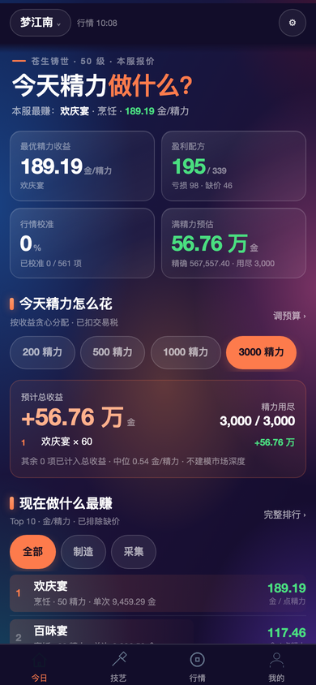
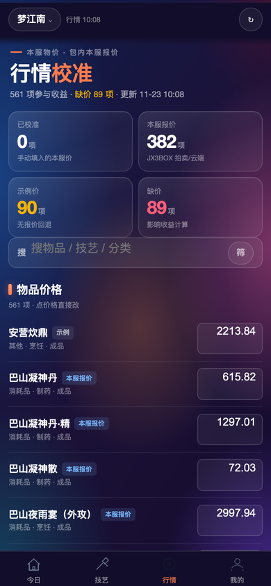

# 精力做什么 · 微信 / 小红书小程序端

这是 Web 版的跨端小程序实现，使用 **Taro 3.6.35 + React**，一份源码同时构建：

- **微信小程序**：`npm run build:weapp` → `dist/weapp`
- **小红书小程序**：`npm run build:xhs` → `dist/xhs`
- **H5 预览**：`npm run build:h5` → `dist/h5`（可选，仅用于本地查看）

> 微信小程序名称：**精力做什么**；头像与上架资料见 [`../wechat/`](../wechat/README.md)，完整上传流程见 [WECHAT-DEPLOY.md](WECHAT-DEPLOY.md)。

> 小红书官方《框架开发》文档推荐 Taro 3.6.35，并通过 `@tarojs/plugin-platform-xhs` 编译到小红书小程序；本项目按该组合实现，未使用 uni-app 的 patch 方案。
> 参考：<https://miniapp.xiaohongshu.com/doc/DC598758>

## 预览

<small>以下为 Taro H5 同构渲染的移动端预览（非微信/小红书 IDE 截图），用于展示小程序端版式与信息层级；H5 预览为 4 Tab，微信真机为 5 Tab（多「五行石」）。</small>

| 总览 | 生活技艺 | 价格库 | 精力分析 |
| --- | --- | --- | --- |
|  |  |  |  |

> 微信端底部为 **今日 / 技艺 / 行情 / 五行石 / 我的** 5 Tab；小红书为 **今日 / 技艺 / 行情 / 我的** 4 Tab。

> 精力收益分析、收益排行、配方详情、物价走势、区服趋势、突破升级、五行石公式为二级页；页面重构记录见 [docs/design/10-miniapp-ui-refactor.md](../docs/design/10-miniapp-ui-refactor.md)。

---

## 快速开始

```bash
cd miniapp
npm install
npm run sync:catalog     # 生成 561 项核心目录 + 556 项行情目录分包
npm run build:weapp
npm run build:xhs
```

如果构建环境无法写用户主目录（CI / 沙箱），可指定临时 HOME：

```bash
HOME=/tmp/tarohome npm run build:weapp
```

构建产物：

| 目标 | 目录 | 打开方式 |
| --- | --- | --- |
| 微信 | `miniapp/dist/weapp` | 微信开发者工具导入 **项目根目录**（读取 `project.config.json`），或直接导入 `dist/weapp` |
| 小红书 | `miniapp/dist/xhs` | 小红书开发者工具打开 `dist/xhs`（官方文档要求打开含 `app.json` 的目录） |

上线前填写 AppID：

- 微信：`project.config.json` → `appid`（已填入当前小程序 AppID；换号执行 `npm run set-appid -- wx你的AppID`）
- 小红书：`project.xhs.json` / `dist/xhs/project.config.json` → `appid`

---

## 页面

| Tab / 页面 | 功能 |
| --- | --- |
| **启动引导**（仅微信） | 启动页，科技风 9:16 默认图 + 底部玻璃浮层与倒计时进入按钮，默认 5 秒；预留广告组件配置 |
| **今日** | 总览：结论句 + 4 KPI（最高收益/盈利配方/行情校准/满精力预估）+ 预算 chips 与满精力方案 + Top10 + 技艺横评 + 分析入口 + 五行石速答 + 行情就绪度 |
| **技艺** | 8 技艺 chip；可做/全部双均值、配方数、最优配方；搜索 + 品阶/仅盈利/仅完整筛选 Sheet；配方两行卡；本技艺材料内联改价；吸底新增 |
| **行情** | 561 项核心物品：搜索、分类/类型/技艺/仅缺价 Sheet、4 种来源标签、右侧改价、加载更多、跨服价差 Top5、批量录入 Sheet、复制 CSV；微信含 556 项行情目录分包入口 |
| **五行石** | 合到几级最赚、单颗利润/精力、1–8 级价格 Sheet、快速/最赚精力/最低金币切换、等级列表、7/8 级爆率线、剥七/剥八说明 |
| **我的** | 当前区服与切换、分析中心（收益分析/走势/区服/突破）、行情校准入口、外观/预算/税率/口径、服务器增删、JSON 备份与导入、重置、更新说明与数据来源 |
| **精力收益分析**（二级） | A/B/C 可做评级、可做中位、可做组合、Top15、成本×收益散点、双制品对比、完整收益表（20 条/页）、复制 CSV；评级口径与网页审计的差异写在页内 |
| **收益排行**（二级） | 339 配方搜索、技艺 chips、类型/仅报价筛选、30 条/页 |
| **全部物品行情**（二级） | 已升级为「行情」Tab；保留跨服价差与批量录入 |
| **区服趋势**（仅微信） | 17 服净广度热力图、区服榜、主要变动；物品视角含跨服涨跌分布与统计榜 |
| **物价走势**（仅微信） | 本服历史快照、区间涨跌、最高/最低、单品曲线、涨跌榜与历史节点 |
| **突破升级** | 8 技艺 1→50 最优冲级路线：30/35/40/45 晋秩突破材料、每段最优配方与产出价值、总精力/收益/次数（1→30 与 30→50 两阶段），支持金币优先 / 精力优先 / 省心 |
| **五行石公式**（仅微信） | 新增/编辑/删除自定义公式、恢复默认、投入材料与产出概率校验 |
| **行情目录**（仅微信，分包） | 556 项家园/强化/消耗品行情，搜索/分类/记价；只查价，不参与配方收益 |
| **配方详情** | 成本/产值/利润/精力收益、产物与材料改价、成本构成、编辑/删除/恢复示例、新物品 |
| **设置** | 服务器增删、精力预算/默认精力/成本口径、JSON 备份复制与导入、重置、数据来源 |

---

## 为什么两端能共用

| 难点 | 处理 |
| --- | --- |
| 小程序无 DOM / `localStorage` | 计算内核 `src/shared/engine.js` 纯函数；状态通过 `Taro.getStorageSync / setStorageSync` 持久化 |
| 微信 / 小红书 API 差异 | 只用 Taro 封装的 `Picker / Input / Textarea / ScrollView / showModal / showToast / navigateTo / switchTab / setClipboardData` |
| Canvas API 跨端不一致 | 走势曲线仅在微信端用 Canvas 2D 绘制；排行/成本构成仍用 `View` + 百分比宽度，避免影响小红书端 |
| 两套导航/包结构 | Taro 编译出 `app.json` + `.wxml/.wxss`（微信）或 `.xhsml/.css`（小红书）；同一份源码，`app.config.js` 按 `TARO_ENV` 决定五行石页是否注册 |
| Tab 切换反馈 | `withTheme` 在 Tab 页 `useDidShow` 时重播顶部进度条；暗色模式窗口底部与 TabBar 同色，避免安全区黑条 |
| 数据不同步 | `npm run sync:catalog` 从 Web 版 `assets/data.js` 生成 `src/shared/catalog.json`（561 项核心）和 `src/market/data/market-catalog.json`（556 项行情目录分包） |
| 外部链接 | 小程序内不打开外链；来源链接提供「复制链接」，由用户自行打开 |

### 与 Web 版的差异

- 小程序端以手机竖屏为主：底部 Tab、卡片列表、无侧栏。
- **五行石模块与公式编辑只进微信端**（第 4 个 Tab + 公式子页）；小红书端为 **今日 / 技艺 / 行情 / 我的** 4 Tab，不注册五行石页。
- 趋势曲线用 Canvas 2D（仅微信）；其余图表用 View 条形图 + 成本×收益散点（CSS 气泡）。网页的箱线图/热力图未搬进主包。
- 精力收益分析的 A/B/C 评级用「17 服报价覆盖 + 本服利润」近似网页 14 天审计；页内明确标注差异，避免把 1MB 审计数据塞进主包。
- 物价走势/区服趋势优先读微信云数据库 `prices/history_*`，趋势缓存 5 分钟（物价走势、区服趋势都有手动刷新）；云端不可用时回退到本地缓存/打包快照。发布前用 `npm run sync:trends` 更新兜底快照。
- 小程序更新说明由 `npm run sync:release` 从 `content/updates/miniapp.json` 同步，只显示在小程序设置页，不影响网页更新提示。
- 不做文件下载：行情/收益表提供「复制 CSV」，备份提供 JSON 复制 + 粘贴导入。
- 支持亮色 / 暗色 / 科技风主题；科技风为默认，未主动选过主题的用户会切到科技风，已选亮色/暗色则保留；可在「我的 → 设置与数据 → 外观」切换。
- 云端行情为可选能力：`CLOUD_ENV` 为空时完全离线；配置后从微信云开发数据库读取公开物价，手动校准价仍在本机优先。
- 交易税已按设置税率扣除；暴击额外产出、署名溢价、市场深度未自动计入，和 Web 端口径一致。

---

## 数据与版本

与 Web 版共用当前「苍生铸世 50 级」数据：

- 制造：锻造、缝纫、制药、烹饪、梓匠；采集：神农、采金、庖丁。
- 已按 JX3BOX 技艺助手 API（2026-11-23）扩容：339 条当前版本配方（318 制造 + 21 采集，数据版本 v3.9-medicine-core）；玄元星平衫 50 级 / 200 精力 / 地脉玄元×1、蜂王浆×10、兽皮胶×20、七彩线×20、百染线×20。
- 除标注「配方已核验/名目已核验」外，配比、采集产出、精力均为可编辑示例，不是官方逐条数据。
- 旧版本（90/100/130 级）数值不适用。
- 详细来源见 Web 版 `README.md` 与小程序「设置 → 数据说明」。
- 物价走势快照：`src/shared/trends.json`，由 `npm run sync:trends` 从 `data/price-history` 生成，按主包体积预算自动收缩到 1 天，并只保留最近 8 个更新点（当前 176KB / 9 节点），作为云端历史不可用时的兜底；云端历史保留 7 天，区服趋势最多查看最近 7 天。
- 突破升级数据：`src/shared/breakthrough.json`，由 `node ../scripts/build-breakthrough-data.mjs` 生成——1036 条当前赛季配方（等级/经验/精力/材料/产出）、32 个晋秩门槛（8 技艺 × 30/35/40/45）、1355 件物品与 17 服拍卖价；突破材料与门槛来自 JX3BOX 攻略 109793，成就库交叉核验「完成40级突破」。经验门槛使用5个用户观测点分段插值、31级起沿末段趋势外推；采集单次经验仍为估算。每个技艺有独立的 49 行经验表，并标明估算状态。门槛可能影响制作次数、路线和收益。

---

## 数据边界与自动更新

- **网页端**：`assets/data.js` 当前是 **1117 个物品 / 339 条配方**，面向“行情查询 + 收益分析”。
- **小程序主包**：装 **561 个生活技艺物品**、**339 条配方（318 制造 + 21 采集）**，`v3.9-medicine-core`，参与收益计算。
- **小程序行情目录**：556 个家园/强化/消耗品等物品进微信 **分包** `market`，只查价/记价，不参与配方收益；主包约 1.55MB，分包约 0.15MB。
- **价格更新链路**：`scripts/update-jx3-prices.mjs --web-only` 现在会同时写网页数据和小程序核心目录（`scripts/lib/miniapp-catalog.cjs`），随后 `build-remote-prices.mjs` 从核心目录生成云端行情。旧链路在 `--web-only` 时跳过小程序，导致包内价和云端行情长期停在旧版本。
- **旧云端保护**：云端 `priceUpdatedAt` 早于包内 `catalog.json` 时，小程序不会用旧行情覆盖新包内价，等待下一次价格机器人写入。

## 云端物价同步

微信端可选接入微信云开发数据库，GitHub Actions 更新物价后无需重新发版。配置步骤见 [CLOUD-SYNC.md](CLOUD-SYNC.md)。

---

## 发布前检查

- [ ] 填写微信 / 小红书 AppID
- [ ] 在两端开发者工具真机预览：Tab 切换、服务器切换、改价、配方编辑、新建自定义配方、备份复制/导入
- [ ] 微信：确认 5 个 Tab（今日 / 技艺 / 行情 / 五行石 / 我的）、精力分析评级、行情筛选 Sheet、1–8 级五行石改价、7/8 级爆率保存与重开恢复
- [ ] 微信：设置名称「精力做什么」、上传 `../wechat/avatar-144.png`、服务类目（工具/效率类）、隐私说明（手动价格仅本地；如启用云端行情，仅同步公开物价，不收集个人信息）
- [ ] 微信：完成小程序 ICP 备案（未备案不能发布）
- [ ] 小红书：按开放平台要求提交类目、截图与隐私说明
- [ ] 确认没有第三方游戏素材/官方 Logo；数据脚注保留「非官方、示例数据」
- [ ] 构建体积：当前约 **1.55 MB 主包 + 0.15 MB 行情目录分包（微信）/ 1.50 MB（小红书）**，在 1.5MB+120KB 代理预算与 2 MB 硬限制内
- [ ] 若后续修改 Web 数据，执行 `npm run sync:catalog` 后重新构建两端；脚本会过滤核心物品，完整行情目录只在网页端

### 审核风险提示

- 本工具是**非官方**玩家工具，不包含官方 Logo、游戏截图、充值/交易功能；描述中已注明数据为示例。
- 小程序名称为「精力做什么」，简介可写「按本服物价计算生活技艺的材料成本与精力收益，帮你决定今天精力做什么」；是否在简介中直接写「剑网3」取决于平台对第三方游戏名称的要求，必要时弱化为「武侠 MMO 生活技艺」。
- 若平台要求游戏授权或投诉侵权，请准备授权材料，或把数据替换成通用示例并改名；计算内核与配方编辑功能不依赖具体游戏名称。
- 不收集账号、位置、通讯录等个人信息；手动价格与配方仅保存在本机 `Taro.setStorageSync`。如启用云端行情，只读取公开物价，不包含用户标识或手动校准内容。

---

## 构建状态（本次交付）

- `npm run build:weapp`：通过，生成 **13 个主包页面** + 1 个行情目录分包页面 + **5 个 Tab**（今日 / 技艺 / 行情 / 五行石 / 我的），主包约 **1.55 MB**、分包 **0.15 MB**（在 1.5MB+120KB 代理预算内），导航栏标题「精力做什么」。
- `npm run build:xhs`：通过，生成 **8 个页面 + 4 个 Tab**（今日 / 技艺 / 行情 / 我的；五行石、走势、区服趋势仅微信端）。
- `npm run verify:weapp`：通过（AppID / 13 个主包页面 + 1 个分包页面 / 5 Tab / 10 个 81×81 图标 / 组件按需注入 / 主包 <2MB 且本地守 1.5MB+120KB 代理预算 / 图片音频 ≤200KB / 启动图 ≤120KB / 无 wx.request）。
- 微信「代码质量」：主包 **1.55 MB，在 1.5MB+120KB 代理预算内**、组件按需注入、图片/音频最大 69KB，全部通过；后续构建必须保持。
- 微信端需在真实基础库中回归：5 Tab 切换、行情筛选/改价/分页、精力分析评级与组合、五行石改价与 7/8 级爆率、物价走势曲线、交易税设置；云端行情已配置环境 ID，未建集合时静默回退。
- 计算内核已用 Node 校验：561 物品 / 339 配方（318 制造 + 21 采集）/ 17 服务器；五行石 8 级价格 + 18 条公式。

### 代码质量门槛（后续构建必查）

1. `npm run verify:weapp` 必须通过；脚本现已检查：
   - `app.json` 的 `lazyCodeLoading: "requiredComponents"`（组件按需注入）；
   - 主包 dist 合计不超过 **1.5MB + 120KB 代理预算**（DevTools 编译包会再小约 116KB；实际以代码质量面板为准）；
   - 单张图片/音频 ≤ **200KB**，启动图 ≤ **120KB**（当前 600×1066 / 约 69KB）。
2. 构建后在开发者工具打开 **代码质量 → 重新扫描**，主包、组件、代码压缩、无使用文件、敏感信息都应通过。
3. 新增图片先压缩到 100KB 左右；大图/大 JSON 不要直接进主包。主包硬上限 2MB，但代码质量按 **1.5MB** 判定。

### 技艺突破核算口径

- 仅有 30/35/40/45 级四道晋秩任务，50 级为满级。
- 优先本服 `catalog.serverPrices` 的脚本 JX3BOX 报价，同名物品须匹配物品 key；缺报价时补用本服突破快照，不读取手动价、示例基准价或其他服务器报价。
- 精力优先只计算逐级最少总精力，不以价格或收益筛选配方。金币优先按已解锁且报价完整配方的金/精力数值范围等宽分三档，各档算术均值作为参考，选择该档完成升级收益最高的实际配方；三档统一用产量中点乘概率，不代表产量高低。空档不跨档补位。收益越高越好，赚钱显示绿色 +，亏损显示红色 −。
- 金币路线缺少任务材料报价时列出物品与数量，总费用留空；空档或缺少报价完整的配方时不跨档补位、不外推高等级配方/采集点。精力路线只要求等级、经验与精力有效，缺价不影响精力计算和排名。
- 经验表 1→2 至 49→50 共49行，含5个用户观测点、25个插值点和19个外推点；暂按八技艺共用门槛，技艺间差异未核实；未核实的任务脚本奖励不计入收益，任务接口未列普通奖励不能证明没有脚本奖励。1→30 阶段包含 30 级任务，30→50 包含 35/40/45 任务。
- 共用模型源文件：`miniapp/src/shared/breakthrough-model.js`；修改后执行 `node scripts/sync-breakthrough-model.mjs` 同步 Web/小工具副本，执行 `node scripts/test-breakthrough.cjs` 核对回归。Web 构建自动同步模型副本。
