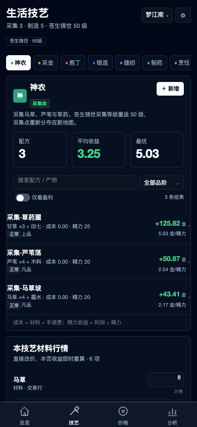
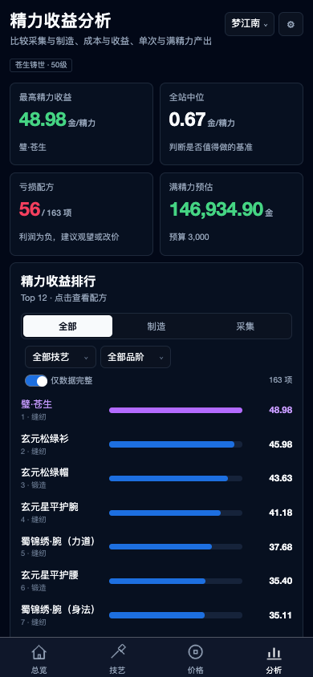

# 剑网三物价助手 · 微信 / 小红书小程序端

这是 Web 版的跨端小程序实现，使用 **Taro 3.6.35 + React**，一份源码同时构建：

- **微信小程序**：`npm run build:weapp` → `dist/weapp`
- **小红书小程序**：`npm run build:xhs` → `dist/xhs`
- **H5 预览**：`npm run build:h5` → `dist/h5`（可选，仅用于本地查看）

> 小红书官方《框架开发》文档推荐 Taro 3.6.35，并通过 `@tarojs/plugin-platform-xhs` 编译到小红书小程序；本项目按该组合实现，未使用 uni-app 的 patch 方案。
> 参考：<https://miniapp.xiaohongshu.com/doc/DC598758>

## 预览

<small>以下为 Taro H5 同构渲染的移动端预览（非微信/小红书 IDE 截图），用于展示小程序端版式与信息层级。</small>

| 总览 | 生活技艺 | 价格库 | 精力分析 |
| --- | --- | --- | --- |
|  |  |  |  |

---

## 快速开始

```bash
cd miniapp
npm install
npm run sync:catalog     # 从 ../assets/data.js 同步当前版本数据（可选）
npm run build:weapp
npm run build:xhs
```

如果构建环境无法写用户主目录（CI / 沙箱），可指定临时 HOME：

```bash
HOME=/tmp/tarohome npm run build:weapp
```

构建产物：

| 目标 | 目录 | 打开方式 |
| --- | --- | --- |
| 微信 | `miniapp/dist/weapp` | 微信开发者工具导入 **项目根目录**（读取 `project.config.json`），或直接导入 `dist/weapp` |
| 小红书 | `miniapp/dist/xhs` | 小红书开发者工具打开 `dist/xhs`（官方文档要求打开含 `app.json` 的目录） |

上线前填写 AppID：

- 微信：`project.config.json` → `appid`（当前为 `touristappid`）
- 小红书：`project.xhs.json` / `dist/xhs/project.config.json` → `appid`

---

## 页面

| Tab / 页面 | 功能 |
| --- | --- |
| **总览** | 服务器切换、最优精力收益、盈利/亏损、价格校准、满精力预估、Top 5 排行、行动建议、技艺概览 |
| **技艺** | 采集 3 / 制造 5、横向技艺切换、搜索、品阶、仅盈利、配方列表、材料行情内联改价、新增 |
| **价格** | 263 物品本服价格、搜索/技艺/类型/仅缺价、批量录入、跨服价差参考 |
| **分析** | 类型/技艺/品阶筛选、Top 12 排行、双制品对比、满精力贪心分配、完整收益榜 |
| **配方详情** | 成本/产值/利润/精力收益、产物与材料改价、成本构成、编辑/删除/恢复示例、新物品 |
| **设置** | 服务器增删、精力预算/默认精力/成本口径、JSON 备份复制与导入、重置、数据来源 |

---

## 为什么两端能共用

| 难点 | 处理 |
| --- | --- |
| 小程序无 DOM / `localStorage` | 计算内核 `src/shared/engine.js` 纯函数；状态通过 `Taro.getStorageSync / setStorageSync` 持久化 |
| 微信 / 小红书 API 差异 | 只用 Taro 封装的 `Picker / Input / Textarea / ScrollView / showModal / showToast / navigateTo / switchTab / setClipboardData` |
| Canvas API 跨端不一致 | **不使用 Canvas**，排行/成本构成用 `View` + 百分比宽度实现轻量条形图，两端渲染一致 |
| 两套导航/包结构 | Taro 编译出 `app.json` + `.wxml/.wxss`（微信）或 `.xhsml/.css`（小红书）；同一份 `pages` 配置 |
| 数据不同步 | `npm run sync:catalog` 从 Web 版 `assets/data.js` 生成 `src/shared/catalog.json` |
| 外部链接 | 小程序内不打开外链；来源链接提供「复制链接」，由用户自行打开 |

### 与 Web 版的差异

- 小程序端以手机竖屏为主：底部 Tab、卡片列表、无侧栏。
- 图表用 View 条形图；Web 端的 SVG 散点图 / 箱线图不在小程序端实现（不是 Canvas，避免小红书 Canvas 兼容问题）。
- 不提供 PNG/CSV 导出；提供 JSON 备份复制 + 粘贴导入。
- 仅暗色主题（与微信/小红书沉浸式导航栏一致）。
- 交易税、暴击额外产出、署名溢价、市场深度同样未自动计入，和 Web 端口径一致。

---

## 数据与版本

与 Web 版共用当前「苍生铸世 50 级」数据：

- 制造：锻造、缝纫、制药、烹饪、梓匠；采集：神农、采金、庖丁。
- 已按 JX3BOX 技艺助手 API（2026-11-18）重构：154 条当前版本制造配方 + 17 个当前版本采集点（数据版本 v3.3）；玄元星平衫 50 级 / 200 精力 / 地脉玄元×1、蜂王浆×10、兽皮胶×20、七彩线×20、百染线×20。
- 除标注「配方已核验/名目已核验」外，配比、采集产出、精力均为可编辑示例，不是官方逐条数据。
- 旧版本（90/100/130 级）数值不适用。
- 详细来源见 Web 版 `README.md` 与小程序「设置 → 数据说明」。

---

## 发布前检查

- [ ] 填写微信 / 小红书 AppID
- [ ] 在两端开发者工具真机预览：Tab 切换、服务器切换、改价、配方编辑、新建自定义配方、备份复制/导入
- [ ] 微信：设置服务类目（工具/效率类）、隐私说明（仅本地存储，不收集个人信息、不联网）
- [ ] 小红书：按开放平台要求提交类目、截图与隐私说明
- [ ] 确认没有第三方游戏素材/官方 Logo；数据脚注保留「非官方、示例数据」
- [ ] 构建体积：当前约 **692 KB（微信）/ 624 KB（小红书）**，低于 2 MB 主包限制
- [ ] 若后续修改 Web 数据，执行 `npm run sync:catalog` 后重新构建两端

### 审核风险提示

- 本工具是**非官方**玩家工具，不包含官方 Logo、游戏截图、充值/交易功能；描述中已注明数据为示例。
- 小程序名称建议使用「剑网三物价助手」，简介可写「武侠生活技艺成本与收益计算器」；是否在简介中直接写「剑网3」取决于平台对第三方游戏名称的要求，必要时弱化为「武侠 MMO 生活技艺」。
- 若平台要求游戏授权或投诉侵权，请准备授权材料，或把数据替换成通用示例并改名；计算内核与配方编辑功能不依赖具体游戏名称。
- 不收集账号、位置、通讯录等个人信息；价格与配方仅保存在本机 `Taro.setStorageSync`，隐私说明按此填写。

---

## 构建状态（本次交付）

- `npm run build:weapp`：通过，生成 6 个页面 + 4 组 Tab 图标，约 692 KB。
- `npm run build:xhs`：通过，生成 `.xhsml` 页面，约 624 KB。
- 计算内核已用 Node 校验：263 物品 / 171 配方（154 制造 + 17 采集）/ 17 服务器；配方等级、精力、材料与产出范围来自 JX3BOX API。
- 未在真实微信开发者工具 / 小红书 IDE 中做真机审核（本机未安装对应 IDE）；已按官方 Taro + XHS 插件组合编译通过，建议按上面清单在两端 IDE 再走一遍预览与上传。
